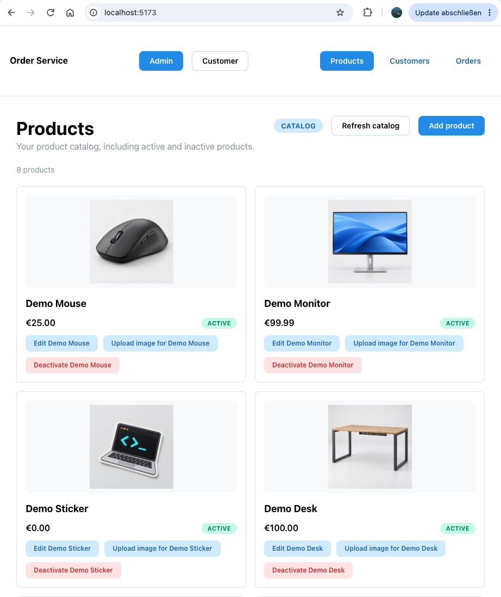
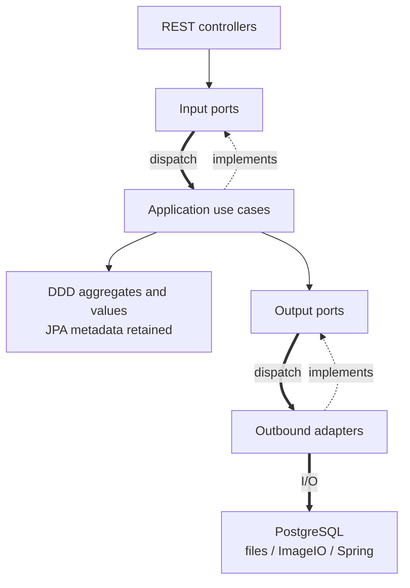
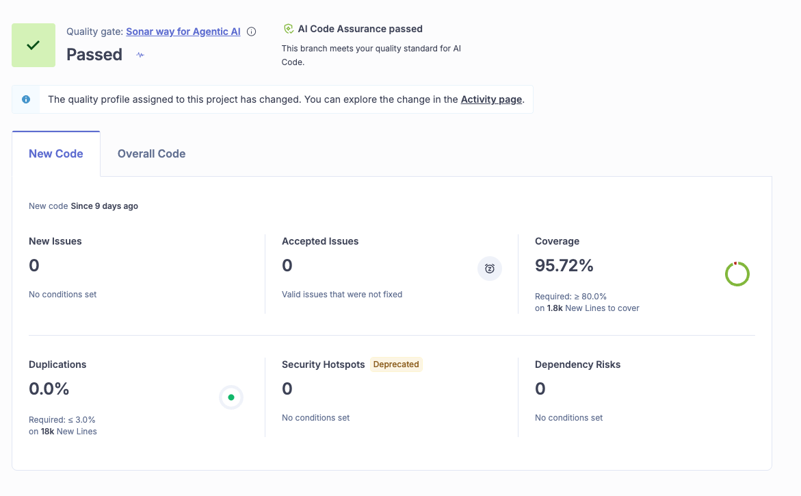

# Agentic Order Service

<p align="center">
  
</p>

A Java 21 / Spring Boot backend for customers, products and historical orders, demonstrating **transaction-safe processing, pragmatic hexagonal architecture and human-controlled agentic coding**.

[](https://github.com/uvormbrock/agentic-order-service/actions/workflows/build.yml?query=branch%3Amain)

**[Try the Application](#try-the-application)** · **[React/TypeScript frontend](https://github.com/uvormbrock/agentic-order-service-ui)** · [Explore in 5 Minutes](#explore-in-5-minutes)

The backend owns validation, persistence and monetary calculations. The separate **agentic-order-service-ui** repository provides a graphical interface; frontend source is not included here.

## At a Glance

| Area | Recorded engineering facts |
| --- | --- |
| Stack | Java 21 · Spring Boot 4.1.1 · PostgreSQL 17.11 · Maven Wrapper · Flyway |
| Architecture | **Pragmatic hexagonal architecture (Ports & Adapters, ADR-0007 Option B)**; DDD; feature-oriented modular monolith with approved JPA mappings |
| Local regression | 2026-10-21: **779 fast + 172 integration tests**, zero failures/errors/skips |
| Architecture tests | **88 ArchUnit test executions across nine suites**, included in the fast count |
| Coverage | **97.57% line / 92.26% branch coverage** in the recorded local regression |
| Cloud quality | **Quality Gate and AI Code Assurance passed; 0 new issues, 0 accepted issues** in the supplied main-branch New Code screenshot, captured 2026-10-22 |

[Evidence and source provenance](docs/05-testing/quality-report.md#latest-recorded-local-regression--2026-10-21) distinguish these dated results from historical PIT runs. The CI badge tracks **main**, the public default branch; its workflow uploads analysis without waiting for the Cloud gate.

<a id="getting-started"></a>
<a id="try-the-application-locally"></a>

## Try the Application

Use the companion UI for the normal workflow; curl, Postman and DBeaver are optional. This is a local demo setup, not a public hosted deployment.

**Prerequisites:** Java 21 with `JAVA_HOME` set; Docker Engine/Desktop with Compose v2; Git, Make, Python 3 and curl for backend helpers; **Node.js 24 and npm** for the frontend. Maven is supplied by the wrapper, and PostgreSQL runs in Docker. Keep ports **15432**, **18080** and **5173** free.

### 1. Start PostgreSQL and the backend

In the backend checkout:

```sh
make demo-setup
make demo-run
```

Keep this terminal running and wait for Spring Boot's `Started` message. Setup creates the local demo configuration and isolated PostgreSQL on `127.0.0.1:15432`; `demo-run` packages the backend and starts it at **http://127.0.0.1:18080**, applying Flyway V1–V3 and validating the schema. No manual database credentials or `.env` configuration is needed for this path.

In another backend terminal, seed the empty database once:

```sh
make demo-seed
```

This supplies five customers, eight products and four orders. Do not repeat or automatically retry a partial seed. [Dataset details](demo/data/README.md) describe the scenarios.

### 2. Start the separate React frontend

From a parent development directory, in another terminal:

```sh
git clone https://github.com/uvormbrock/agentic-order-service-ui.git
cd agentic-order-service-ui
npm ci
cp .env.example .env.local
npm run dev -- --host 127.0.0.1 --port 5173 --strictPort
```

For an existing frontend checkout, start at `npm ci`; preserve any existing `.env.local` rather than overwriting it. Its server-only setting must point to the backend origin:

```dotenv
BACKEND_URL=http://127.0.0.1:18080
```

Open **[http://127.0.0.1:5173](http://127.0.0.1:5173)**; the explicit [Vite CLI options](https://vite.dev/guide/cli.html) fix the host/port and fail if occupied. Vite proxies API requests to the server-only `BACKEND_URL`; restart it after configuration changes and see the [frontend setup guide](https://github.com/uvormbrock/agentic-order-service-ui#run-locally) for environment, CORS and production-routing details.

### 3. Walk through the UI

**Local UI walkthrough last verified: 2026-10-22** — product/customer creation, checkout, receipt, My Orders and independently loaded Admin order details. [Verification record](docs/05-testing/quality-report.md#successful-retry-after-backend-and-docker-restart--2026-10-22).

1. In **Admin → Products**, browse the seeded catalog and thumbnails; create or edit a disposable product. Image upload is a separate action after creation.
2. Open **Customers** and create an active demo customer with a test email.
3. Switch to **Customer**, select that customer, add active products to the cart, then choose **Checkout → Confirm order**. The backend returns the authoritative prices, discount and total.
4. Inspect the receipt and **My Orders**, then switch to **Admin → Orders** to open the saved order details and historical line-item snapshots.

These actions write to the disposable backend. Admin/Customer modes are presentation only, not authentication; My Orders filters the full order list in the browser. The cart is in memory. After an uncertain write result, inspect current data before retrying; the UI does not automatically replay writes. See the [frontend README](https://github.com/uvormbrock/agentic-order-service-ui#run-locally) for its setup and demo boundaries.



### Optional tools and shutdown

[Swagger UI](http://127.0.0.1:18080/swagger-ui/index.html) is enabled in the demo profile; its write requests modify demo data. The [OpenAPI snapshot](docs/02-architecture/openapi.yaml) and [API maintenance guide](docs/06-operations/api-documentation.md) describe the contract. Optional [logging](docs/06-operations/local-demo.md#application-logs), [DBeaver](docs/06-operations/local-demo.md#view-data-in-dbeaver), [curl examples](docs/06-operations/local-demo-technical.md#rest-examples) and [troubleshooting](docs/06-operations/local-demo.md#troubleshooting) remain in the demo guides.

Stop frontend and backend with Ctrl-C in their terminals, then run `make demo-down` from the backend checkout. The demo database is disposable: teardown loses its data. The optional [persistent development setup](docs/06-operations/local-development.md) has separate configuration and migration safeguards.

## Key Engineering Features

- **Customers and Products:** create, query, update and deactivate; delete only unreferenced customers, with referenced deletion rejected as 409 without mutation. Optimistic `@Version` checks detect conflicting writes.
- **Product images:** validate JPEG/PNG, generate PNG thumbnails and store immutable filesystem generations separately from PostgreSQL metadata. Stage before the transaction, retire obsolete files after commit and retain candidates on failure.
- **Orders:** consolidate quantities, capture historical product names/prices and preserve original totals. A subtotal of EUR 100.00 or more receives a 10% discount. Current Customer details enrich stored orders.
- **Strict contracts and observability:** dedicated DTOs, deterministic validation/errors, generated `X-Request-ID`, scoped MDC and Servlet lifecycle events. OSIV is disabled; responses materialize inside transactions.

**Why Order processing is more than a save:**

- **Lock order:** provider capabilities join one Order-owned READ COMMITTED transaction, locking Customer first and Products in canonical order to protect eligibility and snapshots.
- **Bounded retries:** at most three fresh attempts, scheduled outside completed transactions, after confirmed rollback, released resources and eligible failure provenance.
- **Success after commit:** flush is not commit; results and success events follow transaction completion. Uncertain outcomes are never automatically replayed.

## Architecture

The service implements **pragmatic hexagonal architecture (Ports & Adapters)** within a feature-oriented modular monolith: Customer, Product and Order run in one Spring Boot application with one PostgreSQL database. Domain-Driven Design (DDD) keeps business invariants in aggregate roots (`Customer`, `Product` and `Order`), Order-owned `OrderItem` entities, and immutable value objects such as `Money` and `EmailAddress`.

Its **pragmatic hexagonal architecture (Ports & Adapters)** separates application capabilities from delivery and infrastructure. REST controllers are inbound adapters calling application input ports. Use cases implement those ports and depend on application-owned output ports; outbound adapters implement persistence, image processing/storage and transaction capabilities.



Solid arrows show compile-time use of a contract or domain type; dotted arrows show implementation of an interface. Thick arrows show runtime dispatch or infrastructure access. At runtime, Spring injects adapter implementations behind output ports; an output port has no dependency on its adapter.

[ADR-0007 Option B](docs/03-decisions/ADR-0007-hexagonal-architecture-migration.md) retains [ADR-0004's direct JPA mappings](docs/03-decisions/ADR-0004-persistence-mapping.md) on the DDD aggregates. Option B avoids a second domain/persistence model and the associated identity, dirty-checking, optimistic-version and historical-snapshot mapping risks for this single-deployment service. The tradeoff is deliberate ORM metadata coupling, with narrowly approved aggregate-bearing write ports. Cross-feature integration uses capability contracts rather than foreign repositories. ArchUnit checks enforce these boundaries and their explicit exceptions.

Start with the [implemented architecture and class paths](docs/02-architecture/system-architecture.md#implemented-ports-and-adapters), [domain model](docs/02-architecture/domain-model.md), [migration history](docs/02-architecture/hexagonal-migration.md) and [architecture test guide](docs/05-testing/hexagonal-architecture-tests.md).

## Quality Assurance

JUnit 6, Mockito and AssertJ cover domain/application behavior; Spring MVC and OpenAPI tests check HTTP contracts. Testcontainers exercises real PostgreSQL behavior, ArchUnit enforces boundaries, Spotless checks formatting, and JaCoCo reports coverage. GitHub Actions runs `clean verify` and uploads SonarQube Cloud static analysis; `sonar.qualitygate.wait=false` keeps workflow success distinct from the remote gate.

With Java 21 selected:

```sh
make verify-fast             # Complete fast suite, ArchUnit and Spotless; no Docker/PIT.
make verify-full             # Full regression, JaCoCo and PIT; defaults to SCOPE=all.
./mvnw -B -ntp clean verify  # Full non-PIT regression and JaCoCo; Docker required.
```

The PIT-enabled full workflow can take significantly longer. PIT uses only the fast test suite; PostgreSQL integration tests are excluded, while the JaCoCo figures above come from full regression coverage. **Historical full PIT, 2026-10-21:** 1,050 mutants = 800 killed, 213 survived, 31 uncovered and six timed out; strict kill rate **76.19%**. A later focused run killed two targeted survivors; the full PIT suite was not rerun afterward. No mutation threshold or blanket survivor resolution is claimed. See the [mutation assessment](docs/04-agentic-coding/change-requests/CH-003-hexagonal-architecture-migration/increment-8-mutation-analysis.md), [advanced mutation commands](docs/05-testing/mutation-testing-runbook.md#current-automated-workflow) and [verification guide](docs/05-testing/engineering-verification.md).

JaCoCo reports appear at `target/site/jacoco/`; coverage measures execution, not assertion strength. [Formatting and focused test commands](docs/04-agentic-coding/coding-guidelines.md#java-formatting), [test execution conventions](docs/05-testing/testing-strategy.md#running-tests) and the [SonarQube runbook](docs/06-operations/local-development.md#local-sonarqube-cloud-quality-gate) provide deeper instructions. Token-free SonarQube Quality Gate and AI Assurance badges remain unavailable; no private badge tokens are embedded.



SonarQube Cloud, captured **2026-10-22**: the selected **New Code** view shows zero new/accepted issues, security hotspots and dependency risks, with 0.0% duplication. Its 95.72% new-code coverage uses a different scope from the local JaCoCo line/branch figures above. [Screenshot provenance and scope](docs/05-testing/quality-report.md#sonarqube-screenshot-and-archunit-count--2026-10-22).

## Human-Controlled Agentic Development

The developer owns requirements, critical architecture decisions, acceptance, Git operations and deployment. Codex assists with bounded planning and implementation. The main session coordinates requirements/documentation; native implementer, tester and read-only reviewer roles separate production changes, verification and independent architecture review. Scoped maintenance can stay in the main session.

ADRs and project instructions constrain each increment. CH-003 migrated one capability at a time while preserving API, schema and transaction behavior, using structured handoffs, bounded correction rounds, regression/ArchUnit checks, mutation testing and static analysis. Prepared architecture/handoff hooks have script checks; native lifecycle triggering is unverified and the prepared Git hook is inactive. See the [agentic workflow](docs/04-agentic-coding/ai-development-workflow.md), [specialist responsibilities](docs/04-agentic-coding/multi-agent/workflow.md) and [hook inventory](docs/04-agentic-coding/multi-agent/hooks.md).

<a id="architecture-and-further-documentation"></a>

## Explore in 5 Minutes

- [ADR-0007: pragmatic hexagonal architecture](docs/03-decisions/ADR-0007-hexagonal-architecture-migration.md)
- [Quality report: dated results, provenance and remaining debt](docs/05-testing/quality-report.md)
- [AGENTS.md: scope, agent instructions and human approval boundaries](AGENTS.md)
- [Companion React/TypeScript frontend](https://github.com/uvormbrock/agentic-order-service-ui)
- [System architecture: actual class paths and transaction diagrams](docs/02-architecture/system-architecture.md)

## Project Status

The service implements pragmatic hexagonal architecture under ADR-0007 Option B. Local regression passed with the dated results above; the supplied SonarQube Cloud screenshot shows a passing Quality Gate, passing AI Code Assurance and no new issues on main. Historical PIT survivors, uncovered paths and timeouts retain review debt. [ADR-0002](docs/03-decisions/ADR-0002-transaction-locking.md), the transaction and locking strategy, remains Proposed; unresolved deployment, security and operational decisions are tracked in [open items](docs/00-overview/open-items.md).

Production readiness is not established. Neither application provides authentication; image writes require trusted-deployment opt-in (enabled in the isolated demo). Durable image storage, quiescent orphan reconciliation and multi-instance filesystem behavior have deployment limits. See [known limitations](docs/00-overview/open-items.md), [image lifecycle](docs/02-architecture/system-architecture.md#product-image-storage-and-lifecycle--ch-002) and [technology details](docs/02-architecture/technology-stack.md).
