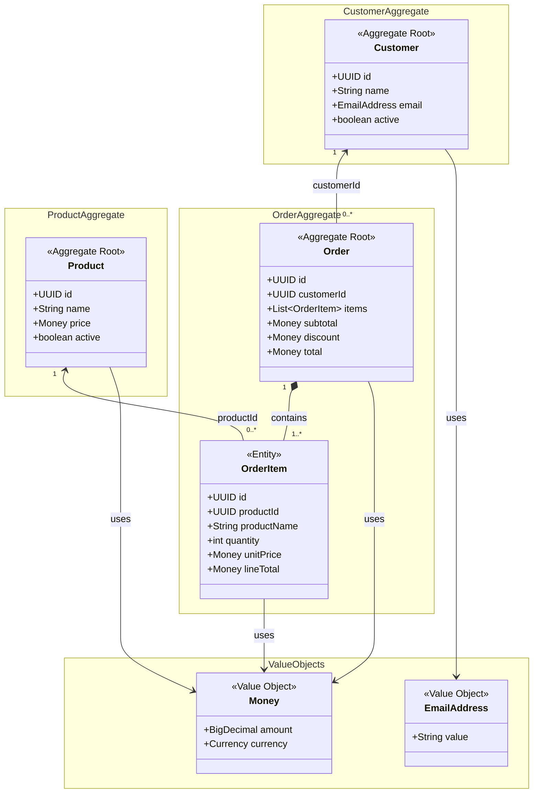

# Domain Model — Agentic Order Service

**Status:** Accepted aggregate and Increment 3 persistence design; scoped implementation Reviewed – Accepted
**Scope:** MVP domain design
**Related:** [Product Requirements](../01-requirements/product-requirements.md) · [Order Item Snapshots](order-item-snapshots.md)

## 1. Overview

The Agentic Order Service models product catalog management, customer management, and order placement. The aggregate baseline contains three aggregate roots (`Customer`, `Product`, and `Order`), one child entity (`OrderItem`), and two value objects (`Money` and `EmailAddress`).

The model deliberately separates the **current catalog state** from the **historical facts captured when an order is placed**. It is a conceptual domain model. Direct JPA mapping is accepted in [ADR-0004](../03-decisions/ADR-0004-persistence-mapping.md); D1–D10 mapping/storage selections are Accepted there; concrete SQL was reviewed against the PRD and scoped runtime verification passed as recorded in the [Increment 3 execution record](../04-agentic-coding/prompts/04-domain-model.md#implementation-results--executed-pending-human-review). Increment 3 is Reviewed – Accepted.

## 2. Domain Model Diagram

**Reading the diagram:** The filled diamond indicates that `OrderItem` is part of the `Order` aggregate. The arrows labeled `customerId` and `productId` indicate **references by identity**, not mandatory in-memory object relationships or JPA mappings. The `OrderItem` multiplicity represents the intended invariant for a created order; a transient construction process may have different intermediate states.

## 3. Aggregate Boundaries

### 3.1 Customer aggregate

**Aggregate root:** `Customer`

- Represents a customer with a stable identity, name, email address, and active status. Customer names use String.strip() and 1–200 Unicode code points, preserving case and valid Unicode (PRD BR-011).
- A new order may only be placed for an existing, active customer.
- An inactive customer can remain referenced by historical orders.
- Delete unreferenced customers physically; deactivate referenced customers instead (PRD BR-003). Deactivation is irreversible within the MVP.

### 3.2 Product aggregate

**Aggregate root:** `Product`

- Represents the **current** catalog product, including name, price, and active status. Product names use String.strip() and 1–200 Unicode code points, preserving case and valid Unicode; gross EUR prices range from EUR 0.00 to EUR 999,999.99 with at most two decimal places (PRD BR-001, BR-011, BR-013).
- Only active products are eligible for new orders.
- Later name or price changes must not change original order product names, prices, or amounts (PRD BR-010).
- Product deactivation preserves the catalog identity for existing references.

### 3.3 Order aggregate

**Aggregate root:** `Order`
**Child entity:** `OrderItem`

- At placement, every order references an existing active customer by `customerId`. Later customer deactivation does not invalidate that order.
- A placed order contains at least one item.
- Each item has a positive integer quantity; after duplicate consolidation, the quantity must not exceed 10,000 per product per order (PRD BR-005).
- Duplicate references to the same product within one order are consolidated by summing their quantities (PRD BR-005).
- The order governs its own totals and discount invariants.
- Changes to order items must be controlled through the `Order` aggregate root, not through an independent `OrderItem` repository API.
- The MVP supports order creation and retrieval, not updates or deletion of placed orders.

**Cross-aggregate checks:** Ensuring that a customer and products exist and are active requires reading other aggregates before placing an order. The application layer can coordinate these checks and the order-creation transaction; the `Order` aggregate protects its own internal invariants.

## 4. Value Objects

### Money

**Accepted Java semantics for Increment 3:** Immutable `BigDecimal` amount/currency value, EUR-only in the MVP. Reject null/invalid inputs and source amounts with more than two decimal places, including trailing zeros such as `10.000`. Normalize accepted values to scale two without rounding; `1`, `1.0`, and `1.00` have equal monetary values and matching hashes. Use exact decimal arithmetic, never `float`/`double`, and reject incompatible-currency operations.

Do not impose a universal maximum amount or prohibit negative intermediate arithmetic without a specific accepted invariant. Product enforces the PRD price range. Order owns the 10% discount beginning at EUR 100.00 and its HALF_UP rounding; rounded discount results are constructed as Money. See PRD BR-001/BR-008/BR-009/BR-013.

Java semantics and SQL enforcement are distinct: the subsequent D1–D10 approval selects an auto-applied BigDecimal converter and unconstrained PostgreSQL NUMERIC with finite, scale ≤2 and invariant-specific non-negative checks. No fixed order-total maximum is selected. [ADR-0004](../03-decisions/ADR-0004-persistence-mapping.md) owns those Accepted mapping decisions; scoped runtime evidence is recorded in the [Increment 3 execution record](../04-agentic-coding/prompts/04-domain-model.md#implementation-results--executed-pending-human-review).

### EmailAddress

**Accepted validation semantics:** Immutable normalized value using `String.strip()` and `Locale.ROOT` lowercase, at most 254 Unicode code points after normalization, deterministic/idempotent normalization, and equality/hashing on the normalized value. The [PRD email policy](../01-requirements/product-requirements.md#approved-email-validation-policy) owns the exact ASCII grammar and examples: one `@`, unquoted local-part punctuation/dots/plus-addressing, at least two nonempty domain labels with internal hyphens, and rejection of quoted/internationalized forms. No DNS lookup or provider-specific transformation is permitted.

Case-insensitive uniqueness spans active and inactive customers. It is coordinated/enforced outside EmailAddress; this value object performs no database lookup. D3/D7 now select an auto-applied String converter, normalized email storage and an all-customer unique lower(email) index, without citext. Verify Java/PostgreSQL case/collation consistency. Customer/product names separately use String.strip() and 1–200 code points, preserving case and Unicode.

## 5. Historical Order Item Snapshots

At order placement, the system captures product data and calculated values in each `OrderItem` under ADR-0001:

| Field | Meaning | Historical behavior |
| --- | --- | --- |
| `productId` | Identity of the catalog product | Retained as a reference |
| `productName` | Product name accepted at placement | Remains unchanged |
| `lineTotal` | Calculated line item amount at placement | Remains unchanged |
| `unitPrice` | Unit price at placement | Remains unchanged |
| `quantity` | Ordered quantity | Remains unchanged for placed orders |

**Example:** A product named *MacBook Pro M4* costs EUR 1,999.00 when ordered. The resulting item stores the original name, price, and calculated line amount. If the catalog entry is renamed to *MacBook Pro M4 – Sale* and repriced to EUR 1,699.00, the order still displays *MacBook Pro M4* at the original EUR 1,999.00 unit price. Customer details likewise come from the current customer record.

The snapshot is **ordinary persisted data**, not an automatic versioning feature or a copy of the entire `Product` entity. See [Order Item Snapshots](order-item-snapshots.md) for additional rationale.

## 6. Pricing Invariants

For the approved MVP requirements:

1. `lineTotal = unitPrice × quantity`.
2. `subtotal = sum(lineTotal)` for all order items.
3. If `subtotal >= EUR 100.00`, `discount = HALF_UP(10% × subtotal, 2)`; otherwise the discount is zero.
4. `total = subtotal − discount`.
5. The discounted total and historical pricing must remain reproducible when an order is retrieved.

For example, EUR 100.05 yields a rounded discount of EUR 10.01 and a payable total of EUR 90.04; EUR 99.99 receives no discount.

The domain model shows `subtotal`, `discount`, and `total` as observable domain values. Their original results must be preserved. Reads must not apply current pricing rules to historical orders. D6/D8 select explicit original monetary columns using unconstrained NUMERIC; persisted reads preserve original results even after rules change. Compatibility and exact round trips remain unverified.

## 7. Aggregate vs. Persistence Model

- Aggregate boundaries express where business invariants must be protected.
- They do **not** automatically prescribe Java packages, JPA relationships, or SQL foreign keys.
- `Order` can reference `Customer` by `customerId`; `OrderItem` can reference `Product` by `productId` while retaining original product names, prices, and monetary results. Only customer details are resolved from current records for responses.
- Customer, Product, Order and OrderItem use JPA-generated UUIDs, PostgreSQL uuid, and null IDs before persistence. Entities retain reference equality; compare persisted business identity by UUID explicitly.
- Order.items is lazy one-to-many mapped by OrderItem.order, cascade PERSIST only, orphan removal false. The lazy, mandatory child association owns the non-null order_id FK. Maintain both sides through Order; cross-aggregate references stay scalar UUIDs with restrictive FKs and no deletion cascades.
- Direct field-access mappings, protected hydration constructors and persistence-package autoApply converters are Accepted. Value objects remain free of JPA annotations; domain has no persistence-package dependency. The four tables and required constraints/indexes are selected in [ADR-0004](../03-decisions/ADR-0004-persistence-mapping.md).
- Single-order reads use an explicit item fetch plan and materialize within transactions with OSIV disabled. List/pagination fetch details remain deferred. Application transaction ownership follows [ADR-0003](../03-decisions/ADR-0003-application-architecture.md); ADR-0002's detailed locking protocol remains Proposed.

## 8. Responsibilities and Open Design Questions

| Responsibility | Owner |
| --- | --- |
| Request shape and required fields; reject caller prices; HTTP error mapping | REST boundary, following the PRD contract |
| Customer/product eligibility and consistent order placement | Application operation coordinating aggregates and persistence |
| Consolidation, quantities, pricing, and internal order invariants | Order domain behavior |
| Atomic storage, referential integrity, cross-customer email uniqueness enforcement | Persistence boundary |
| Historical product names/prices/amounts plus current customer details | Order response assembly |

Concurrency is documented separately in [Order Placement Concurrency](../03-decisions/ADR-0001-order-placement-concurrency.md). Its business policy is accepted. [ADR-0002](../03-decisions/ADR-0002-transaction-locking.md) describes the Proposed technical transaction and locking strategy; it is not implementation-verified.

Remaining design questions:

1. Concrete SQL column/check declarations must be reviewed against the Accepted schema/PRD; prove converter hydration, unconstrained NUMERIC capacity and Java/PostgreSQL normalization/collation consistency. No runtime evidence exists yet.
2. List/pagination-specific fetching, production migration execution/privileges and the detailed ADR-0002 protocol remain Open/Proposed for later work.
3. A line can reach EUR 9,999,999,900.00 and multi-product totals can exceed it. No artificial fixed maximum is selected for Order totals; any additional overall order-size restriction requires approval.

UUID identity in the diagram is now Accepted, including OrderItem's private persistence identity and unique (order_id, product_id); it does not introduce an item API field.

## 9. Suggested Acceptance Tests

- Reject an order without items.
- Reject an item with zero, negative, or fractional quantity.
- Reject orders for nonexistent or inactive customers.
- Reject orders containing nonexistent or inactive products.
- Calculate the expected discount for subtotals below, at, and above EUR 100.00.
- Consolidate duplicate product references according to the agreed rule.
- Preserve original product names, unit prices, and monetary results after catalog changes; display current customer details.
- Reject caller-supplied prices with 400; reject inactive references with 409, as specified in the PRD.
- Verify the EUR 100.05 HALF_UP example and unchanged historical amounts after pricing-rule changes.
- Retrieve a placed order with the same item values and monetary results that were recorded at placement.

## 10. Status and Next Step

Aggregate boundaries, snapshots, names/value objects and D1–D10 persistence selections are Accepted. Increment 3 implementation, concrete DDL review and scoped compatibility tests executed successfully; Increment 3 is Reviewed – Accepted. See the [Increment 3 execution record](../04-agentic-coding/prompts/04-domain-model.md#implementation-results--executed-pending-human-review). Deferred list fetching and production/locking questions remain unresolved. Consult [ADR-0004](../03-decisions/ADR-0004-persistence-mapping.md) and the [implementation plan](../07-implementation/implementation-plan.md) before implementation; no code is authorized by this document.

## Increment 4 Product/Customer Version Direction

Human Accepted @Version for Product and Customer, with confirmed optimistic conflicts mapped outside the domain to CONCURRENT_MODIFICATION/409. [ADR-0006](../03-decisions/ADR-0006-product-customer-optimistic-locking.md) is Proposed as a complete record; the exact boxed Long mapping, BIGINT/NOT NULL/existing-row 0/no final default policy and sequential PATCH no-update/no-increment semantics are now Human Accepted there. Concrete four-statement V2 SQL is reviewed; coding authorization and runtime verification remain pending. Existing UUID identity, reference equality, domain operations, converters, monetary D6 and all D1–D10/Increment 3 acceptance remain unchanged. Version is internal persistence metadata; no API field, Order/OrderItem version or ETag/If-Match selected. It does not establish future Order read/lock consistency. Original diagrams describe the accepted Increment 3 model; version mapping is not implemented here.
