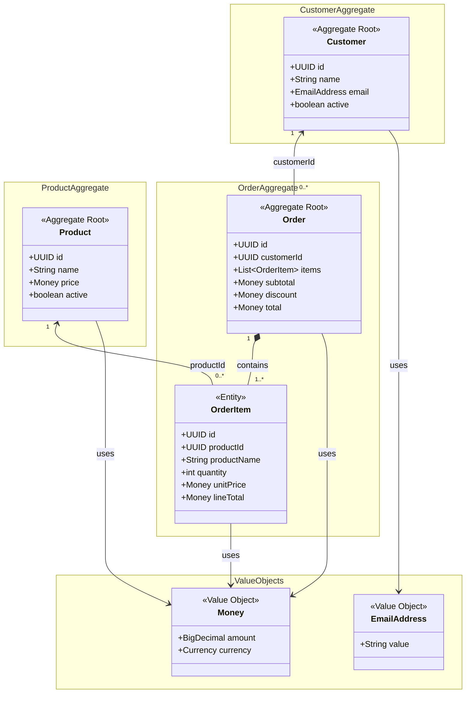

# Domain Model — Agentic Order Service

**Status:** Proposed
**Scope:** MVP domain design
**Related:** [Product Requirements](../01-requirements/product-requirements.md) · [Order Item Snapshots](order-item-snapshots.md)

## 1. Overview

The Agentic Order Service models product catalog management, customer management, and order placement. The proposed domain model contains three aggregate roots (`Customer`, `Product`, and `Order`), one child entity (`OrderItem`), and two value objects (`Money` and `EmailAddress`).

The model deliberately separates the **current catalog state** from the **historical facts captured when an order is placed**. It is a conceptual domain model, not a JPA entity mapping or database schema.

## 2. Domain Model Diagram

**Reading the diagram:** The filled diamond indicates that `OrderItem` is part of the `Order` aggregate. The arrows labeled `customerId` and `productId` indicate **references by identity**, not mandatory in-memory object relationships or JPA mappings. The `OrderItem` multiplicity represents the intended invariant for a created order; a transient construction process may have different intermediate states.

## 3. Aggregate Boundaries

### 3.1 Customer aggregate

**Aggregate root:** `Customer`

- Represents a customer with a stable identity, name, email address, and active status. Customer names are trimmed and limited to 1–200 characters (PRD BR-011).
- A new order may only be placed for an existing, active customer.
- An inactive customer can remain referenced by historical orders.
- Delete unreferenced customers physically; deactivate referenced customers instead (PRD BR-003). Deactivation is irreversible within the MVP.

### 3.2 Product aggregate

**Aggregate root:** `Product`

- Represents the **current** catalog product, including name, price, and active status. Product names are trimmed and limited to 1–200 characters; gross EUR prices range from EUR 0.00 to EUR 999,999.99 with at most two decimal places (PRD BR-001, BR-011, BR-013).
- Only active products are eligible for new orders.
- Later name or price changes must not change original order product names, prices, or amounts (PRD BR-010).
- Product deactivation preserves the catalog identity for existing references.

### 3.3 Order aggregate

**Aggregate root:** `Order`
**Child entity:** `OrderItem`

- At placement, every order references an existing active customer by `customerId`. Later customer deactivation does not invalidate that order.
- A placed order contains at least one item.
- Each item has a positive integer quantity; after duplicate consolidation, the quantity must not exceed 10,000 per product per order (PRD BR-005).
- Duplicate references to the same product within one order are consolidated by summing their quantities (PRD BR-005).
- The order governs its own totals and discount invariants.
- Changes to order items must be controlled through the `Order` aggregate root, not through an independent `OrderItem` repository API.
- The MVP supports order creation and retrieval, not updates or deletion of placed orders.

**Cross-aggregate checks:** Ensuring that a customer and products exist and are active requires reading other aggregates before placing an order. The application layer can coordinate these checks and the order-creation transaction; the `Order` aggregate protects its own internal invariants.

## 4. Value Objects

### Money

`Money` is an immutable value object representing an amount and currency without a distinct business identity. Equality is based on monetary value and currency, not object identity or decimal scale.

- Use decimal arithmetic (e.g., Java `BigDecimal`), not binary floating-point arithmetic.
- Require compatible currencies for arithmetic.
- The MVP supports EUR only.
- Amounts use two decimal places. Reject product prices with more than two decimal places; round discounts using `HALF_UP` (PRD BR-009 and BR-013). Persistence mapping remains a separate design decision.

### EmailAddress

`EmailAddress` is an immutable value object representing a customer's validated email rather than a separately identified entity. Equality is value-based using the trimmed, lowercase address; uniqueness comparisons are case-insensitive (PRD BR-011).

- Encapsulates the email string and appropriate domain validation.
- Trim emails and normalize them to lowercase before storage. Require a valid basic local part and domain and at most 254 characters after normalization; do not apply provider-specific dot or plus-address rules (PRD BR-011).
- Emails must be unique case-insensitively across active and inactive customers. Cross-customer uniqueness is coordinated outside this value object. Only exact basic email syntax and the character-counting convention remain unresolved business validation details.

## 5. Historical Order Item Snapshots

At order placement, the system captures product data and calculated values in each `OrderItem` under ADR-0001:

| Field | Meaning | Historical behavior |
| --- | --- | --- |
| `productId` | Identity of the catalog product | Retained as a reference |
| `productName` | Product name accepted at placement | Remains unchanged |
| `lineTotal` | Calculated line item amount at placement | Remains unchanged |
| `unitPrice` | Unit price at placement | Remains unchanged |
| `quantity` | Ordered quantity | Remains unchanged for placed orders |

**Example:** A product named *MacBook Pro M4* costs EUR 1,999.00 when ordered. The resulting item stores the original name, price, and calculated line amount. If the catalog entry is renamed to *MacBook Pro M4 – Sale* and repriced to EUR 1,699.00, the order still displays *MacBook Pro M4* at the original EUR 1,999.00 unit price. Customer details likewise come from the current customer record.

The snapshot is **ordinary persisted data**, not an automatic versioning feature or a copy of the entire `Product` entity. See [Order Item Snapshots](order-item-snapshots.md) for additional rationale.

## 6. Pricing Invariants

For the approved MVP requirements:

1. `lineTotal = unitPrice × quantity`.
2. `subtotal = sum(lineTotal)` for all order items.
3. If `subtotal >= EUR 100.00`, `discount = HALF_UP(10% × subtotal, 2)`; otherwise the discount is zero.
4. `total = subtotal − discount`.
5. The discounted total and historical pricing must remain reproducible when an order is retrieved.

For example, EUR 100.05 yields a rounded discount of EUR 10.01 and a payable total of EUR 90.04; EUR 99.99 receives no discount.

The domain model shows `subtotal`, `discount`, and `total` as observable domain values. Their original results must be preserved. Reads must not apply current pricing rules to historical orders. The storage representation remains a persistence decision; it must preserve original results even after rules change.

## 7. Aggregate vs. Persistence Model

- Aggregate boundaries express where business invariants must be protected.
- They do **not** automatically prescribe Java packages, JPA relationships, or SQL foreign keys.
- `Order` can reference `Customer` by `customerId`; `OrderItem` can reference `Product` by `productId` while retaining original product names, prices, and monetary results. Only customer details are resolved from current records for responses.
- The actual tables, foreign-key policies, locking strategy, and transaction boundaries will be specified separately in the persistence design.

## 8. Responsibilities and Open Design Questions

| Responsibility | Owner |
| --- | --- |
| Request shape and required fields; reject caller prices; HTTP error mapping | REST boundary, following the PRD contract |
| Customer/product eligibility and consistent order placement | Application operation coordinating aggregates and persistence |
| Consolidation, quantities, pricing, and internal order invariants | Order domain behavior |
| Atomic storage, referential integrity, cross-customer email uniqueness enforcement | Persistence boundary |
| Historical product names/prices/amounts plus current customer details | Order response assembly |

Concurrency is documented separately in [Order Placement Concurrency](../03-decisions/0001-order-placement-concurrency.md). Its business policy is accepted. [ADR-0002](../03-decisions/0002-transaction-and-locking-strategy.md) describes the Proposed technical transaction and locking strategy; it is not implementation-verified.

Remaining design questions:

1. Does `OrderItem` need a separate UUID, or is `(orderId, productId)` sufficient after consolidation? Item identity is local to its order; it does not imply an independent lifecycle. The diagram's item UUID is provisional, not an API requirement.
2. How will persistence preserve original monetary results without recalculation using future rules?
3. Which concrete constraints and JPA mappings will implement the invariants, and how will the Proposed strategy in ADR-0002 be verified?
4. What exact basic email syntax and character-counting convention will apply, as tracked in the PRD?
5. How will monetary storage accommodate a maximum line amount of EUR 9,999,999,900.00 (EUR 999,999.99 × 10,000) and larger totals across multiple distinct products? Database numeric precision, overall order size, and total monetary limits remain open; no new limits are assumed.

UUIDs in the diagram are a proposed identity format, not a finalized requirement.

## 9. Suggested Acceptance Tests

- Reject an order without items.
- Reject an item with zero, negative, or fractional quantity.
- Reject orders for nonexistent or inactive customers.
- Reject orders containing nonexistent or inactive products.
- Calculate the expected discount for subtotals below, at, and above EUR 100.00.
- Consolidate duplicate product references according to the agreed rule.
- Preserve original product names, unit prices, and monetary results after catalog changes; display current customer details.
- Reject caller-supplied prices with 400; reject inactive references with 409, as specified in the PRD.
- Verify the EUR 100.05 HALF_UP example and unchanged historical amounts after pricing-rule changes.
- Retrieve a placed order with the same item values and monetary results that were recorded at placement.

## 10. Status and Next Step

This document is a **proposed conceptual domain model** for discussion and review. After confirming the open decisions, document significant choices in `docs/03-decisions/` as Architecture Decision Records (ADRs) and then design persistence and application services.
