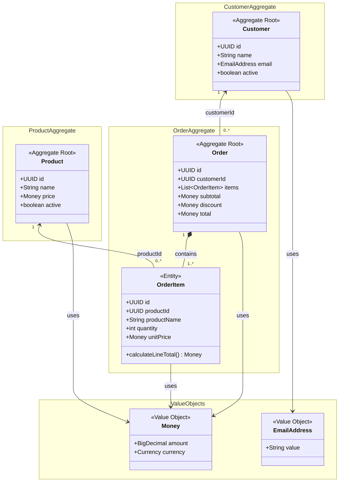

# Domain Model — Agentic Order Service

**Status:** Proposed  
**Scope:** MVP domain design  
**Related:** [Product Requirements](../01-requirements/product-requirements.md) · [Order Item Snapshots](order-item-snapshots.md)

## 1. Overview

The Agentic Order Service models product catalog management, customer management, and order placement. The proposed domain model contains three aggregate roots (`Customer`, `Product`, and `Order`), one child entity (`OrderItem`), and two value objects (`Money` and `EmailAddress`).

The model deliberately separates the **current catalog state** from the **historical facts captured when an order is placed**. It is a conceptual domain model, not a JPA entity mapping or database schema.

## 2. Domain Model Diagram

**Reading the diagram:** The filled diamond indicates that `OrderItem` is part of the `Order` aggregate. The arrows labeled `customerId` and `productId` indicate **references by identity**, not mandatory in-memory object relationships or JPA mappings. The `OrderItem` multiplicity represents the intended invariant for a created order; a transient construction process may have different intermediate states.

## 3. Aggregate Boundaries

### 3.1 Customer aggregate

**Aggregate root:** `Customer`

- Represents a customer with a stable identity, name, email address, and active status.
- A new order may only be placed for an existing, active customer.
- An inactive customer can remain referenced by historical orders.
- Physical deletion versus deactivation depends on whether orders reference the customer and on the finalized business rules.

### 3.2 Product aggregate

**Aggregate root:** `Product`

- Represents the **current** catalog product, including name, price, and active status.
- Only active products are eligible for new orders.
- A later change to a product's name or price must not change the historical contents of an order.
- Product deactivation preserves the catalog identity for existing references.

### 3.3 Order aggregate

**Aggregate root:** `Order`  
**Child entity:** `OrderItem`

- Every placed order references an existing active customer by `customerId`.
- A placed order contains at least one item.
- Each item has a positive integer quantity.
- Duplicate references to the same product within one order are consolidated, according to the current requirements proposal.
- The order governs its own totals and discount invariants.
- Changes to order items must be controlled through the `Order` aggregate root, not through an independent `OrderItem` repository API.
- The MVP supports order creation and retrieval, not updates or deletion of placed orders.

**Cross-aggregate checks:** Ensuring that a customer and products exist and are active requires reading other aggregates before placing an order. The application layer can coordinate these checks and the order-creation transaction; the `Order` aggregate protects its own internal invariants.

## 4. Value Objects

### Money

`Money` represents an amount and currency without a distinct business identity.

- Use decimal arithmetic (e.g., Java `BigDecimal`), not binary floating-point arithmetic.
- Require compatible currencies for arithmetic.
- The MVP supports EUR only.
- The precise rounding points and persistence mapping remain design decisions; the proposed discount rule uses `HALF_UP` rounding to two decimal places.

### EmailAddress

`EmailAddress` represents a customer's email as a validated value rather than a separately identified entity.

- Encapsulates the email string and appropriate domain validation.
- The exact normalization policy, case handling, and uniqueness requirements remain to be decided.

## 5. Historical Order Item Snapshots

At order placement, the system reads the current product data and copies selected values into each `OrderItem`:

| Field | Meaning | Historical behavior |
| --- | --- | --- |
| `productId` | Identity of the catalog product | Retained as a reference |
| `productName` | Product name at placement | Remains unchanged |
| `unitPrice` | Unit price at placement | Remains unchanged |
| `quantity` | Ordered quantity | Remains unchanged for placed orders |

**Example:** A product named *MacBook Pro M4* costs EUR 1,999.00 when ordered. The resulting item stores that name and price. If the catalog entry is renamed and repriced to EUR 1,699.00, the historical order still displays *MacBook Pro M4* at EUR 1,999.00.

The snapshot is **ordinary persisted data**, not an automatic versioning feature or a copy of the entire `Product` entity. See [Order Item Snapshots](order-item-snapshots.md) for additional rationale.

## 6. Pricing Invariants

For the current MVP proposal:

1. `lineTotal = unitPrice × quantity`.
2. `subtotal = sum(lineTotal)` for all order items.
3. If `subtotal >= EUR 100.00`, `discount = 10% × subtotal`; otherwise the discount is zero.
4. `total = subtotal − discount`.
5. The discounted total and historical pricing must remain reproducible when an order is retrieved.

For example, a subtotal of EUR 109.70 yields a discount of EUR 10.97 and a payable total of EUR 98.73.

The domain model shows `subtotal`, `discount`, and `total` as observable domain values. **Their presence in the diagram does not decide whether they are stored in separate database columns or derived from persisted inputs.**

## 7. Aggregate vs. Persistence Model

- Aggregate boundaries express where business invariants must be protected.
- They do **not** automatically prescribe Java packages, JPA relationships, or SQL foreign keys.
- `Order` can reference `Customer` by `customerId`; `OrderItem` can reference `Product` by `productId` while retaining a name-and-price snapshot.
- The actual tables, foreign-key policies, locking strategy, and transaction boundaries will be specified separately in the persistence design.

## 8. Open Design Questions

1. Should `OrderItem` have a separate UUID or be identified only within its parent `Order`?
2. Should `subtotal`, `discount`, and `total` be persisted, derived, or both (with consistency checks)?
3. How should concurrent product price or status changes during order placement be handled?
4. What is the exact set of email validation, normalization, and uniqueness rules?
5. Which product and customer deletion/deactivation rules are final, and what should the API semantics communicate?
6. Which database constraints should additionally enforce positive quantities and valid monetary values?

These questions remain open intentionally. An AI coding agent must not silently resolve them as implementation details.

## 9. Suggested Acceptance Tests

- Reject an order without items.
- Reject an item with zero or negative quantity.
- Reject orders for nonexistent or inactive customers.
- Reject orders containing nonexistent or inactive products.
- Calculate the expected discount for subtotals below, at, and above EUR 100.00.
- Consolidate duplicate product references according to the agreed rule.
- Preserve the original product name and unit price after catalog changes.
- Retrieve a placed order with the same item values and monetary results that were recorded at placement.

## 10. Status and Next Step

This document is a **proposed conceptual domain model** for discussion and review. After confirming the open decisions, document significant choices in `docs/03-decisions/` as Architecture Decision Records (ADRs) and then design persistence and application services.
