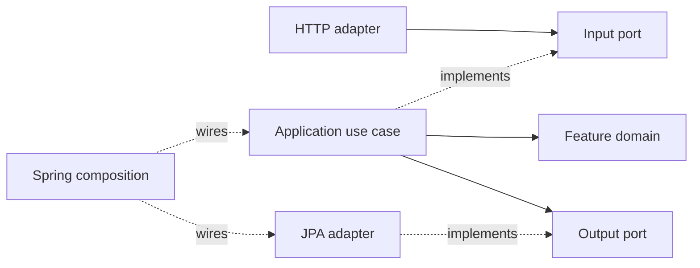

# Hexagonal Migration — Accepted Option B and Increment Proposal

**Status:** Option B accepted under [ADR-0007](../03-decisions/ADR-0007-hexagonal-architecture-migration.md), 2026-10-21. The sequence below guides separately authorized increments. Increment 1 GET-by-ID is implemented; Increment 2 Product create/update/PATCH deactivation is explicitly authorized. Current [system architecture](system-architecture.md) and ADR-0004 remain authoritative for unmigrated code. Increment 3 Customer, Increment 4 Product image, Increment 5 Order reads and Increment 6 Order placement are explicitly authorized; Increment 7 consolidation is explicitly authorized; Increment 8 remains unauthorized; mappings and behavior remain unchanged.

## Boundaries

| Package / component | Responsibility and dependencies |
| --- | --- |
| feature.domain | Existing aggregate invariants and immutable values; Java/domain plus accepted JPA metadata under B. Never application, HTTP, repositories or I/O |
| feature.application | Use cases, transport-neutral commands/results/errors and application validation; own domain and ports, no concrete adapters |
| feature.application.port.in | Narrow command/query/provider capabilities; public signatures contain no HTTP, managed entities or provider-specific exceptions |
| feature.application.port.out | Consumer-owned capabilities for persistence, external/feature access and necessary transaction outcomes; no Spring Data inheritance |
| feature.api | Existing inbound HTTP adapters: binding, deterministic validation precedence, mapping and safe errors; invoke application capabilities |
| feature.persistence | Outbound database adapters and Spring Data internals; implement output ports, not use-case orchestration. Keep current directly mapped aggregates under B |
| feature.storage / image adapter | Filesystem and ImageIO implementations behind image capability ports; preserve filesystem security and binary behavior |
| configuration / transaction adapters | Wire concrete beans and implement transaction execution/participation. Business scope remains application-owned |

Optional package renames to adapter.in/out are separate cleanup, not a prerequisite. No multi-module build, per-class interfaces, generic repository hierarchy or event bus is proposed. Preserve controlled aggregate mutation; the skill's immutable-transformation preference does not authorize a rewrite of existing business methods.

## Feature integration and transactions

Order consumes Customer/Product facts through its output ports; a bridge calls each provider's narrow input port. Customer consumes Order reference lookup separately from placement orchestration. No foreign persistence/domain entity access, HTTP calls between features or recursive CRUD chaining. Provider operations join the caller's transaction; MANDATORY participation checks remain where required. Composition must not form constructor cycles.

For ordinary operations, consider transactional input-port decorators around plain services. For Order, freeze an attempt-execution contract that distinguishes committed, confirmed rolled-back and unknown outcomes, including lock-origin failure provenance, before moving infrastructure. Keep retry scheduling outside completed attempts and preserve existing count/delay/budget/classification behavior. Do not substitute REQUIRES_NEW, suspend ambient transactions or treat flush as commit. Preserve post-commit success logging, safe terminal ownership, request correlation and MDC cleanup.

Option B keeps generated UUIDs, converters, @Version, entity relationships and dirty checking. Option A additionally requires reviewed rehydration/mapping/version contracts and real PostgreSQL proof. Neither option changes database schema, entity data meaning, DTOs, API errors, endpoints, media types or OpenAPI snapshots.

## Reviewable increments after separate implementation authorization

| Increment | Bounded scope | Regression and architecture acceptance |
| --- | --- | --- |
| 0 | ADR comparison, team consolidation, hook inventory/preparation | Native configuration/handler checks, Markdown consistency, protected-file audit; no application migration |
| 1 | Product GET-by-ID input port/use case and output adapter around existing persistence | Product API/missing/inactive cases, port unit test, PostgreSQL read adapter test, populated pilot ArchUnit rules |
| 2 | Remaining Product operations and protected Product fact contract | Product domain/API/persistence, optimistic locking and image/order compatibility; separate JPA model only for approved A |
| 3 | Customer operations, facts and Order reference bridge | Email normalization/uniqueness, delete-409 unchanged state, both placement/delete schedules and provider-contract isolation |
| 4 | Image processing/storage capabilities and metadata access | Binary transport, filesystem security, stage/commit/cleanup failure paths and quiescent reconciliation |
| 5 | Order read capabilities and snapshot persistence boundary | Original snapshots/totals, root/item lifecycle, query counts and closed-context serialization; retain existing mapping |
| 6 | Order placement attempt infrastructure and cross-feature bridges | Deterministic PostgreSQL locks/races, rollback/unknown commit, retries, ambient guards and logging ownership |
| 7 | Remove proven-obsolete paths and enforce approved target globally | Full regression, runtime OpenAPI equivalence and independent architecture/documentation review |

Reassess the exact file manifest and prerequisites for each increment. Use one feature/use case at a time, not concurrent aggregate rewrites. A compatibility facade may delegate through an existing legacy adapter while its internals await migration; label and bound this transitional path. Do not run dual conflicting JPA mappings for an aggregate. Reversion means restoring the reviewed implementation/wiring, not deleting user data or automatically resetting Git.

## ArchUnit strategy

Keep [ArchitectureComplianceTest](../../src/test/java/com/example/agenticorderservice/architecture/ArchitectureComplianceTest.java) unchanged in Increment 0. Future approved checks distinguish port signatures, implementations, adapters and composition. Application must not access Spring Data/JDBC/filesystem/ImageIO implementations; adapters may depend on their port contracts but not use-case implementations. API invokes input capabilities and exposes DTOs; no managed entities in boundary signatures. For B retain the explicit JPA domain exception; for A remove it only from migrated scopes. Existing value validation remains authoritative; preserve the application-owned normalized-email String boundary.

Require actual imported classes for every positive slice rule, not vacuous success. No broad exclusions, frozen violations or blanket feature-cycle ban. ArchUnit cannot prove transaction propagation, commit outcome, no lazy reads or semantic contract narrowness; use behavior, integration and wiring tests.

## Gates and decision boundary

Follow [quality gates](../04-agentic-coding/multi-agent/quality-gates.md): focused fast/ArchUnit checks, affected disposable PostgreSQL tests and full Java 21 Maven verify at stable migration milestones. Runtime OpenAPI JSON/YAML and the snapshot must remain equivalent. No new dependency, migration, threshold, public API or business rule is approved. Under the [CH-003 verification policy](../04-agentic-coding/multi-agent/quality-gates.md#ch-003-migration-verification-policy), each increment requires focused tests/ArchUnit/Spotless, make verify-fast, and complete Maven clean verify with PostgreSQL/Testcontainers, JaCoCo and independent review before acceptance. Do not run PIT during individual increments; reserve make verify-full SCOPE=all and baseline-aware mutation/final regression/architecture/reviewer assessment for final migration acceptance. SonarQube Cloud execution/evaluation remains human-controlled and is excluded from automatic verification; never run scanner/findings targets under general increment authorization. Every increment ends in independent review and Human Acceptance Pending.

## Automated verification ownership

Use the [fast, increment-acceptance and final-migration workflows](../05-testing/engineering-verification.md) at their approved milestones, not every file edit. Individual increments and corrections exclude PIT; final migration acceptance includes it. The Orchestrator runs final local gates sequentially and consolidates tester evidence plus independent reviewer assessment. A successful command does not accept findings or grant human acceptance. Keep required blocked tests Pending and report blockers. No automatic Git staging/committing/pushing/merging/rebasing/resetting, deployment, Cloud gate changes or settings changes.

## Increment 2 authorized Product writes

The human explicitly approved create/update/existing PATCH deactivation only; physical Product DELETE remains unsupported. ProductWriteOperations → ProductWriteService → ProductWriteStore → ProductWriteAdapter preserves existing transactions and directly mapped Product. Legacy ProductApplicationService delegates writes and retains collection reads and compatibility entry points. GET retains Increment 1 contracts.

[ADR-0007 scoped decision](../03-decisions/ADR-0007-hexagonal-architecture-migration.md#increment-2-scoped-output-contract--accepted-2026-10-21) permits exact same-feature Product aggregate signatures on ProductWriteStore only, within the application transaction. All input/GET/cross-feature and other output signatures retain the managed-entity prohibition. This exception keeps mutation in application/domain rather than moving business orchestration into persistence. No Customer, Order or image migration follows.

## Increment 3 authorized Customer migration

CustomerOperations groups the existing six application operations. CustomerApplicationService implements it, retaining the existing transactional bean and static email-normalization compatibility boundary. CustomerReadStore/CustomerReadAdapter provide immutable reads and locked Order facts; CustomerWriteStore/CustomerWriteAdapter retain application-owned aggregate mutation via the explicitly approved [Customer-only exception](../03-decisions/ADR-0007-hexagonal-architecture-migration.md#increment-3-scoped-output-contract--accepted-2026-10-21). No input/read/cross-feature entity allowance follows.

CustomerOrderAccess implements CustomerFacts and remains the independent MANDATORY compatibility provider used by existing Order callers. CustomerOrderReferences is bridged to the existing MANDATORY OrderReferenceQuery; the concrete Order provider is transitional debt until Order migration. No Order orchestration, repository behavior, constructor cycles or independent commits are introduced. Preserve lock-then-distinct-reference-statement deletion and unchanged after-commit logging. Runtime verification status belongs to the CH-003 records; no Increment4 follows.

## Increment 4 authorization — 2026-10-21

The human explicitly authorized existing Product image processing/storage/application migration only. Selected image boundaries use one input capability and coherent processing, storage, metadata and transaction output capabilities. Metadata crosses ports as immutable scalar snapshots; this does not extend ADR-0007's managed-entity exceptions. The image service retains orchestration and the [existing conservative file lifecycle](system-architecture.md#product-image-storage-and-lifecycle--ch-002). No subsequent increment is authorized. All accumulated changes remain uncommitted for cumulative review. PIT Deferred by human decision; Human Acceptance Pending.

## Increment 5 authorization — 2026-10-21

Existing Order get/list migration is explicitly authorized through OrderQueries, immutable OrderReadStore snapshots and a consumer Customer-facts bridge to the already-migrated provider input. No managed-Order port exception or mapping change. Preserve stored historical amounts, current Customer batching, exact fetch joins/query counts and read-only REQUIRED participation. Order placement/retry/reference lookup remains legacy pending separately authorized scope. Stop after Increment 5; all cumulative work uncommitted; PIT Deferred by human decision and Human Acceptance Pending.

## Increment 6 Phase B authorization — 2026-10-21

After mandatory PhaseA,the human explicitly approved the exact OrderWriteStore managed-aggregate save/flush exception and three-state attempt contract under ADR-0007. Fresh-facts retry characterization must pass before extraction; application-owned placement now separates transaction infrastructure,persistence and provider inputs through narrow ports. Preserve existing guard/completion/classification/lock/retry/event behavior,all mappings/business/API contracts and Order reads. Guard/classifier relocate unchanged; Product provider only adds its immutable fact input interface. Reference lookup and provider persistence internals remain explicit later migration debt; do not silently expand this scope. Stop after Increment6,all cumulative work unstaged/uncommitted,PIT Deferred by human decision,Human Acceptance Pending.

## Increment 7 authorized consolidation — 2026-10-21

The independent inventory identified only three residual application repository paths: Product list, Product locked facts and Order reference lookup. The bounded correction and final dependency graph are documented in [system architecture](system-architecture.md#ch-003-consolidation--increment-7) and the [scope safety gate](../04-agentic-coding/change-requests/CH-003-hexagonal-architecture-migration/01-documentation.md#increment-7-phase-a-inventory-and-passed-scope-safety-gate). Existing facade/provider identities and methods remain for supported consumers; no bridge removal or transaction relocation is justified. Earlier increment-specific exclusions remain historical and are superseded only for these explicitly authorized paths.

Activate complete populated application/controller/adapter and provider-contract checks with representative negative fixtures, exact managed-write exceptions and constructor wiring-cycle detection. Intentional Order/OrderItem aggregate associations are not constructor cycles. Keep existing slice checks, behavioral regression, PostgreSQL/query-count and runtime OpenAPI evidence. No blanket feature exclusion or feature-cycle ban. Actual verification and correction usage belong to CH-003 records; Pending checks cannot be reported Passed. Stop after Increment 7; PIT Deferred to Increment 8 by the human request; no Cloud or Git mutation. Human Acceptance Pending.
