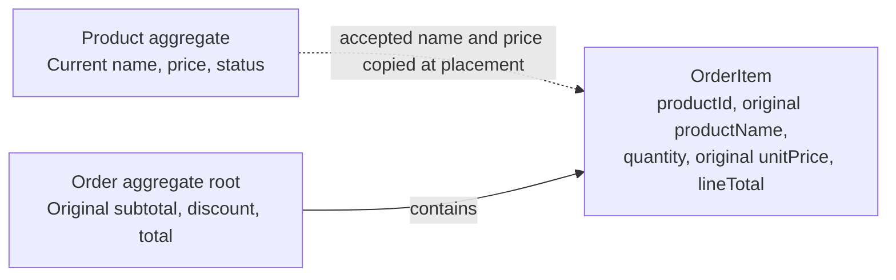

# Order Item Snapshots and DDD Aggregate Boundaries

**Status:** Proposed domain design aligned with the approved MVP requirements
**Related:** [Product Requirements](../01-requirements/product-requirements.md) · [Domain Model](domain-model.md) · [Order Placement Concurrency](../03-decisions/0001-order-placement-concurrency.md)

## 1. Context

The product catalog represents current names, prices, and availability. Orders preserve original product names and monetary facts. According to PRD BR-010, only customer details in order responses reflect their current records.

For example, an order placed for *MacBook Pro M4* at EUR 1,999.00 still uses EUR 1,999.00 after the product is renamed to *MacBook Pro M4 – Sale* and repriced to EUR 1,699.00. The retrieved order still displays *MacBook Pro M4* with the original price and amounts.

## 2. Snapshot Contents

| Field | Purpose |
| --- | --- |
| `productId` | Stable reference to the retained catalog product. |
| `productName` | Original product name accepted at order creation. |
| `quantity` | Positive integer quantity after duplicate consolidation. |
| `unitPrice` | Original gross EUR unit price accepted at order creation. |
| `lineTotal` | Original calculated amount: unit price multiplied by quantity. |

The order additionally preserves `customerId`, `subtotal`, `discount`, and `total`. Product names are read from the item snapshots; customer details are resolved from current records. No SKU is required in the MVP.

These are ordinary persisted business facts, not event sourcing or automatic database versioning. The logical snapshot fields do not prescribe individual database columns.

## 3. Aggregate Boundaries

`Product` controls current catalog attributes. `Customer` controls current customer details and status. `Order` owns its items, consolidated product references, quantities, original product names and prices, and monetary invariants.

`OrderItem` is not independently created, updated, or deleted through a separate operation. Placed orders are immutable in the MVP. Saving the order and all its items is atomic: either all are saved, or none are saved.

## 4. Order Placement Flow

1. Validate the request shape and reject caller-supplied prices or calculated amounts with 400.
2. Require at least one item and positive integer quantities; consolidate duplicate product references by summing quantities.
3. Resolve the customer and products and validate existence and active status under the accepted concurrency policy.
4. Capture the accepted product names and unit prices from the same consistent state and calculate line amounts and subtotal.
5. For a subtotal of at least EUR 100.00, round its 10% discount to two decimal places using HALF_UP; otherwise use zero. Subtract the rounded discount to obtain the payable total.
6. Atomically save the order, items, and original monetary facts while preserving the validated eligibility and reference relationships.

The authoritative product name, price, and eligibility follow the consistent operation ordering defined in [ADR-0001](../03-decisions/0001-order-placement-concurrency.md). Reading a price and later saving an order without protecting that decision is insufficient.

## 5. Persistence Requirements

- Preserve customer and product references. Referenced customers are deactivated instead of physically deleted; products have no physical deletion operation in the MVP.
- Never cascade customer or product deletion into historical orders or items.
- Return original product names from snapshots and current customer details, including inactive customer records.
- Ensure duplicate consolidation leaves one item per product within an order.
- Preserve original monetary results across later price or calculation-rule changes.

The storage representation, concrete constraints, JPA mappings, and item identity remain persistence design decisions. [ADR-0002](../03-decisions/0002-transaction-and-locking-strategy.md) proposes technical enforcement of the accepted ADR-0001 business policy; it remains Proposed and implementation-unverified. This document does not select a database schema.

## 6. Historical Calculations

`lineTotal` is reproducible from immutable unit price and quantity. Discounts and totals must not be recalculated using whatever business rules are current at read time.

The storage representation must preserve the amounts originally accepted; its design remains open. EUR 100.05 produces a discount of EUR 10.01 and a total of EUR 90.04, including after future rule changes.

## 7. Acceptance Tests

| Scenario | Expected result |
| --- | --- |
| Order two occurrences of the same product with quantities 2 and 3 | One stored item with quantity 5 and the accepted unit price. |
| Change product price after placement | Original unit price, line amount, subtotal, discount, and total remain unchanged. |
| Rename a product | Retrieved order retains the original product name, price, and amounts. |
| Update customer details | Retrieved order displays current customer details and original product snapshots. |
| Deactivate a referenced product or customer | New orders are rejected with 409; existing orders remain retrievable. |
| Submit a caller-supplied price or calculated amount | Request is rejected with 400; no order is saved. |
| Submit zero, negative, or fractional quantity, or an empty order | Request is rejected with 400; no order is saved. |
| Confirm rollback while saving several items | Neither the order nor any of its items is saved. |
| Lose commit confirmation | Outcome is unknown; do not assume rollback or automatically replay the order. |
| Change calculation rules after placement | Previously accepted amounts remain unchanged on retrieval. |
| Overlap placement with price/status changes or customer deletion | Outcomes match ADR-0001 and preserve all references and monetary facts. |

## 8. Remaining Design Decisions

- Item identity: separate UUID or identity within its order; the PRD does not expose an item ID.
- Storage representation for original monetary results and enforcement of invariants.
- Implementation and deterministic verification of the Proposed strategy in ADR-0002, including unresolved timeout, retry-delay, and uncertain-outcome details.

Resolved business rules must not be reopened as technical questions. Approved validation rules and the remaining exact email-syntax and character-counting questions are tracked in the PRD.
