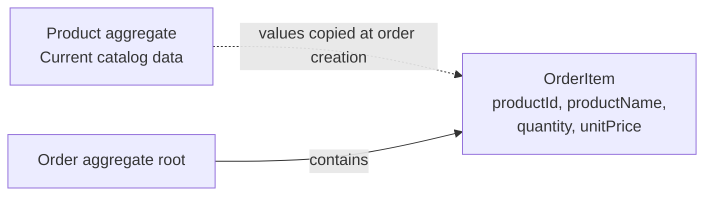

# Order Item Snapshots and DDD Aggregate Boundaries

> **Project:** Agentic Order Service  
> **Status:** Proposed design — to be validated during implementation  
> **Related requirements:** Historical order data must remain stable after product changes.

## 1. Context

The product catalog represents the **current** state of a product: its name, price, and availability can change. An order represents a **historical business transaction**. Displaying or calculating a past order must not silently change when catalog data changes.

For example, a customer orders one product named `MacBook Pro M4` at EUR 1,999.00. A week later, the product is renamed and its price becomes EUR 1,699.00. The original order must still show the name and unit price recorded when the order was created.

## 2. Design Decision: Snapshot Order-Relevant Product Data

When an order is placed, the application loads the current product data, validates that the product can be ordered, and **copies the order-relevant values into the new order item**.

An order item stores at least:

| Field | Purpose |
| --- | --- |
| `productId` | Identifies the catalog product from which the item originated. |
| `productName` | Historical product name displayed on the order. |
| `quantity` | Quantity purchased; must be a positive integer. |
| `unitPrice` | Historical gross unit price in EUR at order creation. |

This is a **business snapshot**, not a database-wide snapshot and not event sourcing. It is simply a set of values persisted as part of the order item.

### Example

**Catalog state when the order is placed**

| products.id | products.name | products.price |
| --- | --- | --- |
| 101 | MacBook Pro M4 | EUR 1,999.00 |

**Persisted order item**

| order_items.product_id | order_items.product_name | order_items.quantity | order_items.unit_price |
| --- | --- | --- | --- |
| 101 | MacBook Pro M4 | 1 | EUR 1,999.00 |

**Catalog state one week later**

| products.id | products.name | products.price |
| --- | --- | --- |
| 101 | MacBook Pro M4 – Sale | EUR 1,699.00 |

The stored order item **does not change**.

## 3. Domain-Driven Design Interpretation

### Product aggregate

`Product` models the current catalog entry and controls changes to its catalog attributes, including price and active status.

### Order aggregate

`Order` is the aggregate root responsible for order invariants, such as:

- The order contains at least one item.
- Every item has a positive quantity.
- The order preserves the monetary values established when it was placed.
- The stored discount and payable amount correspond to the accepted pricing rules.

`OrderItem` belongs to the `Order` aggregate. It is not independently created, updated, or deleted outside an order operation. Its historical values should not be updated when the corresponding `Product` changes.

The aggregate boundary is a consistency boundary: the order and its items are saved atomically. The product catalog and an order are separate aggregates.



## 4. Order Placement Flow

1. Receive an order request containing product IDs and quantities, **not trusted prices**.
2. Validate the customer, line items, and product availability.
3. Resolve the current product details and determine the prices applicable to this order.
4. Copy `productId`, `productName`, `quantity`, and `unitPrice` into each `OrderItem`.
5. Calculate subtotal, discount, and payable total according to the business rules.
6. Persist the `Order` and its `OrderItem` records in a single transaction.

**Important concurrency question:** Define whether a concurrent product-price change can affect an order being placed, and what precise moment determines the accepted price. Snapshotting alone does not settle this; the implementation needs an explicit consistency policy.

## 5. Persistence Considerations

A simplified relational representation is:

```text
products
  id, name, price, active

orders
  id, customer_id, subtotal, discount_amount, total

order_items
  id, order_id, product_id, product_name, quantity, unit_price
```

`order_items.order_id` references the containing order. `product_id` is the product identifier recorded at purchase time. Whether it is also enforced as a database foreign key to `products` is a **separate persistence decision**:

- A restrictive foreign key protects referential integrity but prevents physical deletion of referenced products.
- Retaining catalog records and deactivating them (`active = false`) preserves the relationship.
- Historical order display must use the snapshot fields rather than joining the current product name or price.

Do not configure cascading deletion from products to historical order items.

## 6. Snapshots vs. Derived Values

`lineTotal = unitPrice × quantity` can be derived from immutable snapshot fields. Whether to persist `lineTotal` as another column should be decided based on pricing complexity, rounding rules, and audit requirements, rather than automatically duplicating every derived value.

If discounts or taxes later become line-specific, the snapshot may need to include further agreed price components. The current MVP uses EUR gross prices and an order-level discount.

## 7. Acceptance Tests

| Scenario | Expected result |
| --- | --- |
| Place an order for an active product | Item records product ID, name, quantity, and current accepted unit price. |
| Change the product price after placing the order | Existing item unit price and order total remain unchanged. |
| Rename the product after placing the order | Existing item product name remains unchanged. |
| Deactivate a product | New orders for that product are rejected; past orders remain retrievable. |
| Submit a client-supplied price | Server ignores or rejects the untrusted price; calculation uses accepted catalog pricing. |
| Attempt to place an order with quantity zero | Order is rejected. |
| Persist an order with several items | Order and items are persisted atomically, or none are persisted on failure. |

## 8. Open Decisions

- **Price concurrency:** What is the authoritative instant for pricing if the catalog is updated during order placement?
- **Deletion policy:** Should catalog products always be deactivated, or can unreferenced products be physically deleted?
- **Line totals:** Should derived amounts be persisted or calculated for reads?
- **Product attributes:** Is `productName` sufficient as a historical description, or is a SKU required?

## 9. Interview Takeaway

> A catalog product describes **what is currently offered**. An order item records **what was actually purchased**. Storing order-relevant product data as a snapshot keeps historical orders stable. An agent can implement the data mapping, but the engineer must define the aggregate boundaries, invariants, concurrency semantics, and deletion policy.
