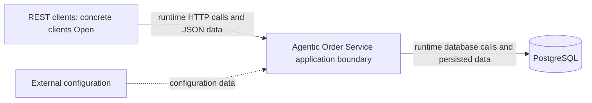
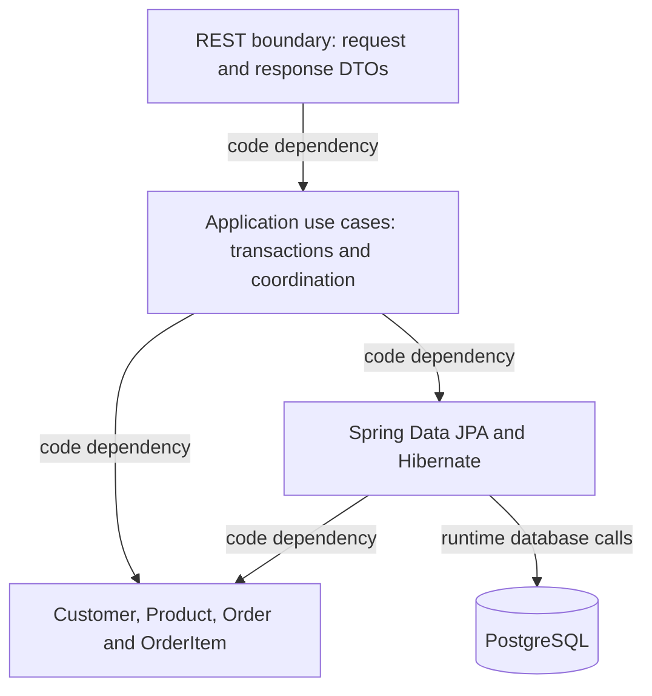

# System Architecture

**Status:** Accepted architecture baseline; technical foundation accepted; Increment 3 domain/persistence Reviewed – Accepted

## Authority and Decision Status

The [PRD](../01-requirements/product-requirements.md) owns business rules and REST behavior. ADRs own decisions; this document summarizes boundaries. Accepted does not mean implemented or verified. Proposed subdecisions must not be treated as approved implementation instructions.

| ADR | Subject | Decision status | Verification |
| --- | --- | --- | --- |
| [ADR-0001](../03-decisions/ADR-0001-order-placement-concurrency.md) | Business concurrency policy | Accepted | Implementation pending |
| [ADR-0002](../03-decisions/ADR-0002-transaction-locking.md) | Detailed transaction/locking protocol | Proposed | Implementation-unverified |
| [ADR-0003](../03-decisions/ADR-0003-application-architecture.md) | Application architecture | Accepted baseline | Implementation pending |
| [ADR-0004](../03-decisions/ADR-0004-persistence-mapping.md) | Direct aggregate mapping | Accepted Increment 3 mapping/schema selections; concrete DDL review Pending | Implementation pending |
| [ADR-0005](../03-decisions/ADR-0005-technology-stack.md) | Java 21 / Spring Boot 4.1.1 and stack | Accepted baseline; scoped foundation choices approved, production details Open | Foundation verified; human review passed, implementation accepted |

## Technology Reference

The [technology stack reference](technology-stack.md) inventories selected technologies, version policies, Proposed tooling, and Open compatibility choices. ADR-0005 remains authoritative for selection rationale.

## System Context

REST clients call the application through its documented HTTP/JSON contract. The application boundary contains the feature modules, domain behavior, REST adapters, transaction coordination, and persistence integration. PostgreSQL is the external database. Environment-supplied configuration provides connection settings and infrastructure configuration through the composition root; it does not redefine accepted business rules.

Client identity/type, authentication/authorization policy, exposure/network boundary, configuration delivery/secrets mechanism, and deployment platform remain unresolved. This context neither assumes anonymous production access nor introduces security or deployment features.

Arrows in the context diagram represent runtime calls/data flow, not Java package dependencies.

## Runtime and Responsibilities

One Spring Boot application, one Maven module, and one PostgreSQL database. Organize packages by `product`, `customer`, and `order`; introduce `api`, `application`, `domain`, and `persistence` packages only as actual code requires them. Small configuration and shared Money packages are permitted; no generic framework is needed.

| Boundary | Responsibility |
| --- | --- |
| REST API | Strict JSON binding, request DTOs, validation, response DTOs, safe HTTP error mapping |
| Application | Use-case orchestration, cross-aggregate checks, transaction ownership, retries, DTO materialization |
| Domain | Aggregate behavior, immutable value objects, quantity/consolidation/pricing invariants |
| Persistence | Spring Data JPA, Hibernate mappings, explicit locking queries, referential and uniqueness constraints |

Directly mapped domain aggregates intentionally depend on JPA metadata. HTTP types remain outside the domain. Pricing methods perform no database access. Avoid pretending this is a fully framework-independent hexagonal model.

The following diagram shows code dependencies, except the explicitly labeled database runtime edge. It does not prescribe additional interfaces.

## Package Dependencies and Composition Root

| Package | Permitted dependencies | Boundary |
| --- | --- | --- |
| `api` | Own feature application operations and API DTO/error-mapping types | Controllers do not call repositories, orchestrate aggregates, or calculate business amounts. |
| `application` | Own domain/persistence components, shared value objects, narrow provider-owned cross-feature contracts | No dependency on controllers or API-specific DTOs; return transport-independent materialized results for API mapping. |
| `domain` | Domain types, shared immutable values, and JPA metadata required by accepted direct mapping | No API/application/persistence component dependency or database calls; JPA metadata is the explicit framework-coupling exception. |
| `persistence` | Own domain types and JPA/Hibernate/Spring Data infrastructure | No API or use-case orchestration dependency; no foreign feature persistence access. |
| `configuration` | Components/infrastructure needed to wire the application | The composition root may depend on these components; feature/domain behavior must not depend on the concrete configuration package. |

Feature-owned public contracts are the narrowly exposed application operations and immutable request/result carriers intended for cross-feature use. Repositories, entity graphs, controller classes, and other implementation helpers remain internal. Public Java visibility needed for Spring/JPA is not permission for another feature to depend on an internal type. Do not add a contracts framework or an interface per class.

The Boot entry point and configuration wiring form the composition root. Constructor injection supplies explicit collaborators. Infrastructure settings are bound and supplied here; domain code does not read environment variables or construct repositories. Concrete configuration classes, scanning boundaries, contract signatures, and base package remain part of scoped implementation planning.

## Module Access

Order placement coordinates narrow provider-owned Customer/Product access operations for locked lookup and immutable placement data. Customer deletion uses a narrow Order-reference query. These are small application components; do not require interfaces without a concrete need. Never expose another feature's managed entities or broad CRUD services as the integration contract.

Cross-feature workflows share the outer application's transaction. Helper operations must participate rather than independently commit. Dependencies in both directions are limited to narrow contracts; they do not permit recursive application-service calls or circular constructor dependencies. Order placement uses a Customer lookup component independent of customer-deletion orchestration. Customer deletion uses an Order-reference query component independent of order-placement orchestration. These responsibilities clarify the boundary without prescribing new class names or interfaces. Modules are code organization, not independently deployable services.

## Use-Case Ownership

| Use case | Application owner | Coordination and persistence ownership |
| --- | --- | --- |
| Order placement | Order application operation; retry coordinator outside attempts | Customer/Product provider-owned locked access participates in the Order-owned attempt transaction. Order domain owns consolidation/pricing/snapshots; Order persistence saves the whole aggregate. |
| Customer deletion | Customer application operation | Customer persistence owns the customer mutation; narrow Order-owned reference query participates in the same transaction. Accepted behavior is delete if unreferenced, otherwise deactivate; detailed race enforcement remains Proposed in ADR-0002. |
| Product/customer mutations | Respective feature application operation | Respective feature owns its domain mutation and repository access. Compatible detailed locking paths follow Proposed ADR-0002. |
| Order retrieval | Order application read operation | Order persistence supplies original order/item facts; narrow Customer-owned read access supplies current details. Fully materialize the result within the read transaction; no entity/lazy state escapes. |

Complete transport-independent order results are materialized inside transactions. API adapters map those results to response DTOs without additional database access; alternatively the response DTO can itself be a transport-neutral immutable carrier. This preserves the materialization convention without introducing an application-to-API dependency.

## Domain and Transaction Rules

The [domain model](domain-model.md) defines aggregate ownership. Historical names/prices/amounts remain original; customer details remain current. [Transaction conventions](transaction-locking.md) require ambient-transaction rejection, disabled OSIV, fresh attempt state, complete DTO materialization, and commit observation. ADR-0002 remains the unverified enforcement proposal.

## Scope and Remaining Decisions

No microservices, event sourcing, CQRS infrastructure, generic repository hierarchy, or idempotency-key feature is approved. D1–D10 identity/converter/storage/name/email/schema and local/test migration selections are Accepted under ADR-0004/0005; Increment 3 was explicitly authorized, concrete SQL reviewed and scoped domain/persistence verification passed; Increment 3 is Reviewed – Accepted following explicit human acceptance. See the [execution record](../04-agentic-coding/prompts/04-domain-model.md#implementation-results--executed-pending-human-review). List/pagination fetching, production execution/privileges and detailed concurrency configuration remain deferred/Open in [open items](../00-overview/open-items.md). Follow the [implementation plan](../07-implementation/implementation-plan.md) for approval gates.

## Approved PostgreSQL Foundation Increment

Increment 2 wires Boot-managed JPA/JDBC/Flyway to PostgreSQL 17.11 (`postgres:17.11-bookworm`). Local development uses explicit Compose lifecycle, localhost-bound configurable ports, environment credentials, and a named persistent volume. Integration tests use a separate Spring-managed Testcontainers database with random ports and independent credentials; they never reuse the Compose database.

OSIV is disabled, Hibernate uses `validate`, and SQL initialization is disabled. Flyway is disabled by default and enabled only in local/integration-test profiles; the historical Increment 2 scope approved metadata initialization only. No entities, repositories, application migrations, transaction coordinator, retries, or locks exist in this increment. Deployment/security and detailed concurrency questions remain Open; ADR-0002 remains Proposed. The subsequent Increment 3 design approval selects the four domain tables/mappings and local/test V1 policy; implementation is not yet authorized or verified. See [the execution record](../04-agentic-coding/prompts/03-postgresql-foundation.md).
