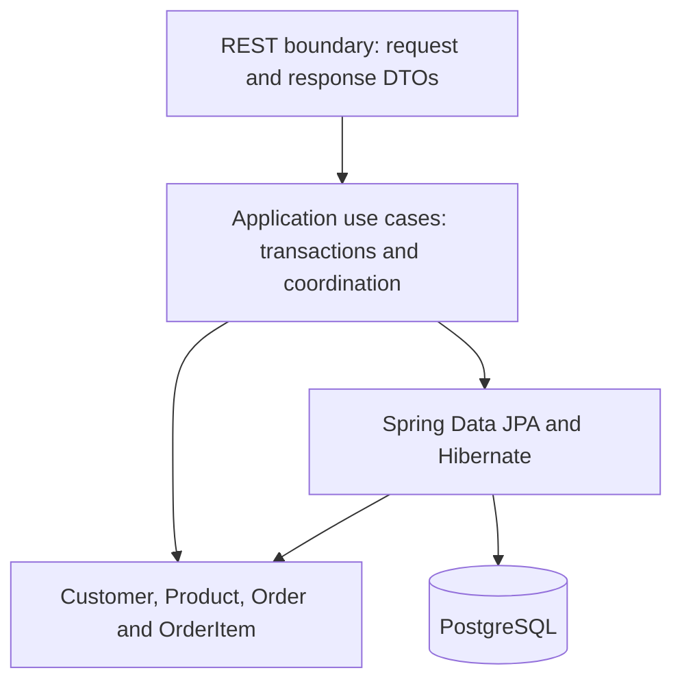

# System Architecture

**Status:** Accepted architecture baseline; implementation not started

## Authority and Decision Status

The [PRD](../01-requirements/product-requirements.md) owns business rules and REST behavior. ADRs own decisions; this document summarizes boundaries. Accepted does not mean implemented or verified. Proposed subdecisions must not be treated as approved implementation instructions.

| ADR | Subject | Decision status | Verification |
| --- | --- | --- | --- |
| [ADR-0001](../03-decisions/ADR-0001-order-placement-concurrency.md) | Business concurrency policy | Accepted | Implementation pending |
| [ADR-0002](../03-decisions/ADR-0002-transaction-locking.md) | Detailed transaction/locking protocol | Proposed | Implementation-unverified |
| [ADR-0003](../03-decisions/ADR-0003-application-architecture.md) | Application architecture | Accepted baseline | Implementation pending |
| [ADR-0004](../03-decisions/ADR-0004-persistence-mapping.md) | Direct aggregate mapping | Accepted baseline; converter details Proposed, schema Open | Implementation pending |
| [ADR-0005](../03-decisions/ADR-0005-technology-stack.md) | Java 21 / Spring Boot 4.1.1 and stack | Accepted baseline; dependency alignment Open | Implementation pending |

## Runtime and Responsibilities

One Spring Boot application, one Maven module, and one PostgreSQL database. Organize packages by `product`, `customer`, and `order`; introduce `api`, `application`, `domain`, and `persistence` packages only as actual code requires them. Small configuration and shared Money packages are permitted; no generic framework is needed.

| Boundary | Responsibility |
| --- | --- |
| REST API | Strict JSON binding, request DTOs, validation, response DTOs, safe HTTP error mapping |
| Application | Use-case orchestration, cross-aggregate checks, transaction ownership, retries, DTO materialization |
| Domain | Aggregate behavior, immutable value objects, quantity/consolidation/pricing invariants |
| Persistence | Spring Data JPA, Hibernate mappings, explicit locking queries, referential and uniqueness constraints |

Directly mapped domain aggregates intentionally depend on JPA metadata. HTTP types remain outside the domain. Pricing methods perform no database access. Avoid pretending this is a fully framework-independent hexagonal model.

## Module Access

Order placement coordinates narrow provider-owned Customer/Product access operations for locked lookup and immutable placement data. Customer deletion uses a narrow Order-reference query. These are small application components; do not require interfaces without a concrete need. Never expose another feature's managed entities or broad CRUD services as the integration contract.

Cross-feature workflows share the outer application's transaction. Helper operations must participate rather than independently commit. Dependencies in both directions are limited to narrow contracts and must not become recursive service calls. Modules are code organization, not independently deployable services.

## Domain and Transaction Rules

The [domain model](domain-model.md) defines aggregate ownership. Historical names/prices/amounts remain original; customer details remain current. [Transaction conventions](transaction-locking.md) require ambient-transaction rejection, disabled OSIV, fresh attempt state, complete DTO materialization, and commit observation. ADR-0002 remains the unverified enforcement proposal.

## Scope and Remaining Decisions

No microservices, event sourcing, CQRS infrastructure, generic repository hierarchy, or idempotency-key feature is approved. Fine-grained converter choices, identity/schema/capacity, exact email syntax, dependency alignment, migration execution, and timeout values are tracked in [open items](../00-overview/open-items.md). Follow the [implementation plan](../07-implementation/implementation-plan.md) for approval gates.
