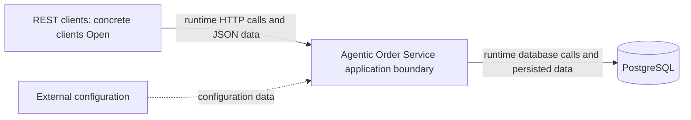
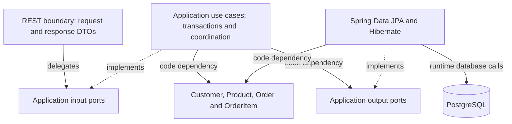

# System Architecture

**Status:** Accepted architecture baseline; technical foundation accepted; Increment 3 domain/persistence Reviewed – Accepted; Increment 4 Reviewed – Accepted

## Authority and Decision Status

The [PRD](../01-requirements/product-requirements.md) owns business rules and REST behavior. ADRs own decisions; this document summarizes boundaries. Accepted does not mean implemented or verified. Proposed subdecisions must not be treated as approved implementation instructions.

| ADR | Subject | Decision status | Verification |
| --- | --- | --- | --- |
| [ADR-0001](../03-decisions/ADR-0001-order-placement-concurrency.md) | Business concurrency policy | Accepted | Implementation pending |
| [ADR-0002](../03-decisions/ADR-0002-transaction-locking.md) | Detailed transaction/locking protocol | Proposed | Implementation-unverified |
| [ADR-0003](../03-decisions/ADR-0003-application-architecture.md) | Application architecture | Accepted baseline | Implementation pending |
| [ADR-0004](../03-decisions/ADR-0004-persistence-mapping.md) | Direct aggregate mapping | Accepted Increment 3 mapping/schema selections | Increment 3 domain/persistence Reviewed – Accepted; Increment 4 version/V2 disposable verification passed; persistent local gate blocked |
| [ADR-0005](../03-decisions/ADR-0005-technology-stack.md) | Java 21 / Spring Boot 4.1.1 and stack | Accepted baseline; scoped foundation choices approved, production details Open | Foundation verified; human review passed, implementation accepted |
| [ADR-0006](../03-decisions/ADR-0006-product-customer-optimistic-locking.md) | Product/Customer optimistic locking | Proposed complete ADR; @Version direction Human Accepted | Exact mapping/schema choices Accepted; V2 SQL reviewed; scoped implementation/runtime verification passed; human accepted 2026-10-15 |
| [ADR-0007](../03-decisions/ADR-0007-hexagonal-architecture-migration.md) | Incremental pragmatic hexagonal architecture, Option B | Accepted — human decision 2026-10-21; ADR-0004 retained | Product, Customer, images and Order migrated in Increments 1–6; Increment 7 consolidation authorized, verification in CH-003 |

## Technology Reference

The [technology stack reference](technology-stack.md) inventories selected technologies, version policies, Proposed tooling, and Open compatibility choices. ADR-0005 remains authoritative for selection rationale.

## System Context

REST clients call the application through its documented HTTP/JSON contract. The application boundary contains the feature modules, domain behavior, REST adapters, transaction coordination, and persistence integration. PostgreSQL is the external database. Environment-supplied configuration provides connection settings and infrastructure configuration through the composition root; it does not redefine accepted business rules.

Client identity/type, authentication/authorization policy, exposure/network boundary, configuration delivery/secrets mechanism, and deployment platform remain unresolved. This context neither assumes anonymous production access nor introduces security or deployment features.

Arrows in the context diagram represent runtime calls/data flow, not Java package dependencies.

## Runtime and Responsibilities

One Spring Boot application, one Maven module, and one PostgreSQL database. Organize packages by `product`, `customer`, and `order`; introduce `api`, `application`, `domain`, and `persistence` packages only as actual code requires them. Small configuration and shared Money packages are permitted; no generic framework is needed.

| Boundary | Responsibility |
| --- | --- |
| REST API | Strict JSON binding, request DTOs, validation, response DTOs, safe HTTP error mapping |
| Application | Use-case orchestration, cross-aggregate checks, transaction ownership, retries, DTO materialization |
| Domain | Aggregate behavior, immutable value objects, quantity/consolidation/pricing invariants |
| Persistence | Spring Data JPA, Hibernate mappings, explicit locking queries, referential and uniqueness constraints |

Directly mapped domain aggregates intentionally depend on JPA metadata. HTTP types remain outside the domain. Pricing methods perform no database access. Avoid pretending this is a fully framework-independent hexagonal model.

The following diagram shows the consolidated Option B dependency direction. Application owns the capability contracts; adapters implement them. The database edge denotes runtime access.

## Package Dependencies and Composition Root

| Package | Permitted dependencies | Boundary |
| --- | --- | --- |
| `api` | Own feature application input ports, immutable application data and API DTO/error-mapping types | Controllers do not call repositories, orchestrate aggregates, or calculate business amounts. |
| `application` | Own domain, application input/output capabilities and shared value objects | No dependency on controllers or API-specific DTOs; return transport-independent materialized results for API mapping. |
| `domain` | Domain types, shared immutable values, and JPA metadata required by accepted direct mapping | No API/application/persistence component dependency or database calls; JPA metadata is the explicit framework-coupling exception. |
| `persistence` | Own output contracts, immutable application data, own domain types and JPA/Hibernate/Spring Data infrastructure; exact provider input for the Customer reference bridge | No API or use-case orchestration dependency; no foreign feature persistence access. |
| `configuration` | Components/infrastructure needed to wire the application | The composition root may depend on these components; feature/domain behavior must not depend on the concrete configuration package. |

Feature-owned public contracts are the narrowly exposed application operations and immutable request/result carriers intended for cross-feature use. Repositories, entity graphs, controller classes, and other implementation helpers remain internal. Public Java visibility needed for Spring/JPA is not permission for another feature to depend on an internal type. Do not add a contracts framework or an interface per class.

The Boot entry point and configuration wiring form the composition root. Constructor injection supplies explicit collaborators. Infrastructure settings are bound and supplied here; domain code does not read environment variables or construct repositories. Concrete configuration classes, scanning boundaries, contract signatures, and base package remain part of scoped implementation planning.

## Module Access

Order placement coordinates narrow provider-owned Customer/Product access operations for locked lookup and immutable placement data. Customer deletion uses a narrow Order-reference query. These are narrow capability contracts under ADR-0007; retain the supported provider implementations and their transaction participation. Never expose another feature's managed entities or broad CRUD services as the integration contract.

Cross-feature workflows share the outer application's transaction. Helper operations must participate rather than independently commit. Dependencies in both directions are limited to narrow contracts; they do not permit recursive application-service calls or circular constructor dependencies. Order placement uses a Customer lookup component independent of customer-deletion orchestration. Customer deletion uses an Order-reference query component independent of order-placement orchestration. These responsibilities clarify the boundary without prescribing new class names or interfaces. Modules are code organization, not independently deployable services.

## Use-Case Ownership

| Use case | Application owner | Coordination and persistence ownership |
| --- | --- | --- |
| Order placement | Order application operation; retry coordinator outside attempts | Customer/Product provider-owned locked access participates in the Order-owned attempt transaction. Order domain owns consolidation/pricing/snapshots; Order persistence saves the whole aggregate. |
| Customer deletion | Customer application operation | Customer persistence owns the customer mutation; narrow Order-owned reference query participates in the same transaction. Current implementation deletes if unreferenced, otherwise rejects without mutation. The [approved 2026-10-18 target](../01-requirements/product-requirements.md#customer-delete--approved-target-contract-2026-10-18) rejects referenced DELETE with 409 and no state changes; Phase 2 human acceptance is pending; see the [review evidence](../04-agentic-coding/change-requests/CH-001-customer-delete-semantics/03-review.md). Complete ADR-0002 remains Proposed. |
| Product/customer mutations | Respective feature application operation | Respective feature owns its domain mutation and repository access. Compatible detailed locking paths follow Proposed ADR-0002. |
| Order retrieval | Order application read operation | Order persistence supplies original order/item facts; narrow Customer-owned read access supplies current details. Fully materialize the result within the read transaction; no entity/lazy state escapes. |

Complete transport-independent order results are materialized inside transactions. API adapters map those results to response DTOs without additional database access; alternatively the response DTO can itself be a transport-neutral immutable carrier. This preserves the materialization convention without introducing an application-to-API dependency.

## Domain and Transaction Rules

The [domain model](domain-model.md) defines aggregate ownership. Historical names/prices/amounts remain original; customer details remain current. [Transaction conventions](transaction-locking.md) require ambient-transaction rejection, disabled OSIV, fresh attempt state, complete DTO materialization, and commit observation. ADR-0002 remains the unverified enforcement proposal.

## Scope and Remaining Decisions

No microservices, event sourcing, CQRS infrastructure, generic repository hierarchy, or idempotency-key feature is approved. D1–D10 identity/converter/storage/name/email/schema and local/test migration selections are Accepted under ADR-0004/0005; Increment 3 was explicitly authorized, concrete SQL reviewed and scoped domain/persistence verification passed; Increment 3 is Reviewed – Accepted following explicit human acceptance. See the [execution record](../04-agentic-coding/prompts/04-domain-model.md#implementation-results--executed-pending-human-review). List/pagination fetching, production execution/privileges and detailed concurrency configuration remain deferred/Open in [open items](../00-overview/open-items.md). Follow the [implementation plan](../07-implementation/implementation-plan.md) for approval gates.

## Approved PostgreSQL Foundation Increment

Increment 2 wires Boot-managed JPA/JDBC/Flyway to PostgreSQL 17.11 (`postgres:17.11-bookworm`). Local development uses explicit Compose lifecycle, localhost-bound configurable ports, environment credentials, and a named persistent volume. Integration tests use a separate Spring-managed Testcontainers database with random ports and independent credentials; they never reuse the Compose database.

OSIV is disabled, Hibernate uses `validate`, and SQL initialization is disabled. Flyway is disabled by default and enabled only in local/integration-test profiles; the historical Increment 2 scope approved metadata initialization only. No entities, repositories, application migrations, transaction coordinator, retries, or locks exist in this increment. Deployment/security and detailed concurrency questions remain Open; ADR-0002 remains Proposed. The subsequent Increment 3 was explicitly authorized, implemented and human accepted with four domain tables/mappings and verified local/test V1 policy. That later evidence supersedes the foundation-only state; Increment 4 is now Reviewed – Accepted; see [final Increment 4 acceptance](../04-agentic-coding/prompts/05-product-customer-api.md#final-human-acceptance--2026-10-15). See [the execution record](../04-agentic-coding/prompts/03-postgresql-foundation.md).

## Increment 4 Architecture Decision Update

Human Accepted on 2026-10-14: Product/Customer application write methods @Transactional/read methods readOnly=true, immutable results materialized within transaction, success and API error translation after transaction completion; Product/Customer @Version and confirmed CONCURRENT_MODIFICATION/409 without automatic retries. [ADR-0006](../03-decisions/ADR-0006-product-customer-optimistic-locking.md) records the direction while remaining Proposed for complete-record approval; exact mapping/schema choices and V2 SQL are reviewed, scoped implementation/runtime verification passed; human accepted 2026-10-15. No response version field or ETag/If-Match selected; optimistic versions do not replace the later Order locking/deletion protocol. ADR-0002 and Accepted D1–D10 are unchanged.

Exactly ten intended Product/Customer POST/GET list/GET ID/PUT/PATCH operations; Customer DELETE remains deferred MVP work with Accepted interim OPERATION_NOT_AVAILABLE/405. Strict types/price lexical rules/canonical UUIDs/single-error precedence and safe technical statuses are in [REST design](rest-api-design.md#10-human-accepted-increment-4-api-and-transaction-decisions) and [API catalog](api-error-codes.md). Follow the [current plan](../07-implementation/implementation-plan.md#increment-4--product--customer-application-services-and-rest-api); implementation/V2 disposable verification is Reviewed – Accepted; persistent local migration remains separately blocked. See [final Increment 4 acceptance](../04-agentic-coding/prompts/05-product-customer-api.md#final-human-acceptance--2026-10-15).

## Product Image Storage and Lifecycle — CH-002

The human-approved CH-002 increment adds Product-owned filesystem content and a dedicated PostgreSQL metadata association, without new dependencies, remote storage or an administration UI. Java ImageIO validates JPEG/PNG and generates the thumbnail. See the [business limits](../01-requirements/product-requirements.md#product-images--ch-002) and [metadata model](domain-model.md#product-image-metadata--ch-002). Complete ADR statuses above remain unchanged.

`app.product-images.storage-directory` selects the root (default `./var/product-images`, Git-ignored). Application-generated UUID directory names and fixed variant filenames replace caller filenames; only relative managed keys are persisted. Path containment and symbolic-link rejection protect managed filesystem access. The storage directory must be trusted and unavailable to untrusted writers.

A replacement stages both variants in a fresh immutable generation before the metadata transaction. The Product application operation locks the product row and swaps the association in one database transaction. Reads lock the same product while resolving/reading content. Only confirmed transaction completion permits success. Replacement/deletion retires prior files after confirmed commit; failures retain files for later recovery. Any database transaction failure conservatively retains staged generations, including confirmed rollback; unknown commit outcomes never trigger blind write replay. PostgreSQL and filesystem writes are not a distributed atomic transaction: crash/interrupted cleanup can leave unreferenced generations, never evidence of successful cleanup.

The explicit application reconciliation operation `reconcileOrphans(true)` is for a quiescent maintenance window with all image readers and writers across every instance stopped. It compares live database references with managed generations and removes unreferenced content. There is no public cleanup endpoint or automatic startup sweep. Reconciliation must not run concurrently with staged writes.

Deployment requires persistent filesystem storage with consistent access for the application and backups. Local container files are neither durable nor shared by assumption. This increment supports a controlled deployment with one writer and a coherent storage root; arbitrary multi-instance/shared-filesystem correctness is not established. Quiesce writers for a consistent database-plus-filesystem backup/restore pair.

The service has no built-in authentication. `app.product-images.writes-enabled=false` is the default; the human approved explicit trusted-deployment opt-in and isolated demo enablement. Production access control must be supplied externally before opt-in. Public read policy is unchanged. This setting is a capability switch, not user authentication. Verification and Human Acceptance remain in the [CH-002 review](../04-agentic-coding/change-requests/CH-002-product-images/03-review.md).

## Accepted Option B — incremental hexagonal migration

[ADR-0007](../03-decisions/ADR-0007-hexagonal-architecture-migration.md) accepts human-selected Option B: introduce ports/adapters incrementally while retaining approved direct domain/JPA mapping. ADR-0004 is not superseded. The [target and increment plan](hexagonal-migration.md) distinguishes accepted dependency conventions from future implementation steps; existing package rules above govern unmigrated code. No production migration is authorized by Increment 0, and mapping/transaction/API invariants remain unchanged.

## CH-003 Product migration — Increment 2 historical scope

Product GET-by-ID retains the Increment 1 GetProductQuery/GetProductService/FindProductById/ProductReadAdapter path. Create, update and PATCH deactivation now use ProductWriteOperations/ProductWriteService and application-owned ProductWriteStore implemented by ProductWriteAdapter. The facade retains write compatibility delegates, collection listing and static price-validation compatibility; Order/image helpers remain legacy. The existing aggregate, mapping and repository lock query are unchanged.

The [explicit ADR-0007 exception](../03-decisions/ADR-0007-hexagonal-architecture-migration.md#increment-2-scoped-output-contract--accepted-2026-10-21) permits Product on ProductWriteStore only within this feature's application transaction, preserving dirty checking without detached mappings. Input, GET and cross-feature contracts still expose immutable results. The earlier layered diagram/table describe unmigrated paths. Increment 3 is separately authorized; [CH-003 records](../04-agentic-coding/change-requests/CH-003-hexagonal-architecture-migration/README.md) own actual verification and Human Acceptance remains Pending.

## CH-003 Customer migration — Increment 3 historical scope

The authorized Customer path is Controller → CustomerOperations → existing CustomerApplicationService → CustomerReadStore/CustomerWriteStore → CustomerReadAdapter/CustomerWriteAdapter → unchanged CustomerRepository and directly mapped Customer. Cohesive input operations preserve all existing endpoints and immutable CustomerResult responses. The [Customer-only ADR-0007 exception](../03-decisions/ADR-0007-hexagonal-architecture-migration.md#increment-3-scoped-output-contract--accepted-2026-10-21) permits exactly save, locked lookup and delete aggregate signatures within existing application transactions.

CustomerOrderAccess remains an independent MANDATORY provider implementing CustomerFacts for immutable locked/batch-current facts; existing Order callers retain this compatibility class. Customer deletion uses CustomerOrderReferences and a narrow CustomerOrderReferenceAdapter calling the independent existing MANDATORY OrderReferenceQuery. This concrete Order provider remains migration debt, without changing Order orchestration or persistence. Application transactions, READ COMMITTED deletion, separate reference query after Customer locking, dirty checking, UUID/version mappings and static email-normalization compatibility remain unchanged. [CH-003 records](../04-agentic-coding/change-requests/CH-003-hexagonal-architecture-migration/README.md) own measured evidence and Human Acceptance Pending; no later increment is authorized.

## Product image hexagonal boundaries — CH-003 Increment 4

The existing image controller invokes `ProductImageOperations`; the existing application service implements that input capability and retains orchestration. It depends on `ImageProcessing`, `ImageStorage`, `ProductImageMetadataStore` and `ProductImageTransactions`. Application-owned processed/staged values and flat metadata snapshots carry bytes, relative keys and scalar metadata without exposing managed entities or infrastructure types. No new managed-entity output exception is introduced.

The ImageIO processor and existing filesystem implementation reside in `product.storage`; `ProductImageMetadataAdapter` maps snapshots through the unchanged domain constructor/replace and Spring Data repositories, retaining the existing managed instance on replacement. `SpringProductImageTransactions` supplies the original ambient-resource guard and READ COMMITTED TransactionTemplate execution. It returns only after successful transaction completion and propagates failures unchanged. Transaction scope, metadata construction and lifecycle policy remain application-owned.

The [existing lifecycle](#product-image-storage-and-lifecycle--ch-002) is preserved: complete generation before metadata transaction; Product lock before metadata and byte reads; obsolete generation retirement after successful commit; retain candidates after every transaction failure; no retries, asynchronous cleanup, synchronization callbacks or extra finalization. Quiescent reconciliation remains maintenance-only. REST/OpenAPI, JPA/schema, keys, deployment restrictions and write opt-in remain unchanged. Increment 4 implementation evidence and Human Acceptance Pending are recorded in [CH-003](../04-agentic-coding/change-requests/CH-003-hexagonal-architecture-migration/03-review.md).

## Order reads through ports — CH-003 Increment 5

Existing `GET /orders` and `GET /orders/{id}` delegate through `OrderQueries`, implemented by the existing `OrderQueryService`. `OrderReadStore` returns immutable `OrderReadSnapshot` values from `OrderReadAdapter`, which invokes unchanged distinct left fetch joins and copies persisted item snapshots and monetary amounts. No managed entity crosses the read port. No ordering, filters, pagination, recalculation or new query is introduced.

Current Customer enrichment uses consumer-owned `OrderCustomerFacts` through `order.integration.OrderReadCustomerAdapter` and existing provider `CustomerFacts.current`. The service keeps one distinct-ID batch, including the empty batch call, and unchanged missing-order/missing-customer behavior. Customer implementation remains unchanged.

The service retains class-level `@Transactional(readOnly=true)` and default REQUIRED participation. Snapshots, Customer facts and final immutable results materialize inside that transaction; existing MANDATORY provider joins it. Ambient read-write transactions retain their persistence context/settings. HTTP response mapping/serialization needs no OSIV. Stored names, quantities, unit prices, line totals, subtotal, discount and total are copied directly without consulting current Product data. Domain/JPA mappings, repository queries and placement/retry/reference operations remain unchanged; `OrderResult.from` remains the placement compatibility mapper. Local evidence and Human Acceptance Pending are recorded in [CH-003](../04-agentic-coding/change-requests/CH-003-hexagonal-architecture-migration/README.md).

## Order placement through ports — CH-003 Increment 6

POST/orders invokes `OrderPlacementOperations`,implemented by existing `OrderPlacementCoordinator`. Application consumes `OrderWriteStore`,`OrderPlacementCustomerFacts`,`OrderPlacementProductFacts` and `OrderPlacementAttempts`. Only the exact human-approved OrderWriteStore.save(Order):Order signature carries the same-feature managed aggregate; flush remains inside the same attempt and is not commit. OrderWriteAdapter delegates existing repository save/flush with unchanged Order/OrderItem mappings/generated identity/ownership.

Customer/Product bridges invoke provider inputs CustomerFacts/ProductFacts through their existing MANDATORY implementations. ProductOrderAccess adds interface implementation only; provider locking/validation/repository behavior stays unchanged. Order reads,reference lookup and Customer application behavior are untouched. No new transaction or commit between features.

SpringOrderPlacementAttempts uses the unchanged qualified REQUIRED/READ COMMITTED template. Completion observation registers before local2s timeout SQL and application work; callback status maps to application attempt-local UNKNOWN/COMMITTED/ROLLED_BACK. Guard and retry classifier move unchanged to order.transaction. Original failure identity and lock-call provenance remain; no wrapping or exception-as-rollback inference. Normal template return after completion/resource cleanup precedes success logging. Exceptional non-rollback outcomes are never replayed.

Application retains customer-first/canonical Product locking,active-state precedence,price/name snapshots,aggregate construction/save/flush/materialization,unbound checking before eligible rollback retry,3attempts/10s budget,25/50ms backoff,fresh facts and existing safe diagnostic events. No generic retry framework or independent commits. [ADR-0007](../03-decisions/ADR-0007-hexagonal-architecture-migration.md) records exact approved exceptions/contracts; full ADR-0002 remains Proposed. [CH-003](../04-agentic-coding/change-requests/CH-003-hexagonal-architecture-migration/README.md) owns execution evidence and Human Acceptance Pending.

## CH-003 consolidation — Increment 7

The authorized consolidation closes the remaining Product collection/provider and Order reference repository paths. `ListProductsQuery` is implemented by retained `ProductApplicationService`; `ProductCatalogReads` is implemented by existing `ProductReadAdapter` for immutable list/locked facts. `ProductOrderAccess` retains MANDATORY participation and uses that output. Existing GET/write contracts and public facade methods remain. `OrderReferences` is implemented by retained MANDATORY `OrderReferenceQuery`, which uses `OrderReferenceStore` implemented by existing `OrderReadAdapter`; CustomerOrderReferenceAdapter consumes the provider input. The underlying findAll/findLockedById/existsByCustomerId queries and transaction annotations remain unchanged.

| Flow | Input / implementation | Outputs / adapters |
| --- | --- | --- |
| Product get | GetProductQuery / GetProductService | FindProductById / ProductReadAdapter |
| Product list | ListProductsQuery / ProductApplicationService | ProductCatalogReads / ProductReadAdapter |
| Product write | ProductWriteOperations / ProductWriteService | ProductWriteStore / ProductWriteAdapter |
| Product facts | ProductFacts / ProductOrderAccess | ProductCatalogReads / ProductReadAdapter |
| Customer operations / facts | CustomerOperations / CustomerApplicationService; CustomerFacts / CustomerOrderAccess | CustomerReadStore, CustomerWriteStore / CustomerReadAdapter, CustomerWriteAdapter; CustomerOrderReferences / CustomerOrderReferenceAdapter → OrderReferences |
| Images | ProductImageOperations / ProductImageApplicationService | Processing, storage, metadata and transaction capabilities / existing technical adapters |
| Order read | OrderQueries / OrderQueryService | OrderReadStore / OrderReadAdapter; OrderCustomerFacts / OrderReadCustomerAdapter → CustomerFacts |
| Order placement | OrderPlacementOperations / OrderPlacementCoordinator | OrderWriteStore / OrderWriteAdapter; OrderPlacementAttempts / SpringOrderPlacementAttempts; consumer Customer/Product facts / integration adapters → provider inputs |
| Order reference | OrderReferences / OrderReferenceQuery | OrderReferenceStore / OrderReadAdapter |

Supported compatibility facades/providers remain; none is removed. Existing static price/email validation calls remain narrow transport compatibility exceptions. Spring application annotations and Customer after-commit observation retain existing application-owned transaction behavior. Option B permits domain JPA metadata and the exact three ADR-0007 same-feature managed-write signatures; no input/read/cross-feature entity allowance. No generic repository framework or package rename. Approved provider directions may be bidirectional at feature level; constructor wiring must remain acyclic.

Earlier increment sections record their historical scope and debt; this section supersedes the collection/provider/reference migration debt only. Image orphan reconciliation, historical mutation findings, unresolved ADR subdecisions and human-controlled Cloud evaluation remain. [CH-003 records](../04-agentic-coding/change-requests/CH-003-hexagonal-architecture-migration/README.md) own actual implementation/verification status and exact manifest. Human Acceptance Pending; no Increment 8.
