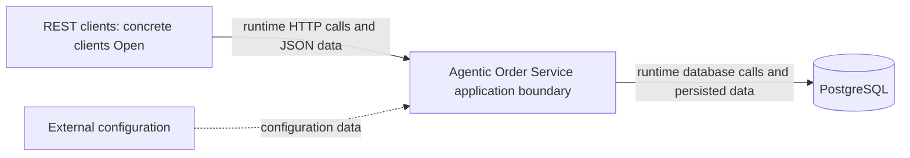
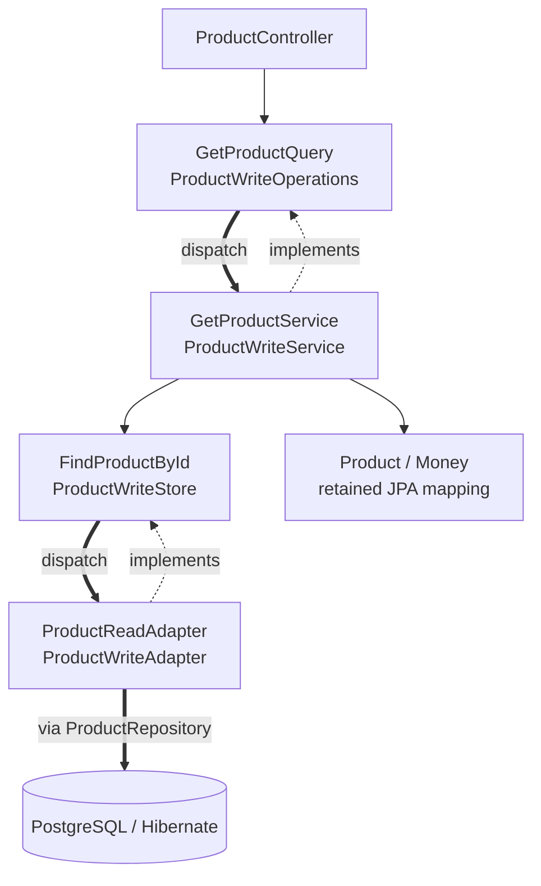
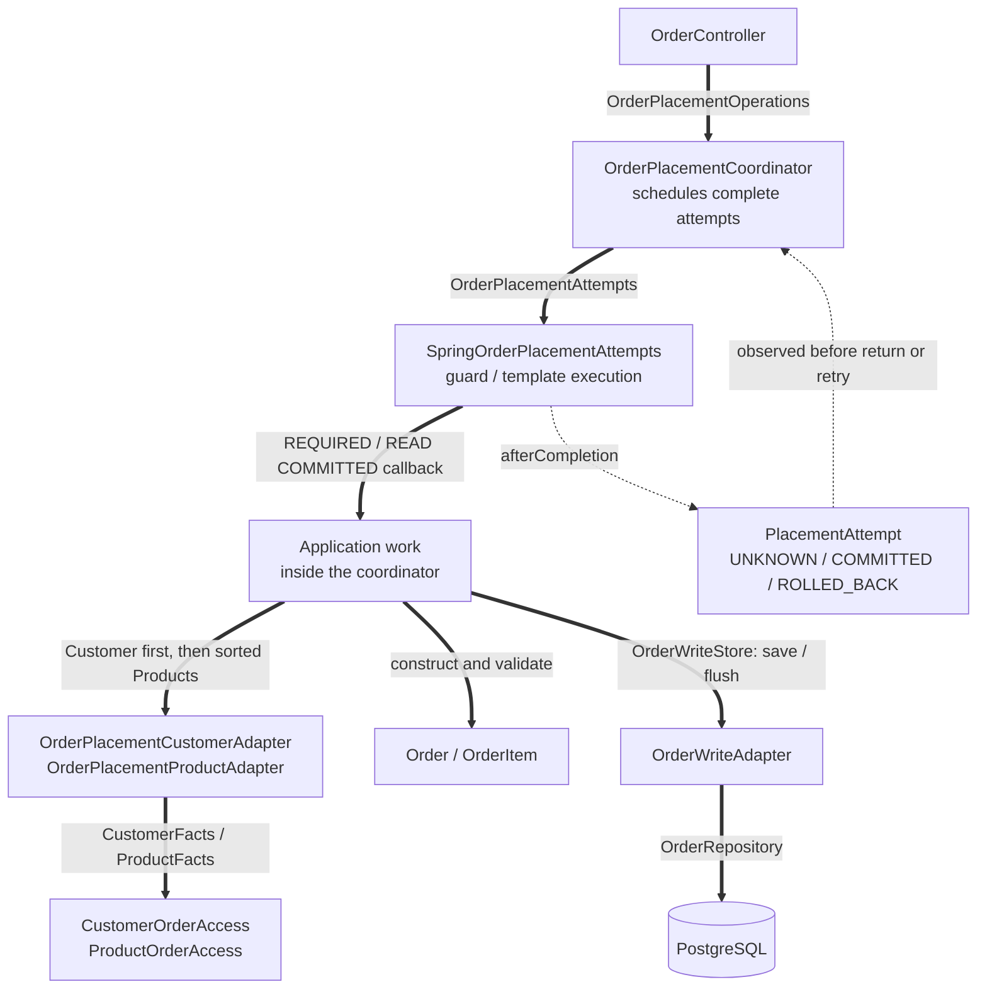

# System Architecture

**Status:** Implemented pragmatic hexagonal architecture; CH-003 migration complete as confirmed by the human on 2026-10-21. ADR-0007 Option B and ADR-0004 remain authoritative. This documentation update awaits human acceptance.

## Authority and Decision Status

The [PRD](../01-requirements/product-requirements.md) owns business rules and REST behavior. ADRs own decisions; this document summarizes boundaries. Accepted does not mean implemented or verified. Proposed subdecisions must not be treated as approved implementation instructions.

| ADR | Subject | Decision status | Verification |
| --- | --- | --- | --- |
| [ADR-0001](../03-decisions/ADR-0001-order-placement-concurrency.md) | Business concurrency policy | Accepted | Implemented business policy; see transaction conventions and CH-003 evidence |
| [ADR-0002](../03-decisions/ADR-0002-transaction-locking.md) | Detailed transaction/locking protocol | Proposed | Scoped implemented transaction behavior does not accept the complete ADR |
| [ADR-0003](../03-decisions/ADR-0003-application-architecture.md) | Application architecture | Accepted baseline | Implemented; ports/adapters refined by ADR-0007 |
| [ADR-0004](../03-decisions/ADR-0004-persistence-mapping.md) | Direct aggregate mapping | Accepted Increment 3 mapping/schema selections | Increment 3 domain/persistence Reviewed – Accepted; Increment 4 version/V2 disposable verification passed; persistent local gate blocked |
| [ADR-0005](../03-decisions/ADR-0005-technology-stack.md) | Java 21 / Spring Boot 4.1.1 and stack | Accepted baseline; scoped foundation choices approved, production details Open | Foundation verified; human review passed, implementation accepted |
| [ADR-0006](../03-decisions/ADR-0006-product-customer-optimistic-locking.md) | Product/Customer optimistic locking | Proposed complete ADR; @Version direction Human Accepted | Exact mapping/schema choices Accepted; V2 SQL reviewed; scoped implementation/runtime verification passed; human accepted 2026-10-15 |
| [ADR-0007](../03-decisions/ADR-0007-hexagonal-architecture-migration.md) | Incremental pragmatic hexagonal architecture, Option B | Accepted — human decision 2026-10-21; ADR-0004 retained | CH-003 migration complete; implemented paths below; dated verification in CH-003 and the quality report |

## Technology Reference

The [technology stack reference](technology-stack.md) inventories selected technologies, version policies, Proposed tooling, and Open compatibility choices. ADR-0005 remains authoritative for selection rationale.

## System Context

REST clients call the application through its documented HTTP/JSON contract. The application boundary contains the feature modules, domain behavior, REST adapters, transaction coordination, and persistence integration. PostgreSQL is the external database. Environment-supplied configuration provides connection settings and infrastructure configuration through the composition root; it does not redefine accepted business rules.

Client identity/type, authentication/authorization policy, exposure/network boundary, configuration delivery/secrets mechanism, and deployment platform remain unresolved. This context neither assumes anonymous production access nor introduces security or deployment features.

Arrows in the context diagram represent runtime calls/data flow, not Java package dependencies.

## Runtime and Responsibilities

One Spring Boot application, one Maven module and one PostgreSQL database. The `product`, `customer` and `order` features contain `api`, `application`, `application.port.in`, `application.port.out`, `domain` and `persistence` packages. Product image adapters also use `product.storage`; Order bridges use `order.integration` and attempt infrastructure uses `order.transaction`. Shared value/validation/error support and Spring `configuration` complete the application. Package names describe adapter roles without requiring an `adapter.in/out` rename.

| Boundary | Responsibility |
| --- | --- |
| REST API | Strict JSON binding, request DTOs, validation, response DTOs, safe HTTP error mapping |
| Application | Use-case orchestration, cross-aggregate checks, transaction ownership, retries, DTO materialization |
| Domain | Aggregate behavior, immutable value objects, quantity/consolidation/pricing invariants |
| Persistence | Spring Data JPA, Hibernate mappings, explicit locking queries, referential and uniqueness constraints |

Directly mapped domain aggregates intentionally depend on JPA metadata. HTTP types remain outside the domain. Pricing methods perform no database access. This is the deliberate ORM metadata coupling accepted under Option B.

## Implemented Ports and Adapters

All class names below are under `com.example.agenticorderservice`. Each row is a runtime route: controller or consumer → input interface → application implementation → output interface → injected adapter. Spring Data repositories remain adapter internals. Grouped diagram nodes summarize related contracts; the table gives the exact pairings.

| Capability / entry point | Input port → implementation | Output port → adapter |
| --- | --- | --- |
| `ProductController` get | `GetProductQuery` → `GetProductService` | `FindProductById` → `ProductReadAdapter` |
| `ProductController` list | `ListProductsQuery` → `ProductApplicationService` | `ProductCatalogReads` → `ProductReadAdapter` |
| `ProductController` create/update/deactivate | `ProductWriteOperations` → `ProductWriteService` | `ProductWriteStore` → `ProductWriteAdapter` |
| `CustomerController` operations | `CustomerOperations` → `CustomerApplicationService` | `CustomerReadStore` → `CustomerReadAdapter`; `CustomerWriteStore` → `CustomerWriteAdapter`; `CustomerOrderReferences` → `CustomerOrderReferenceAdapter` |
| `ProductImageController` images | `ProductImageOperations` → `ProductImageApplicationService` | `ImageProcessing` → `ProductImageProcessor`; `ImageStorage` → `ProductImageStorage`; `ProductImageMetadataStore` → `ProductImageMetadataAdapter`; `ProductImageTransactions` → `SpringProductImageTransactions` |
| `OrderController` get/list | `OrderQueries` → `OrderQueryService` | `OrderReadStore` → `OrderReadAdapter`; `OrderCustomerFacts` → `OrderReadCustomerAdapter` |
| `OrderController` place | `OrderPlacementOperations` → `OrderPlacementCoordinator` | `OrderWriteStore` → `OrderWriteAdapter`; `OrderPlacementAttempts` → `SpringOrderPlacementAttempts`; `OrderPlacementCustomerFacts` → `OrderPlacementCustomerAdapter`; `OrderPlacementProductFacts` → `OrderPlacementProductAdapter` |
| Cross-feature Customer facts | `CustomerFacts` → `CustomerOrderAccess` | `CustomerReadStore` → `CustomerReadAdapter` |
| Cross-feature Product facts | `ProductFacts` → `ProductOrderAccess` | `ProductCatalogReads` → `ProductReadAdapter` |
| Cross-feature Order references | `OrderReferences` → `OrderReferenceQuery` | `OrderReferenceStore` → `OrderReadAdapter` |

The following concrete dependency example uses Product reads/writes; Customer and image paths use the same port/adapter direction shown in the table.

**Compile-time dependencies:** solid arrows mean a class uses the referenced interface/type; dotted arrows mean an implementation depends on the interface it implements. Output interfaces never depend on adapters. Thick arrows denote runtime dispatch or infrastructure access, not a reverse code dependency. Grouped classes implement only their corresponding contracts in the table. `CustomerOrderReferenceAdapter` calls an Order input capability rather than PostgreSQL directly.

**Runtime invocation:** an interface call dispatches to the injected implementation, so actual execution continues from input port to use case and from output port to adapter. Those dispatch steps do not reverse the compile-time dependency. Spring component scanning, constructor injection and the configuration package supply the implementations.

`ProductReadAdapter`/`ProductWriteAdapter` use `ProductRepository`; Customer read/write adapters use `CustomerRepository`; Order read/write adapters use `OrderRepository`; `ProductImageMetadataAdapter` uses `ProductRepository` and `ProductImageRepository`. These Spring Data interfaces and Hibernate perform persistence, while domain methods retain business mutation. Read adapters project immutable facts/snapshots before returning them.

## Package Dependencies and Composition Root

| Package | Permitted dependencies | Boundary |
| --- | --- | --- |
| `api` | Own feature application input ports, immutable application data and API DTO/error-mapping types | Controllers do not call repositories, orchestrate aggregates, or calculate business amounts. |
| `application` | Own domain, application input/output capabilities and shared value objects | No dependency on controllers or API-specific DTOs; return transport-independent materialized results for API mapping. |
| `domain` | Domain types, shared immutable values, and JPA metadata required by accepted direct mapping | No API/application/persistence component dependency or database calls; JPA metadata is the explicit framework-coupling exception. |
| `persistence` | Own output contracts, immutable application data, own domain types and JPA/Hibernate/Spring Data infrastructure; exact provider input for the Customer reference bridge | No API or use-case orchestration dependency; no foreign feature persistence access. |
| `storage`, `integration`, `transaction` | Application output contracts, required provider input capabilities and their own technical infrastructure | Implement processing/storage, feature bridges or transaction execution; never call concrete use-case implementations. |
| `configuration` | Components/infrastructure needed to wire the application | The composition root may depend on these components; feature/domain behavior must not depend on the concrete configuration package. |

Feature-owned public contracts are the narrowly exposed application operations and immutable request/result carriers intended for cross-feature use. Repositories, entity graphs, controller classes, and other implementation helpers remain internal. Public Java visibility needed for Spring/JPA is not permission for another feature to depend on an internal type. Do not add a contracts framework or an interface per class.

The Boot entry point and configuration wiring form the composition root. Constructor injection supplies explicit collaborators. Infrastructure settings are bound and supplied here; domain code does not read environment variables or construct repositories. The base package is `com.example.agenticorderservice`; `OrderTransactionConfiguration` supplies the qualified placement template. No separate container or runtime service locator is introduced.

## Module Access

Order placement coordinates narrow provider-owned Customer/Product access operations for locked lookup and immutable placement data. Customer deletion uses a narrow Order-reference query. These are narrow capability contracts under ADR-0007; retain the supported provider implementations and their transaction participation. Never expose another feature's managed entities or broad CRUD services as the integration contract.

Cross-feature workflows share the outer application's transaction. Helper operations must participate rather than independently commit. Dependencies in both directions are limited to narrow contracts; they do not permit recursive application-service calls or circular constructor dependencies. Order placement uses a Customer lookup component independent of customer-deletion orchestration. Customer deletion uses an Order-reference query component independent of order-placement orchestration. The implemented bridges are listed below. Modules are code organization, not independently deployable services.

### Cross-feature capability paths

- Placement: `OrderPlacementCustomerFacts` → `OrderPlacementCustomerAdapter` → `CustomerFacts` → `CustomerOrderAccess`; `OrderPlacementProductFacts` → `OrderPlacementProductAdapter` → `ProductFacts` → `ProductOrderAccess`.
- Order reads: `OrderCustomerFacts` → `OrderReadCustomerAdapter` → `CustomerFacts.current`, including distinct-ID batch enrichment with current Customer details. `OrderReadAdapter` copies historical item names, prices and totals without current Product lookup.
- Customer deletion: `CustomerOrderReferences` → `CustomerOrderReferenceAdapter` → `OrderReferences` → `OrderReferenceQuery` → `OrderReferenceStore` → `OrderReadAdapter`. The reference statement runs after the Customer lock in the same READ COMMITTED transaction.

Provider implementations `CustomerOrderAccess`, `ProductOrderAccess` and `OrderReferenceQuery` use MANDATORY participation; they do not start independent commits. Opposite feature capability directions are approved; constructor wiring remains acyclic.

## Use-Case Ownership

| Use case | Application owner | Coordination and persistence ownership |
| --- | --- | --- |
| Order placement | Order application operation; retry coordinator outside attempts | Customer/Product provider-owned locked access participates in the Order-owned attempt transaction. Order domain owns consolidation/pricing/snapshots; Order persistence saves the whole aggregate. |
| Customer deletion | Customer application operation | Customer application/domain owns the mutation; Customer persistence executes storage; narrow Order-owned reference query participates in the same transaction. Current implementation deletes if unreferenced, otherwise rejects without mutation. The [approved 2026-10-18 target](../01-requirements/product-requirements.md#customer-delete--approved-target-contract-2026-10-18) rejects referenced DELETE with 409 and no state changes; Phase 2 human acceptance is pending; see the [review evidence](../04-agentic-coding/change-requests/CH-001-customer-delete-semantics/03-review.md). Complete ADR-0002 remains Proposed. |
| Product/customer mutations | Respective feature application operation | Respective feature owns its domain mutation and repository access. Compatible detailed locking paths follow Proposed ADR-0002. |
| Order retrieval | Order application read operation | Order persistence supplies original order/item facts; narrow Customer-owned read access supplies current details. Fully materialize the result within the read transaction; no entity/lazy state escapes. |

Complete transport-independent order results are materialized inside transactions. API adapters map those results to response DTOs without additional database access; alternatively the response DTO can itself be a transport-neutral immutable carrier. This preserves the materialization convention without introducing an application-to-API dependency.

## Domain and Transaction Rules

The [domain model](domain-model.md) defines aggregate ownership. Historical names/prices/amounts remain original; customer details remain current. [Transaction conventions](transaction-locking.md) require ambient-transaction rejection, disabled OSIV, fresh attempt state, complete DTO materialization, and commit observation. Full ADR-0002 remains Proposed; implemented and tested scoped behavior is documented here and in the transaction conventions without accepting its unresolved details.

### Order placement and transaction attempts

This second diagram shows **runtime calls and completion observation**, not compile-time dependencies. Edge labels name invoked ports; the implementations are verified in the class-path table. Thick arrows denote invocation, and dotted arrows denote completion observation. The application has no dependency on the concrete adapter classes shown in this runtime view. The callback executes Customer locking, then canonically ordered Product locking, aggregate construction, save/flush and immutable result materialization inside one attempt. Provider adapters ultimately use their own repositories through the preceding table's ports.

`OrderPlacementCoordinator` owns attempt scheduling outside transactions. `OrderPlacementAttempts.checkUnbound()` rejects ambient transactions/bound resources; `SpringOrderPlacementAttempts` uses the qualified template from `OrderTransactionConfiguration`. It registers completion observation before `SET LOCAL lock_timeout = '2s'` and then invokes the application callback. Normal return occurs after transaction completion and resource cleanup, before `ORDER_COMMITTED` logging or HTTP success. `flush()` surfaces database failures inside the attempt and is never a commit claim.

`PlacementAttempt` starts UNKNOWN, records the exact lock-call failure identity and distinguishes COMMITTED from confirmed ROLLED_BACK. An exception alone never establishes rollback. The coordinator retries only after confirmed rollback, an unbound-resource check and eligibility classification through the transaction adapter's existing `OrderRetryPolicy`. It preserves at most three attempts, the ten-second scheduling budget, 25/50 ms backoff outside attempts and fresh provider reads. Unknown or other non-rollback exceptional outcomes are never replayed. See [transaction conventions](transaction-locking.md) for the retained classification and locking contract.

### Accepted exceptions and compatibility

[ADR-0007 Option B](../03-decisions/ADR-0007-hexagonal-architecture-migration.md) keeps [ADR-0004](../03-decisions/ADR-0004-persistence-mapping.md): Customer, Product, Order and OrderItem retain approved JPA metadata, UUID identity, hydration constructors, converters, association ownership and version behavior. Domain code performs no repository/SQL/HTTP calls; the domain is deliberately not framework-free.

Only these same-feature persistence output ports may carry managed aggregates inside application-owned transactions: `ProductWriteStore` (`save`, locked lookup), `CustomerWriteStore` (`save`, locked lookup, `delete`) and `OrderWriteStore` (`save`, with a separate `flush`). Input, read and cross-feature contracts remain entity-free. This is an exact signature exception, not a general repository abstraction or permission to move business orchestration into adapters.

`ProductApplicationService` remains the list implementation and a supported get/write compatibility delegate. `CustomerOrderAccess`, `ProductOrderAccess` and `OrderReferenceQuery` remain independent capability providers. Existing static price/email validators and Customer after-commit observation are narrow documented exceptions enforced by architecture tests. Application Spring transaction annotations remain intentional; migration did not introduce transaction decorators everywhere.

### Verification and current status

[Architecture tests](../05-testing/hexagonal-architecture-tests.md) enforce populated feature slices, application isolation, controller input calls, adapter contracts, provider bridges, recursive port signatures, exact managed-write/JPA exceptions and constructor cycles. Behavior tests, PostgreSQL concurrency/adapter tests and runtime OpenAPI checks cover semantics ArchUnit cannot prove. [Local verification](../05-testing/engineering-verification.md) distinguishes fast checks, complete non-PIT verification, full PIT and separately controlled Cloud analysis.

The human confirmed migration completion and a latest passing Cloud Quality Gate with no findings on 2026-10-21; [quality status](../05-testing/quality-report.md#current-architecture-and-quality-status--2026-10-21) records this as human-reported, without inventing an analysis ID or fresh test run. Historical PIT debt and unverified hook delivery are not resolved by a green Cloud gate. Earlier increment descriptions below are historical scope, not current migration blockers or new authorization.

## Scope and Remaining Decisions

No microservices, event sourcing, CQRS infrastructure, generic repository hierarchy, or idempotency-key feature is approved. D1–D10 identity/converter/storage/name/email/schema and local/test migration selections are Accepted under ADR-0004/0005; Increment 3 was explicitly authorized, concrete SQL reviewed and scoped domain/persistence verification passed; Increment 3 is Reviewed – Accepted following explicit human acceptance. See the [execution record](../04-agentic-coding/prompts/04-domain-model.md#implementation-results--executed-pending-human-review). Pagination-specific design, production execution/privileges and unresolved concurrency subdecisions remain deferred/Open in [open items](../00-overview/open-items.md). Follow the [implementation plan](../07-implementation/implementation-plan.md) for approval gates.

## Approved PostgreSQL Foundation Increment

Historical foundation scope; later accepted increments supersede its implementation inventory.

Increment 2 wires Boot-managed JPA/JDBC/Flyway to PostgreSQL 17.11 (`postgres:17.11-bookworm`). Local development uses explicit Compose lifecycle, localhost-bound configurable ports, environment credentials, and a named persistent volume. Integration tests use a separate Spring-managed Testcontainers database with random ports and independent credentials; they never reuse the Compose database.

OSIV is disabled, Hibernate uses `validate`, and SQL initialization is disabled. Flyway is disabled by default and enabled only in local/integration-test profiles; the historical Increment 2 scope approved metadata initialization only. No entities, repositories, application migrations, transaction coordinator, retries, or locks exist in this increment. Deployment/security and detailed concurrency questions remain Open; ADR-0002 remains Proposed. The subsequent Increment 3 was explicitly authorized, implemented and human accepted with four domain tables/mappings and verified local/test V1 policy. That later evidence supersedes the foundation-only state; Increment 4 is now Reviewed – Accepted; see [final Increment 4 acceptance](../04-agentic-coding/prompts/05-product-customer-api.md#final-human-acceptance--2026-10-15). See [the execution record](../04-agentic-coding/prompts/03-postgresql-foundation.md).

## Increment 4 Architecture Decision Update

Historical Increment 4 scope; current Customer deletion behavior is described under Use-Case Ownership above.

Human Accepted on 2026-10-14: Product/Customer application write methods @Transactional/read methods readOnly=true, immutable results materialized within transaction, success and API error translation after transaction completion; Product/Customer @Version and confirmed CONCURRENT_MODIFICATION/409 without automatic retries. [ADR-0006](../03-decisions/ADR-0006-product-customer-optimistic-locking.md) records the direction while remaining Proposed for complete-record approval; exact mapping/schema choices and V2 SQL are reviewed, scoped implementation/runtime verification passed; human accepted 2026-10-15. No response version field or ETag/If-Match selected; optimistic versions do not replace the later Order locking/deletion protocol. ADR-0002 and Accepted D1–D10 are unchanged.

Exactly ten intended Product/Customer POST/GET list/GET ID/PUT/PATCH operations; Customer DELETE remains deferred MVP work with Accepted interim OPERATION_NOT_AVAILABLE/405. Strict types/price lexical rules/canonical UUIDs/single-error precedence and safe technical statuses are in [REST design](rest-api-design.md#10-human-accepted-increment-4-api-and-transaction-decisions) and [API catalog](api-error-codes.md). Follow the [current plan](../07-implementation/implementation-plan.md#increment-4--product--customer-application-services-and-rest-api); implementation/V2 disposable verification is Reviewed – Accepted; persistent local migration remains separately blocked. See [final Increment 4 acceptance](../04-agentic-coding/prompts/05-product-customer-api.md#final-human-acceptance--2026-10-15).

## Product Image Storage and Lifecycle — CH-002

The human-approved CH-002 increment adds Product-owned filesystem content and a dedicated PostgreSQL metadata association, without new dependencies, remote storage or an administration UI. Java ImageIO validates JPEG/PNG and generates the thumbnail. See the [business limits](../01-requirements/product-requirements.md#product-images--ch-002) and [metadata model](domain-model.md#product-image-metadata--ch-002). Complete ADR statuses above remain unchanged.

`app.product-images.storage-directory` selects the root (default `./var/product-images`, Git-ignored). Application-generated UUID directory names and fixed variant filenames replace caller filenames; only relative managed keys are persisted. Path containment and symbolic-link rejection protect managed filesystem access. The storage directory must be trusted and unavailable to untrusted writers.

A replacement stages both variants in a fresh immutable generation before the metadata transaction. The Product application operation locks the product row and swaps the association in one database transaction. Reads lock the same product while resolving/reading content. Only confirmed transaction completion permits success. Replacement/deletion retires prior files after confirmed commit; failures retain files for later recovery. Any database transaction failure conservatively retains staged generations, including confirmed rollback; unknown commit outcomes never trigger blind write replay. PostgreSQL and filesystem writes are not a distributed atomic transaction: crash/interrupted cleanup can leave unreferenced generations, never evidence of successful cleanup.

The explicit application reconciliation operation `reconcileOrphans(true)` is for a quiescent maintenance window with all image readers and writers across every instance stopped. It compares live database references with managed generations and removes unreferenced content. There is no public cleanup endpoint or automatic startup sweep. Reconciliation must not run concurrently with staged writes.

Deployment requires persistent filesystem storage with consistent access for the application and backups. Local container files are neither durable nor shared by assumption. This increment supports a controlled deployment with one writer and a coherent storage root; arbitrary multi-instance/shared-filesystem correctness is not established. Quiesce writers for a consistent database-plus-filesystem backup/restore pair.

The service has no built-in authentication. `app.product-images.writes-enabled=false` is the default; the human approved explicit trusted-deployment opt-in and isolated demo enablement. Production access control must be supplied externally before opt-in. Public read policy is unchanged. This setting is a capability switch, not user authentication. Verification and Human Acceptance remain in the [CH-002 review](../04-agentic-coding/change-requests/CH-002-product-images/03-review.md).

## Accepted Option B — incremental hexagonal migration

CH-003 is complete under accepted Option B; ADR-0004 remains valid. Use the [implemented paths](#implemented-ports-and-adapters) above. The [migration guide](hexagonal-migration.md) preserves the increment sequence and historical authorization boundaries.

## CH-003 Product migration — Increment 2 historical scope

Historical scope: Product get/write extraction, with the exact ProductWriteStore exception. Product list and facts were subsequently consolidated in Increment 7. Current contracts and compatibility delegates are listed above.

## CH-003 Customer migration — Increment 3 historical scope

Historical scope: Customer operations/facts and aggregate-write exception. The transitional concrete Order provider dependency was subsequently replaced by OrderReferences. Current bridges use input capabilities, not concrete providers.

## Product image hexagonal boundaries — CH-003 Increment 4

ProductImageApplicationService orchestrates the four image output capabilities in the class-path table. Processing/staging precedes the metadata transaction; Product locking precedes metadata and byte reads. SpringProductImageTransactions returns after completion. Old generations retire only after successful commit; candidates remain after any transaction failure. The [CH-002 lifecycle](#product-image-storage-and-lifecycle--ch-002), write opt-in and quiescent reconciliation remain unchanged.

## Order reads through ports — CH-003 Increment 5

OrderQueryService implements OrderQueries with read-only REQUIRED transactions. OrderReadAdapter projects stored OrderReadSnapshot values through unchanged get/list fetch joins; OrderReadCustomerAdapter obtains current Customer facts in the same transaction. Results are materialized before HTTP serialization, with OSIV disabled and no recalculation of historical prices or totals.

## Order placement through ports — CH-003 Increment 6

The [placement diagram and completion semantics](#order-placement-and-transaction-attempts) above describe the final implementation. The approved attempt and managed-Order contracts are recorded in ADR-0007; the migration preserved transaction, retry, locking, error and logging behavior.

## CH-003 consolidation — Increment 7

Historical consolidation completed Product list/locked facts and Order references, retained supported delegates/providers and activated whole-production boundary enforcement. The [CH-003 records](../04-agentic-coding/change-requests/CH-003-hexagonal-architecture-migration/README.md) retain increment evidence and the final mutation assessment; the [quality report](../05-testing/quality-report.md#current-architecture-and-quality-status--2026-10-21) supplies the later human-reported Cloud status. Earlier Pending/BLOCKED entries retain their execution-time meaning.
