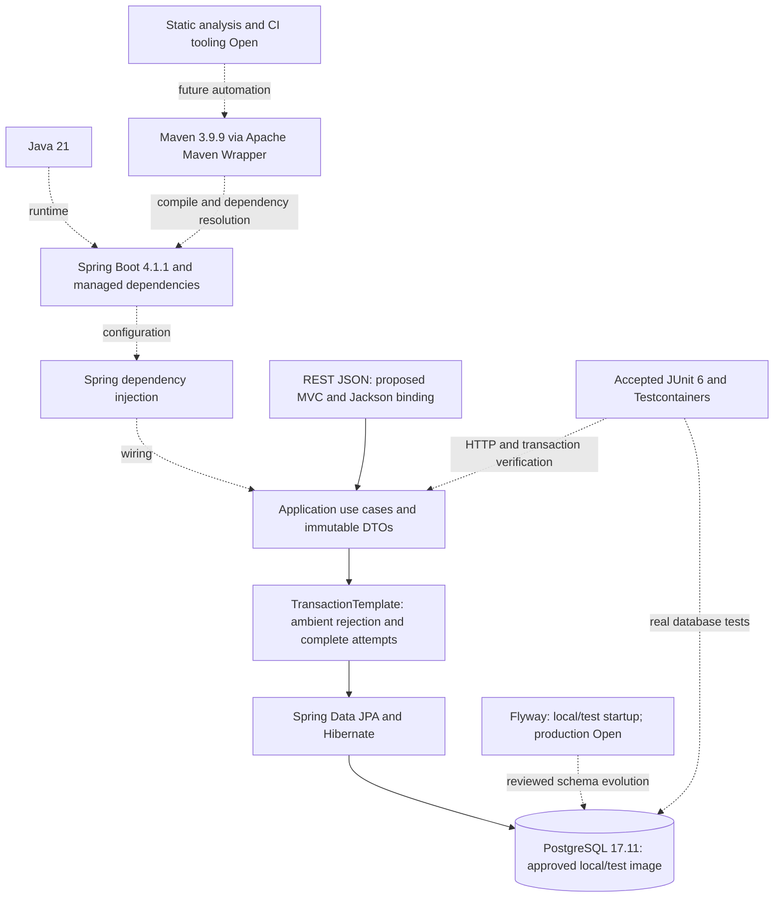

# Technology Stack Reference

**Status:** Authoritative inventory of Accepted, Proposed, and Open selections
**Last reviewed:** 2026-10-17
**Implementation verification:** Increment 1 accepted; Increment 2 foundation verified, human review passed, implementation accepted; Increment 3 domain/persistence Reviewed – Accepted; Increment 4 application/optimistic verification Reviewed – Accepted; full Order concurrency Pending

## Purpose and Authority

This reference describes technology roles, version policies, and compatibility checks. [ADR-0005](../03-decisions/ADR-0005-technology-stack.md) owns architectural rationale, alternatives, consequences, and selection history; those are not repeated here. The [system architecture](system-architecture.md) defines responsibilities, and the [testing strategy](../05-testing/testing-strategy.md) defines quality gates.

**Accepted** means explicitly selected, not implemented or verified. **Proposed** means a documented suggestion awaiting acceptance. **Open** means no tool/version/operational choice has been selected. A technology can be Accepted while its exact version or execution configuration remains Open. Nothing here approves new dependencies, code, or an ADR status change.

## 1. Programming Language

| Technology | Version / management policy | Purpose | Decision status |
| --- | --- | --- | --- |
| Java | **21**; JDK distribution and patch release not selected | Application language/runtime; immutable DTOs and value objects where appropriate | **Accepted** Java 21; distribution/patch Open |

## 2. Spring Boot and Spring Framework

| Technology | Version / management policy | Purpose | Decision status |
| --- | --- | --- | --- |
| Spring Boot | **4.1.1** | Application bootstrap, configuration and compatible dependency management | **Accepted** |
| Spring Framework | Version aligned with Boot 4.1.1 dependency management; no independent override selected | Application container, web and transaction infrastructure | **Accepted** as part of Boot baseline |

## 3. REST API

| Technology | Version / management policy | Purpose | Decision status |
| --- | --- | --- | --- |
| REST over HTTP with JSON | PRD contract; no extra versioned API prefix selected | Product/customer management and order creation/retrieval | **Accepted** contract |
| Spring MVC | Boot-managed Spring version | Imperative controllers and HTTP binding in the existing REST design | **Proposed** implementation approach |
| Jackson | Boot-aligned stack with the [approved security override](#approved-security-version-overrides--2026-10-14); concrete REST configuration remains Open | Strict JSON parsing, DTO binding, and serialization | **Proposed** REST design; configuration Open |
| Jakarta Bean Validation / provider | Boot-managed compatible validation stack | Required fields and approved limits, supplemented by domain/cross-item checks | **Proposed** REST design; annotations/provider configuration Open |

Unknown nested properties and caller prices must be rejected. Selecting a parser does not prove correct coercion behavior. See [REST API design](rest-api-design.md) for binding requirements rather than treating default settings as evidence.

## 4. Dependency Injection

| Technology | Version / management policy | Purpose | Decision status |
| --- | --- | --- | --- |
| Spring dependency injection with constructor injection | Boot-managed Spring Framework | Wire use cases, narrow feature access components, repositories, and configuration | **Accepted** engineering convention |

No separate DI framework is selected.

## 5. Persistence and ORM

| Technology | Version / management policy | Purpose | Decision status |
| --- | --- | --- | --- |
| Spring Data JPA | Boot 4.1.1-compatible managed version | Repository queries and explicitly verified locked access | **Accepted** |
| Hibernate ORM / Jakarta Persistence | Boot-compatible managed provider/API versions; verify resolved dependency graph | Direct aggregate mapping, persistence context and SQL execution | **Accepted** baseline |
| JPA AttributeConverters for Money/EmailAddress | Boot-managed JPA provider; persistence-package AttributeConverters with autoApply=true | Map immutable values to reviewed database representations | **Accepted** under ADR-0004; scoped discovery/hydration tests passed; implementation Reviewed – Accepted |

[ADR-0004](../03-decisions/ADR-0004-persistence-mapping.md) accepts UUID identity, field-access mappings, autoApply converters, unconstrained NUMERIC with reviewed checks and D1–D9 schema/fetch/equality selections. Concrete SQL review and scoped provider/database verification passed in Increment 3; list/pagination details are deferred. Open EntityManager in View is disabled; managed entities are never REST response objects. Complete response data must be materialized inside application transactions.

## 6. Database

| Technology | Version / management policy | Purpose | Decision status |
| --- | --- | --- | --- |
| PostgreSQL | **17.11**; official `postgres:17.11-bookworm` for local development and integration tests; production deployment details Open | Durable orders/catalog/customer data, constraints and row locking | **Accepted** database, version, and development/test image |
| PostgreSQL JDBC driver | [Approved security override](#approved-security-version-overrides--2026-10-14); verify server/provider compatibility | JDBC access beneath Hibernate and transaction management | **Accepted** integration and security override; updated driver integration-tested |

## 7. Database Migrations

| Technology | Version / management policy | Purpose | Decision status |
| --- | --- | --- | --- |
| Flyway with PostgreSQL support | Boot-compatible managed artifacts; exact module coordinates verified before POM approval | Git-versioned schema evolution | **Accepted** tool and local/test startup; production execution Open |

Increment 2 approved local/test metadata only. D10 now accepts V1 domain migration in local/test environments, immutable applied versions, validation, no automatic baseline/repair/clean and Hibernate validate. Increment 3 subsequently implemented and verified V1 in isolated PostgreSQL tests and is Reviewed – Accepted; its prompt preserves the earlier pre-execution/metadata-only history. This does not authorize the proposed Increment 4 V2 or production execution. Default/production execution stays disabled; production execution/privileges remain Open.

## 8. Transaction Management

| Technology | Version / management policy | Purpose | Decision status |
| --- | --- | --- | --- |
| Spring TransactionTemplate and JPA transaction management | Boot-managed Spring/provider versions | Application-owned complete attempts and commit/rollback observation | **Accepted** baseline |
| PostgreSQL READ COMMITTED and deterministic pessimistic row locks | Selected PostgreSQL/provider behavior must be tested | Protect eligibility, consistent snapshots, and deletion races | **Accepted** baseline; full ADR-0002 protocol **Proposed** and unverified |
| Custom bounded retry coordination | No extra retry library selected; detailed policy in ADR-0002 | Retry only complete attempts known not to have committed | **Proposed** detailed policy; timeouts/delays/classification Open |

Reject ambient transactions before coordination; use fresh transaction-scoped state per attempt. No automatic replay after uncertain commit. Consult [transaction conventions](transaction-locking.md); this inventory does not promote [ADR-0002](../03-decisions/ADR-0002-transaction-locking.md).

## 9. Build and Dependency Management

| Technology | Version / management policy | Purpose | Decision status |
| --- | --- | --- | --- |
| Maven, single module | **3.9.9**, pinned by the official Apache Maven Wrapper (wrapper scripts 3.3.4) | Compile/package and execute approved quality gates consistently across developer environments | **Accepted** build tool, structure, and wrapper-managed Maven version |
| Spring Boot dependency management | **4.1.1** parent/BOM alignment with the explicitly approved security overrides below | Keep compatible Spring and supported library versions aligned | **Accepted** version policy |
| Maven Surefire / Failsafe | Boot-managed versions (3.5.6) | Docker-free smoke/unit tests via Surefire; PostgreSQL `*IT` via Failsafe during `verify` | **Accepted** execution convention for Increment 2 |

## 10. Unit Testing

| Technology | Version / management policy | Purpose | Decision status |
| --- | --- | --- | --- |
| JUnit 6 / Jupiter and Platform | Use versions managed by Boot **4.1.1**; 6.0.3 in ADR-0005's recorded inspection, with no override to retain JUnit 5 | Domain and application unit tests | **Accepted** |

Keep test API, engine, and Platform versions aligned through Boot 4.1.1 dependency management. The user explicitly replaced JUnit 5 with JUnit 6; [ADR-0005](../03-decisions/ADR-0005-technology-stack.md) preserves that history. Boot-managed JUnit build/runtime verification passed in Increment 1 and the foundation tests; Increment 3 domain tests passed; Increment 3 is Reviewed – Accepted.

## 11. Integration Testing

| Technology | Version / management policy | Purpose | Decision status |
| --- | --- | --- | --- |
| Testcontainers with PostgreSQL | Boot-managed modules; `postgres:17.11-bookworm`, isolated random-port database | Disposable real database for mappings, migrations and deterministic concurrency tests | **Accepted** test infrastructure; concrete setup and scoped domain persistence tests verified |
| Spring Boot test infrastructure | Boot **4.1.1**, with its managed JUnit 6 stack | Application-context and transaction-boundary integration tests | **Accepted** framework baseline; foundation configuration approved; domain/persistence tests passed, transaction coordination tests Pending |

Container execution needs a compatible container runtime; no host/container-runtime product is selected here. H2 and mock-only tests cannot verify PostgreSQL locking semantics.

## 12. HTTP/API Testing

| Technology | Version / management policy | Purpose | Decision status |
| --- | --- | --- | --- |
| Spring MVC Test / MockMvc | Existing Boot-managed spring-test (7.0.9 source inspection) | Actual binding/controller/error tests via MockMvcBuilders.webAppContextSetup | **Accepted** minimal Increment 4 approach; no new test dependency; runtime verification passed; Increment 4 Reviewed – Accepted |
| Real HTTP client against a running test application | Client/library choice and version Open | Verify full transport behavior where required, including connection-loss cases | **Open** concrete tool |

Required API outcomes are already Accepted in the PRD. These client suggestions do not create additional dependencies or substitute mocked controller calls for binding tests.

## 13. Code Quality and Static Analysis

| Technology / check | Version / management policy | Purpose | Decision status |
| --- | --- | --- | --- |
| Java compiler, automated checks, Git diff and human review | Java **21**; repository workflow | Required verification and acceptance gates | **Accepted** engineering process |
| Static analyzer / formatter / lint tooling | No tool/version selected; Checkstyle or SpotBugs are examples to evaluate, not selections | Optional future enforcement of style or defect checks | **Open** tooling |

Do not add analysis plugins or arbitrary coverage thresholds without scoped approval. Follow [coding guidelines](../04-agentic-coding/coding-guidelines.md) and report unavailable future gates as Pending.

## 14. CI/CD

| Technology | Version / management policy | Purpose | Decision status |
| --- | --- | --- | --- |
| CI platform / pipeline runner | Provider, images and pipeline configuration Open | Future automated build/document/test gates | **Open** |
| Deployment platform / release tooling | Hosting, packaging and rollout details Open | Future application deployment and reviewed migration execution | **Open** |

No CI/CD platform or deployment mechanism is approved by this reference. Manual verification obligations still apply before an implementation increment can be accepted.

## Technology Interaction Diagram

Solid arrows show intended runtime/data flow; dotted arrows show supporting wiring, build, or testing relationships. Labels identify pending implementation tooling; the diagram does not approve those tools.



## Version Management and Compatibility Verification

1. Keep Java 21 and Spring Boot 4.1.1 fixed unless an explicitly approved ADR change records a concrete reason. Do not reopen them as ordinary setup questions.
2. Use Boot 4.1.1 dependency management for compatible Spring-managed and supported libraries. Avoid separately pinning Spring Framework, Spring Data, Hibernate, or Jackson without a reviewed reason. Dependencies and plugin versions not managed by Boot need an explicit compatible selection.
3. Before build approval, verify Boot 4 artifact/starter coordinates, resolved transitive versions, Java compatibility, test API/engine alignment, and driver/Flyway/PostgreSQL support. The earlier Boot 3.5 skeleton is not an approved dependency list.
4. Use the Accepted JUnit 6 baseline and Boot 4.1.1-managed Jupiter/Platform versions under ADR-0005. Verify the resolved graph; do not add JUnit 5-retention overrides.
5. Pin the selected database image and match integration tests to deployment major version. Inspect actual Hibernate locking SQL and transaction behavior with deterministic PostgreSQL tests.
6. Record dependency-tree/build evidence and relevant runtime tests; verify strict unknown-field/numeric parsing, context startup, mappings/migrations, and DTO serialization with OSIV disabled. Foundation dependency resolution/context startup/OSIV evidence is in Increment 2; scoped mappings/migrations passed in the [Increment 3 execution record](../04-agentic-coding/prompts/04-domain-model.md#implementation-results--executed-pending-human-review); Increment 4 HTTP binding/application/optimistic checks passed and are human accepted; full Order concurrency remains **Pending**. See [final Increment 4 acceptance](../04-agentic-coding/prompts/05-product-customer-api.md#final-human-acceptance--2026-10-15).
7. Keep decisions in ADRs, version roles in this inventory, and unresolved execution details in [open items](../00-overview/open-items.md). Avoid maintaining duplicate version lists with competing authority.

For recorded upstream compatibility observations and links, consult [ADR-0005](../03-decisions/ADR-0005-technology-stack.md). This reference changes no business rules, ADR statuses, or tool approvals.

### Approved Security Version Overrides — 2026-10-14

The user authorized targeted POM updates for the dependency vulnerabilities reported by SonarQube. The executable version declarations are in root [pom.xml](../../pom.xml). These selections are exceptions to the default Boot-managed versions, not an upgrade of Spring Boot or the PostgreSQL server. [ADR-0005](../03-decisions/ADR-0005-technology-stack.md#security-dependency-overrides--2026-10-14) records the rationale, consequences and approval history.

| Component | Previously resolved | Current selected/resolved version | POM property | Decision status |
| --- | --- | --- | --- | --- |
| PostgreSQL JDBC driver | 42.7.13 | **42.7.14** | postgresql.version | **Accepted** security override |
| Embedded Tomcat modules | 11.0.24 | **11.0.26** | tomcat.version | **Accepted** security override |
| Jackson 3 BOM, Core and Databind | 3.1.5 | **3.1.7** | jackson-bom.version | **Accepted** security override |
| Logback Core and Classic | 1.5.38 | **1.6.5** | logback.version | **Accepted** security override |

Java 21, Boot 4.1.1, Maven Wrapper 3.9.9, Boot-managed JUnit Jupiter/Platform 6.0.3, Hibernate 7.4.5.Final, Flyway 12.4.0 and Testcontainers 2.0.5 are unchanged. PostgreSQL **17.11** and postgres:17.11-bookworm remain selected for local/test databases; the JDBC driver version is independent of the server image. The Jackson property aligns the Jackson 3 modules through their BOM; the Logback property aligns Core/Classic and the Tomcat property aligns the embedded modules. No individual JUnit override or new dependency declaration was introduced.

Actual verification on 2026-10-14: Maven dependency-tree inspection confirmed these versions and module alignment. With command-local Java 21, the existing Maven verify suite passed **120 fast and 21 PostgreSQL integration tests**, zero failures/errors/skips, including context startup, Flyway/Hibernate validation and persistence round trips. These results cover implemented compatibility gates; they do not establish future HTTP or concurrency behavior. SonarQube reanalysis is still required to confirm clearance of the reported vulnerabilities.

```sh
env JAVA_HOME=/Library/Java/JavaVirtualMachines/jdk-21.jdk/Contents/Home ./mvnw -B -ntp dependency:tree
env JAVA_HOME=/Library/Java/JavaVirtualMachines/jdk-21.jdk/Contents/Home ./mvnw -B -ntp verify
```

Earlier prompt-playbook version tables record what was actually used during those executions and remain unchanged. Use this section and the current POM for the latest dependency versions. Reassess the overrides when a separately approved Boot update manages suitable fixed versions; do not silently change the accepted Boot baseline or discard the recorded security rationale.

### Authorized Jackson 2 Security Remediation — 2026-10-17

**Status:** Jackson remediation executed and remotely verified; pending human review. JAXB remains unresolved. This separately authorized remediation preserves the Accepted Java 21 / Spring Boot 4.1.1 baseline and all earlier security overrides.

The OpenAPI integration brings Jackson 2 through `springdoc-openapi-starter-webmvc-ui:3.1.1` → `swagger-core-jakarta:2.2.55`. Boot manages that family independently through `jackson-2-bom.version`; the existing `jackson-bom.version=3.1.7` applies to `tools.jackson` (Jackson 3) and does not patch `com.fasterxml.jackson` Core/Databind.

Root [pom.xml](../../pom.xml) now sets `jackson-2-bom.version=2.21.7`. Effective dependency-graph comparison confirms that only Jackson 2 Core, Databind, YAML and JSR-310 move from **2.21.5 to 2.21.7**. Shared Jackson annotations remain **2.21**, as selected by the BOM; Jackson 3 Core/Databind remain **3.1.7**. No artifacts are added or removed, and other selected versions remain unchanged. The [2.21.6](https://github.com/FasterXML/jackson/wiki/Jackson-Release-2.21.6) and [2.21.7](https://github.com/FasterXML/jackson/wiki/Jackson-Release-2.21.7) release notes identify the seven reported Jackson fixes. This is a patch update within Boot's selected 2.21 line, not a new JSON implementation or framework upgrade.

**Unresolved JAXB risk:** Hibernate 7.4.5.Final brings `jaxb-runtime` → `jaxb-core`, both **4.0.9**. CVE-2026-92877 concerns XML external-entity hardening. On 2026-10-17, Maven Central metadata for [Core](https://repo.maven.apache.org/maven2/org/glassfish/jaxb/jaxb-core/maven-metadata.xml) and [Runtime](https://repo.maven.apache.org/maven2/org/glassfish/jaxb/jaxb-runtime/maven-metadata.xml) lists 4.0.9 as the latest stable release. The [upstream hardening fix](https://github.com/eclipse-ee4j/jaxb-ri/pull/2013) is merged, but the [release-tracking issue](https://github.com/eclipse-ee4j/jaxb-ri/issues/2031) remains open; no published compatible fixed release was verified. JAXB Core/Runtime/TXW2 therefore remain aligned at 4.0.9. No snapshot, exclusion, replacement implementation, risk acceptance or security-disabling workaround is introduced. Reassess an aligned update when a compatible fixed release is published; the finding remains open.

See the [separate verification record](../05-testing/quality-report.md#dependency-security-remediation--2026-10-17) for exact advisories, tests and fresh scanner results. Local replacement of vulnerable versions is distinct from remote confirmation and does not imply that all dependency risks or the `main` quality gate are resolved. No ADR status is changed.

### Approved Maven Wrapper Enhancement

The user explicitly approved Maven **3.9.9** via the official Apache Maven Wrapper as a post-review enhancement to Increment 1. The generated `only-script` wrapper uses scripts from wrapper release 3.3.4 and downloads Maven from `https://repo.maven.apache.org/maven2/org/apache/maven/apache-maven/3.9.9/apache-maven-3.9.9-bin.zip`. No wrapper JAR is committed. Java 21 is supplied through a command-local JAVA_HOME; no system configuration is changed. See the [bootstrap execution record](../04-agentic-coding/prompts/02-technical-bootstrap.md#post-review-enhancement--maven-wrapper) for successful version/build/test/dependency evidence and recorded human acceptance of this enhancement. This resolves the previously Open Maven/wrapper selection for this increment; ADR-0005's original decision history is preserved. Other Open technology and operational decisions remain unchanged.

### PostgreSQL Foundation Scope

[ADR-0005](../03-decisions/ADR-0005-technology-stack.md#increment-2-approval-and-history) records the scoped approval. [Increment 2](../04-agentic-coding/prompts/03-postgresql-foundation.md) records actual resolved versions and verification separately. Empty-schema JPA startup does not verify domain mappings, and no transaction coordinator or locking protocol is implemented.

### PostgreSQL Configuration Source and Local Credentials

The single executable image source is root [config/postgres.properties](../../config/postgres.properties), property `POSTGRES_IMAGE`. Compose uses `${POSTGRES_IMAGE:?Load config/postgres.properties}` without a fallback; Testcontainers reads the same file through standard Java `Properties` and a UTF-8 reader. Tests do not parse Compose YAML, load `.env`, or require Compose services to be running. The configuration file must be available relative to the Maven project working directory. Missing/unreadable properties files, malformed properties syntax, or missing/empty/invalid image values fail with a configuration exception; no default image is selected. The approved PostgreSQL image/version remains unchanged.

Use both environment files for local commands:

```sh
docker compose --env-file .env --env-file config/postgres.properties config --quiet
docker compose --env-file .env --env-file config/postgres.properties up -d --wait postgres
docker compose --env-file .env --env-file config/postgres.properties down
```

`.env` contains ignored local credentials; `config/postgres.properties` is versioned and contains only the public image reference. Later environment files take precedence over earlier ones, but exported shell variables can override both. Detect an unexpected exported image override without displaying any credentials:

```sh
if printenv POSTGRES_IMAGE >/dev/null; then
  echo "POSTGRES_IMAGE is exported; unset it to use config/postgres.properties"
fi
docker compose --env-file .env --env-file config/postgres.properties config --images
```

If the override is unintended, use `unset POSTGRES_IMAGE` in the shell before running Compose. Testcontainers deliberately reads the file directly and ignores this shell override. Check the resolved Compose image to prevent disagreement. Commands without the explicit environment-file options are outside the documented startup contract; the required image substitution fails when no image variable is supplied. No wrapper script was added.

Spring Boot does not read `.env` automatically: export its trusted, shell-compatible values into the application process and use the `local` profile, as shown in the [current enhancement record](../04-agentic-coding/prompts/03-postgresql-foundation.md#post-review-enhancement--central-postgresql-image-configuration). Existing credentials and volume remain preserved, `.env.example` stays credential-free, and the original temporary verification file remains untouched. Production migration strategy and ADR-0002 status are unchanged.

### Increment 4 Approved Technical Direction

Global strict JSON scalar types/no coercion, price numeric lexeme restrictions, canonical UUIDs and single-error precedence are Human Accepted in the [REST design](rest-api-design.md#10-human-accepted-increment-4-api-and-transaction-decisions); the scoped Boot 4.1.1/Jackson implementation has passing verification and human acceptance. Product/Customer application @Transactional/readOnly policy and JPA @Version direction are Human Accepted. [ADR-0006](../03-decisions/ADR-0006-product-customer-optimistic-locking.md) remains Proposed as a complete record, with exact mapping/schema choices Accepted, reviewed V2 SQL proposal recorded and scoped implementation/runtime verification passed; Increment 4 Reviewed – Accepted. No new library/version is selected; approved minimal MockMvc uses existing test dependencies. The earlier test-starter proposal is not required/selected. Final edge D1–D8 are Human Accepted in REST design; scoped decoder/writer/MVC/proxy/provider evidence is recorded in [final Increment 4 acceptance](../04-agentic-coding/prompts/05-product-customer-api.md#final-human-acceptance--2026-10-15). Existing version overrides/JUnit 6 and ADR statuses remain unchanged. Detailed Order pessimistic/retry protocol and production migration policy are not superseded.

Before local-profile startup can apply Increment 4 V2 to an existing persistent database, satisfy the [persistent local target/recovery safety gate](../04-agentic-coding/prompts/05-product-customer-api.md#persistent-local-database-safety-gate). Disposable Testcontainers verification is independent; missing persistent recovery evidence blocks only local migration and must not be presented as a passed gate.
