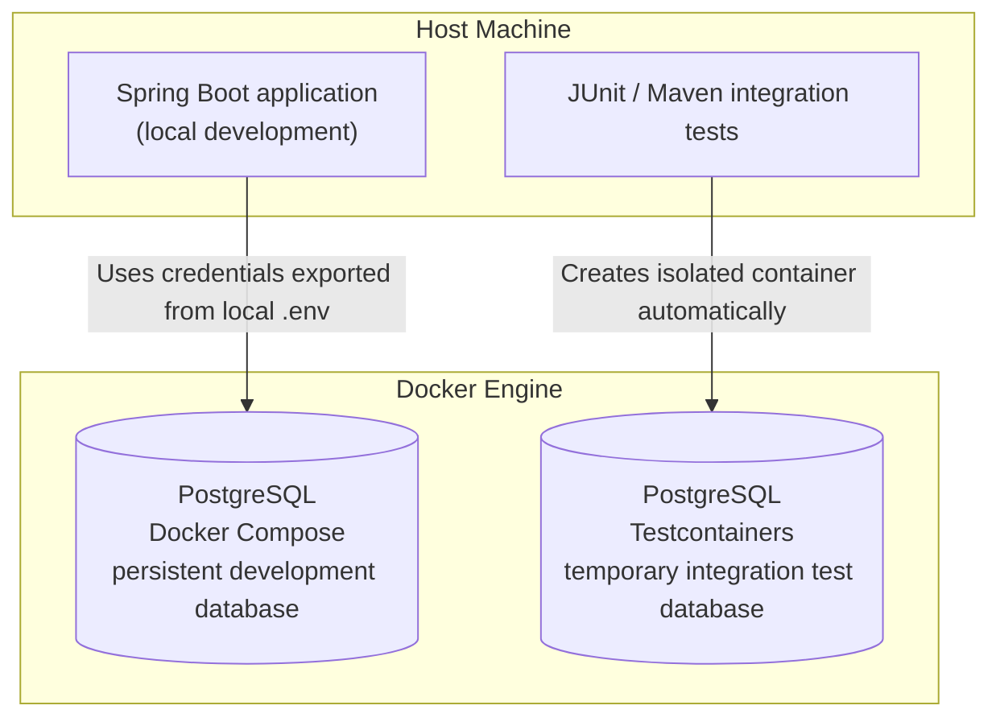

# Testing Strategy

**Status:** Approved quality requirements; foundation/domain/persistence tests executed; Increment 3 Reviewed – Accepted; Increment 4 Reviewed – Accepted; Order concurrency gates Pending

## Scope and Prerequisites

The [PRD acceptance criteria](../01-requirements/product-requirements.md) define behavior; [ADR-0001](../03-decisions/ADR-0001-order-placement-concurrency.md) defines concurrency outcomes. The [Proposed ADR-0002](../03-decisions/ADR-0002-transaction-locking.md) defines technical verification scenarios. JUnit 6 is Accepted under [ADR-0005](../03-decisions/ADR-0005-technology-stack.md), explicitly replacing JUnit 5. Use Jupiter and Platform versions managed by Spring Boot 4.1.1 without JUnit 5-retention overrides; foundation and Increment 3 domain/persistence verification passed; Increment 4 application/HTTP/optimistic verification is recorded below; Increment 4 human acceptance is recorded; full Order concurrency remains Pending.

## Quality Gate Applicability

Applicable gates are mandatory for the approved increment. All remaining gates are future obligations and must be reported as **Pending**, not Passed. A gate is Passed only with actual successful verification evidence; a required gate that cannot run remains Pending and blocks the corresponding readiness claim. Human acceptance does not manufacture missing evidence.

| Increment type | Mandatory applicable gates | Future gates |
| --- | --- | --- |
| Documentation only | Documentation links, structure, ADR IDs/statuses, preserved rules, diff checks and human review | Build, domain/application, persistence/migrations, and concurrency: Pending |
| Technical skeleton | Documentation; Java 21/Boot 4.1.1 dependency alignment; PostgreSQL context startup; OSIV disabled; tests for any implemented transaction guard/template | Unimplemented business, mappings/migrations, and concurrency: Pending |
| Domain and application | Documentation/build; relevant domain rules, HTTP validation/error behavior, transaction ownership and DTO materialization for implemented use cases | Unimplemented features and unrelated persistence/concurrency scenarios: Pending |
| Persistence and migrations | Documentation/build; approved migration/schema validation, PostgreSQL round trips, constraints/capacity, atomic rollback and fetching tests for affected mappings | Unimplemented workflows and full concurrency protocol: Pending |
| Concurrency | All prerequisite implemented-layer gates plus deterministic PostgreSQL races, retries and uncertain-outcome handling | Any uncovered required scenario: Pending; no full concurrency-verification claim |

Before declaring the MVP complete, every required implementation gate must have passing evidence and every implementation increment must have explicit human acceptance. ADR-0002 acceptance remains a separate explicit decision. No migrations or test code are authorized by this strategy.

## Quality Gates

| Gate | Required evidence |
| --- | --- |
| Documentation | Working links, unique ADR identifiers, correct statuses, preserved approved rules, reviewed diff |
| Build | Java 21 compile, compatible Boot 4.1.1 dependency graph, Boot 4.1.1-managed JUnit 6 API/engine/Platform alignment |
| Domain | Pricing/consolidation/limits, EUR 99.99/100.00/100.05 discount cases, immutable snapshot behavior |
| HTTP | Actual request binding; unknown root/nested fields, price overrides, fractional/missing/null quantities, all approved boundary cases and error shape |
| Persistence | PostgreSQL round trips, reviewed schema/migrations, constraints, email uniqueness, monetary capacity, rollback, no lazy access after DTO return |
| Transaction infrastructure | Reject ambient coordinator entry, READ COMMITTED, fresh attempt contexts, shared helper transaction, commit-time exception observation |
| Concurrency | Deterministic PostgreSQL tests of the scenarios below, using actual JPA/provider paths |

Use unit tests for domain behavior and HTTP integration tests through real JSON binding. PostgreSQL/Testcontainers is required for persistence/concurrency evidence, not H2 or mocked repositories. Use reviewed migrations in disposable databases only after migration approval. A context smoke test does not establish locking correctness. No arbitrary coverage percentage replaces meaningful gates.

## Mutation Testing — Automated Diagnostic Workflow

**Status:** Automated PIT workflow implemented; documentation update Pending Human Review. Mutation analysis is diagnostic; no mandatory mutation-score release gate has been selected.

Test execution checks whether the current code satisfies selected assertions. JaCoCo coverage measures code exercised; SonarQube static analysis reports findings under selected rules. Mutation testing instead investigates whether tests detect deliberately altered behavior. Green tests, high coverage and clean static analysis do not establish mutation-test effectiveness.

The [mutation-testing strategy](mutation-testing.md) and [automated runbook](mutation-testing-runbook.md#current-automated-workflow) describe the existing Makefile/PIT implementation. All scopes use project-wide fast `*Test` selection; only production mutation targets vary. PostgreSQL/Testcontainers `*IT` tests are excluded and need a future dedicated persistence mutation strategy. Interpret KILLED, SURVIVED, NO_COVERAGE and TIMED_OUT separately, compare exact identities and obtain approval before test improvements. Preserve evidence from each run; successful Maven execution is not acceptance of surviving mutants.

The [verified experiments](mutation-results/mutation-testing-experiments.md) show a JUnit-detected production defect and a KILLED → SURVIVED → KILLED transition after temporary test weakening/restoration. Existing mandatory gates, CI and increment acceptance records are unchanged. This documentation authorizes no execution, tooling changes or commits.

## Architecture Boundary Verification

These are mandatory obligations for implemented feature code, not evidence that boundaries already exist. For a documentation-only increment they remain Pending; a technical skeleton verifies only boundaries actually introduced. Check against [system architecture](../02-architecture/system-architecture.md).

- Controllers depend on application operations, not repositories or domain orchestration; HTTP-level tests cover delegation and translation.
- Domain code does not depend on API/application packages or persistence components and performs no database access. Direct JPA metadata coupling is the accepted exception, not permission to call infrastructure.
- Cross-feature access uses feature-owned narrow public contracts; no imports/access to foreign persistence packages or managed entity graphs.
- REST request/response types expose DTOs, never managed JPA entities/proxies. Verify complete serialization after transaction/context closure without new queries.
- No circular constructor dependencies, recursive use-case call chains, or forbidden layer cycles. Narrow feature contracts may reference features in both directions without creating those execution/wiring cycles; a blanket ban on all feature-level references in both directions would contradict the accepted design.

Inspect actual imports/dependency paths and wiring, with targeted tests where applicable. The concrete automated enforcement mechanism remains **Open**. Do not introduce ArchUnit, Spring Modulith, or other dependencies without separate approval. Manual inspection must be reported as review evidence, not as an automated test result; future/unavailable automated checks remain Pending.

## Deterministic Concurrency Matrix

- Placement versus product repricing and renaming, each in both winning orders; inspect original names/prices and all totals.
- Placement versus product/customer deactivation, both orders; success before deactivation or 409 with no order afterward.
- **Approved Customer DELETE target — 2026-10-18; Phase 2 verification pending:** physical deletion versus first order in both winning orders. Placement-first DELETE must observe the reference and return 409 CUSTOMER_HAS_ORDERS with completely unchanged customer/order state; delete-first placement yields the existing 404. No dangling references or partial writes. Earlier Increment 5 tests/acceptance below verify the historical delete-or-deactivate contract, not this target.
- Multi-product orders with reversed request order/different customers and coordinated updates; inspect actual acquisition order and capture no incompatible mixture.
- Confirmed holder rollback, partial-save failure, and restrictive foreign keys; no partial orders or orphaned items.
- Controlled deadlock/lock timeout; confirmed full rollback, bounded attempts, fresh reads, exhaustion behavior, no individual-statement retries.
- Lost commit confirmation after real commit and HTTP transport loss; no automatic replay, no assumed rollback, no response required when transport fails.
- Concurrent normalized-email creation/update, including inactive records; database uniqueness and approved business errors.

Use independent transactions/connections/contexts, barriers/latches, and bounded lock observations and deadlines. Avoid arbitrary sleeps and an enclosing test transaction shared by workers. Always clean up workers/locks. Fault injection must distinguish actual commit success with lost confirmation from confirmed rollback.

## Evidence and Release Readiness

Record test locations/commands, selected PostgreSQL image, outcomes, and limitations in the increment report. Increment 2 explicitly accepts Surefire for Docker-free tests and Failsafe for PostgreSQL `*IT` during `verify`. Include serialization after the persistence context closes and prove it emits complete DTO data without additional queries.

Foundation tests and the scoped Increment 3 domain/persistence tests have run; see the [Increment 3 execution record](../04-agentic-coding/prompts/04-domain-model.md#implementation-results--executed-pending-human-review). No concurrency evidence is claimed. Passing tests does not automatically accept ADR-0002; explicit ADR acceptance and implementation verification are independent gates.

## Increment 2 Test Responsibilities

The current test classes verify the technical foundation:

- `AgenticOrderServiceApplicationTest`: web application context, DispatcherServlet, and Validation wiring. DataSource, Hibernate JPA, and Flyway auto-configuration are excluded only in this smoke test; it provides no persistence evidence.
- `PostgreSqlImageConfigurationTest`: understandable failures for missing files/properties, empty or malformed image values, and malformed properties syntax, using temporary files.
- `PostgreSqlFoundationIT`: isolated container startup, configured image and actual server version, JDBC `SELECT 1`, EntityManagerFactory initialization with four approved entities, disabled OSIV, Hibernate validation, disabled SQL initialization, V1 migration/history and exactly the four domain tables plus Flyway metadata. The earlier zero-entity/metadata-only assertions are preserved in Increment 2 history.

Historical foundation results are recorded in the [Increment 2 execution record](../04-agentic-coding/prompts/03-postgresql-foundation.md). Increment 3 extends the current suite:

- MoneyTest, EmailAddressTest, CustomerTest, ProductTest and OrderTest: exact values, normalization/grammar, Unicode and field limits, controlled lifecycle, consolidation, discount rounding and large totals.
- CustomerPersistenceIT and ProductPersistenceIT: converter hydration after flush/clear, generated identity, controlled updates and inactive-inclusive email uniqueness.
- OrderPersistenceIT: production root save/cascade, original snapshots after catalog changes, lazy/explicit fetch counts, immutable closed-context values, restrictive FKs and confirmed full rollback.
- DomainSchemaIT: unconstrained NUMERIC, named negative constraints, actual V1/checksum/repeat migration and normalized unique email index.

The initial execution passed 25 fast/14 PostgreSQL tests. Human-reviewed test hardening increased this to 120 fast tests (10 foundation, 110 domain) and 21 PostgreSQL integration tests, all passing without skips. Increment 3 is Reviewed – Accepted. At Increment 3 acceptance, application/HTTP, transaction coordination, concurrent uniqueness response handling and ADR-0002 gates were Pending; later scoped Increment 4 evidence is recorded below; see the [Increment 3 execution record](../04-agentic-coding/prompts/04-domain-model.md#implementation-results--executed-pending-human-review).

## Running Tests

Run commands from the repository root using the Maven Wrapper. Both test groups use JUnit 6; Surefire and Failsafe determine their execution within the Maven lifecycle.

### Fast Tests and Integration Tests

| Aspect                       | Fast tests                                        | PostgreSQL integration tests                                     |
| ---------------------------- | ------------------------------------------------- | ---------------------------------------------------------------- |
| Maven plugin                 | Surefire                                          | Failsafe                                                         |
| Project naming convention    | `*Test`                                           | `*IT`                                                            |
| Execution phase              | `test`                                            | `integration-test`, with results checked in `verify`             |
| Current scope                | Smoke, image-configuration and pure domain checks | Real PostgreSQL foundation, migrations, mappings and constraints |
| PostgreSQL / Docker required | No                                                | Yes                                                              |
| Command                      | `./mvnw test`                                     | `./mvnw verify` also runs the fast tests                         |

Fast tests provide frequent development feedback without starting containers. They are not necessarily unit tests: the smoke test loads a Spring web application context. PostgreSQL integration tests additionally exercise database connectivity and framework integration, including container and database startup.

`verify` includes the earlier `test` phase, so it runs both groups. These commands do not select mutually exclusive suites; a passing `test` run does not establish PostgreSQL readiness.

Use the existing Java 21 installation through command-local JAVA_HOME without changing system configuration:

```sh
env JAVA_HOME=/Library/Java/JavaVirtualMachines/jdk-21.jdk/Contents/Home ./mvnw test
env JAVA_HOME=/Library/Java/JavaVirtualMachines/jdk-21.jdk/Contents/Home ./mvnw verify
```

### Docker Compose vs. Testcontainers

Both approaches use the image defined in [config/postgres.properties](../../config/postgres.properties), but their database instances, credentials, and lifecycles are separate.

| Aspect | Local development | PostgreSQL integration tests |
| --- | --- | --- |
| Application/test process | Spring Boot application on the host | JUnit/Maven tests on the host |
| Database management | Docker Compose, started explicitly | Testcontainers, started automatically |
| Credentials | Git-ignored local `.env`, exported to the application | Isolated values in `PostgreSqlTestConfiguration` |
| Host database port | Configurable, bound to `127.0.0.1` | Dynamically mapped |
| Database storage | Persistent named volume | Disposable test database; reuse disabled |
| Teardown | Explicit Compose shutdown; preserve the volume | Application-context teardown and Testcontainers cleanup |



Integration tests require a reachable Docker Engine and may download images on first use. They read the central properties file directly, without parsing Compose YAML, loading local `.env`, or requiring a running Compose database. They do not modify the persistent development database. Docker unavailability fails integration startup; unavailable verification must not be reported as Passed.

Spring starts the PostgreSQL container bean before dependent beans. Context teardown closes JPA and the connection pool before stopping the container; Testcontainers cleans up its test resources.

Local Compose commands require `--env-file .env --env-file config/postgres.properties`. See the [technology reference](../02-architecture/technology-stack.md#postgresql-configuration-source-and-local-credentials) for startup, teardown, environment export, and image-override checks. The automated tests do not use this local startup workflow.

### Development and Pre-commit Workflow

1. Run `./mvnw test` during development for fast feedback.
2. Run `./mvnw verify` after database/integration changes and before proposing an implementation commit.
3. Inspect results in `target/surefire-reports/` and `target/failsafe-reports/`, review the actual Git diff, and run whitespace checks. Report failures and applicable verification limitations.
4. Obtain human acceptance and explicit commit authorization through the [AI workflow](../04-agentic-coding/ai-development-workflow.md).

Documentation-only changes use documentation gates. Passing the current tests does not establish completion of future application, HTTP, transaction coordination or concurrency gates.

## Increment 4 Accepted API and Versioning Verification

**Mandatory verification matrix; the pre-execution requirements below are retained. Current scoped results and human acceptance are recorded under Increment 4 Execution Evidence.** Read the [current playbook matrix](../04-agentic-coding/prompts/05-product-customer-api.md#updated-mandatory-test-matrix--runtime-results-pending), [accepted API catalog](../02-architecture/api-error-codes.md), [REST decisions](../02-architecture/rest-api-design.md#10-human-accepted-increment-4-api-and-transaction-decisions) and [Proposed ADR-0006](../03-decisions/ADR-0006-product-customer-optimistic-locking.md). The @Version direction and finalized Long/BIGINT/NOT NULL/backfill 0/no final default/no-op policies are Human Accepted; the complete ADR remains Proposed; the four-statement V2 SQL is reviewed, scoped coding authorization and runtime verification are recorded below. Increment 3 acceptance and evidence remain unchanged.

| Level | Required Increment 4 evidence |
| --- | --- |
| Application unit (Surefire) | All ten create/list/get/update/deactivate operations in isolation; normal/boundary/invalid/inactive cases; controlled mutations, immutable results and error propagation without HTTP dependencies |
| Actual HTTP/MVC (Surefire where Docker-free) | DispatcherServlet, real JSON binding/validation/central errors and serialization; all ten endpoint statuses/fields; 201 Location, 405 Allow; every applicable accepted code; no direct controller-method substitute |
| PostgreSQL/Testcontainers (Failsafe verify) | Full-context API/service transactions, committed reads, uniqueness/rollback, version/migration/newness behavior and deterministic overlapping transactions; mocks/H2 do not establish these gates |

Mandatory input matrix: unknown/forbidden/read-only/activation fields; future nested DTO rejection without adding Order endpoints; JSON strings/numbers/booleans without coercion; missing/null required fields; canonical 36-character UUID text versus well-formed absent UUID; names normalized with String.strip()/1–200 Unicode code points, supplementary Unicode preserved; approved ASCII email/Locale.ROOT/254-code-point policy and active/inactive uniqueness/provider distinctions; exact price boundaries/scale, ordinary decimal notation and rejection of exponent notation before BigDecimal/Money conversion. Specifically accept 149/149.9/149.99 and reject 149.990/10.000/1.4999e2/1e3; numeric strings are INVALID_FIELD_TYPE, not rounded values.

Verify exactly one safe code/message and the Accepted six-category precedence with mixed errors, JSON property permutations and deterministic same-category cases. PATCH false succeeds/repeats, missing/null/true/wrong scalar/known extra/unknown extra use the accepted distinct codes; rejected requests change no persisted state. Every ten-endpoint row in the playbook has U/H/P responsibilities, including empty lists, inactive records and PUT replacing both editable fields without reactivation.

HTTP checks include real 400/404/405/406/409/415/500/503 paths under controlled scenarios. Customer DELETE uses OPERATION_NOT_AVAILABLE/405 and accurate Allow without a delete/reference-check operation; generic unsupported methods use METHOD_NOT_ALLOWED. Unknown routes use ENDPOINT_NOT_FOUND. Incompatible Accept must still produce the accepted JSON NOT_ACCEPTABLE envelope; unsupported Content-Type uses UNSUPPORTED_MEDIA_TYPE. Safe technical failures use INTERNAL_SERVER_ERROR; only classified temporary outages SERVICE_UNAVAILABLE. Do not blanket-map SQL failures, expose diagnostics or weaken negotiation/error-dispatch tests. The selected decoder/writer and D8 narrow classifier require runtime proof; accepted policy is not reopened.

PostgreSQL requirements after explicit Increment 4 execution approval:

- Test fresh V1+V2 and existing representative V1 data→V2, unchanged V1 checksum/correct history, accepted BIGINT/NOT NULL/existing-row version 0/no final database default, boxed Long Hibernate initialization/newness/update increments and unchanged records/IDs/converters/constraints/FKs/indexes. Repeat startup/migrate/validate without V2 reapplication, history/checksum changes or version reset. No migration execution is authorized by this document.
- Use independent connections/transactions/contexts and barriers/latches with deadlines for overlapping Product/Customer PUT/PUT and PUT/PATCH in both completion orders. Assert actual version predicates, confirmed stale-write conflict/409, winner state preserved, loser fully rolled back and deactivation never undone. Sequential inactive PATCH repeat must be 200 with the unchanged inactive representation, no SQL UPDATE and no version increment; measure actual SQL and fresh persisted version. Concurrent overlap may conflict/no-op according to observed version and actual writes, without automatic retry.
- Confirm real uniqueness and optimistic failures, including flush/commit paths, reach API translation outside the proxy transaction before success. Avoid an enclosing test rollback transaction that masks commit failures; verify final state with fresh transactions.
- Fault-inject confirmed rollback separately from lost completion confirmation: no state on known rollback, no false rollback assertion or automatic write replay on uncertain completion. Use classified temporary-outage vs unexpected-failure cases; transport loss may prevent a response.
- Verify complete immutable response materialization/OSIV disabled/no serialization SQL. Unit or mock-only failures do not prove actual database/version behavior.

Preserve all Increment 1–3 tests, Surefire/Failsafe separation, JUnit 6 alignment, JaCoCo and existing SonarQube/GitHub Actions. Coverage remains evidence alongside meaningful cases. Full Order pessimistic/retry/delete-race protocol remains separate under ADR-0002; Product/Customer optimistic tests do not establish it. No ETag/If-Match or stale-client precondition test is a promised feature in this increment. Future/unavailable gates remain Pending, not Passed.

### Final ADR-0006 Concurrency Cases

The [authoritative seven-scenario matrix](../03-decisions/ADR-0006-product-customer-optimistic-locking.md#verification-criteria--pending) and [playbook matrix](../04-agentic-coding/prompts/05-product-customer-api.md#mandatory-optimistic-locking-matrix) require PUT vs PUT, PUT vs PATCH, PATCH vs PUT, PATCH vs PATCH, sequential repeated PATCH, stale entity after committed update and stale entity after committed deactivation, each for both aggregates. Verify actual Hibernate version checks using independent PostgreSQL/Testcontainers transactions/contexts and deterministic barriers/latches, no timing sleeps, committed winner state and confirmed loser rollback. Sequential repetition is required to succeed/no-op; overlapping requests are not promised the same result. Unit-only evidence is insufficient. These were pre-execution obligations; scoped results and acceptance are recorded below. This strategy does not authorize additional test/migration execution.

### Final Edge Policies and Existing-Fixture Compatibility

The [current implementation prompt](../04-agentic-coding/prompts/05-product-customer-api.md#current-implementation-prompt--increment-4) and [REST D1–D8](../02-architecture/rest-api-design.md#11-final-human-decisions-d1d8) resolve the prior edge-policy gaps. Mandatory actual MVC tests cover:

| Decision | Evidence required |
| --- | --- |
| D1 body | Absent/{}→REQUIRED_FIELD_MISSING; whitespace-only/null/array root→MALFORMED_JSON; all 400, no writes. |
| D2 duplicates | Root/nested repeated keys→MALFORMED_JSON before tree collapse/type/property errors. |
| D3 trailing | Whitespace suffix allowed; extra JSON value/nonwhitespace rejected as MALFORMED_JSON. |
| D4 tie-breaking | Product name→price, Customer name→email, PATCH active, unknown/forbidden paths lexicographic; property-order permutations do not change selected category/code. |
| D5 UUID | Upper/lower/mixed hex accepted with exact 36-character structure, response lowercase; shortened/malformed path 400, valid missing 404. |
| D6 outer order | Combined routing/method/header/path/body failures prove HTTP→path→body→application; invalid input never reaches resource lookup/mutation. |
| D7 media | application/json UTF-8, optional charset=UTF-8 accepted; other encodings/media, including merge-patch/vendor/other +json, rejected/415; incompatible Accept still safe JSON/406. |
| D8 failures | Confirmed establishment/pre-write 503 versus unknown commit/unclassified 500, confirmed optimistic/normalized-unique 409; no broad SQL mapping, false rollback claim or automatic replay. |

Use existing Spring Test MockMvcBuilders.webAppContextSetup/@MockitoBean with test-only database exclusions; no new MVC test dependency. Preserve the smoke assertions/reduced scope. Full-context PostgreSQL tests use real application proxies and existing Testcontainers; servlet/error-dispatch fallback additionally needs transport proof using a running test server and existing Java HTTP facilities. Keep Surefire/Failsafe/JaCoCo/CI unchanged.

Explicitly test id/active/version request rejection and absence of version in responses. Adapt direct SQL fixtures to column lists/explicit version 0: DomainSchemaIT, OrderPersistenceIT and CustomerPersistenceIT, without weakening the intended negative constraint assertions. Foundation/schema current migration-history expectations become V1+V2; separately retain V1 checksum and V1→V2 upgrade fixtures. Prepare V1-only data with Flyway/JDBC before bootstrapping the new versioned Hibernate mappings, then verify validation after V2. A null version failure must not mask the original constraint under test.

All existing seven optimistic scenarios remain required, with actual SQL/no-op counts, committed-state/rollback checks, independent transactions and deterministic coordination. Report persistent local V2 target/recovery/migration evidence separately under the [current implementation prompt](../04-agentic-coding/prompts/05-product-customer-api.md#persistent-local-database-safety-gate). If a usable recovery mechanism cannot be established, mark only that gate Blocked — Human Action Required and continue disposable Testcontainers tests and other approved work. Testcontainers success does not prove local migration; preserve development data. This matrix was recorded before execution; scoped results and current acceptance are recorded below. This documentation update runs no tests, containers or migrations.

## Increment 4 Execution Evidence — Reviewed – Accepted

[Increment 4 execution evidence](../04-agentic-coding/prompts/05-product-customer-api.md#implementation-results--executed-pending-human-review) records the initial implementation Java 21 verify run: 240 fast and 44 real PostgreSQL integration tests passed with zero failures/errors/skips, preserving the existing suites. Fresh-run JaCoCo coverage is 95.14% lines, 85.15% branches and 94.64% instructions. New tests cover isolated application operations, actual MockMvc input/HTTP contracts, random-port PostgreSQL API/commit behavior, V1→V2 preservation, all seven optimistic scenarios for each aggregate, SQL version predicates and no-update repeated PATCH. The smoke test excludes database auto-configuration and mocks application services; it proves MVC/validation startup only.

The controlled outage fixture stops only its own disposable container and evicts its pool handles to establish acquisition-phase failure/503; uncertain completion remains 500 in controlled tests. Persistent local migration is separately Blocked — Human Action Required because actual target/history/recovery evidence was not established. No local rollout, production safety, complete Order protocol, remote SonarQube success or human acceptance is inferred from these results. Existing gates and ADR statuses are unchanged.


### Final Human Acceptance — 2026-10-15

Increment 4 is **Reviewed – Accepted**, including reviewed follow-up fixes and test hardening. The [acceptance record](../04-agentic-coding/prompts/05-product-customer-api.md#final-human-acceptance--2026-10-15) identifies the committed `develop` revision and final existing verification log: 309 fast and 94 PostgreSQL integration tests passed, with no failures/errors/skips. Read-only SonarQube verification returned zero OPEN/CONFIRMED issues and quality gate OK. Earlier counts and coverage remain evidence of earlier runs. No build was rerun for this documentation update. SonarQube is not mutation-testing evidence; later mutation evidence is recorded separately in the [verified experiment report](mutation-results/mutation-testing-experiments.md). Full Order concurrency, persistent local migration/recovery and production gates remain deferred/blocked as recorded there; ADR statuses are unchanged.

## Increment 5 — Reviewed and Accepted

The [final G1–G6 decisions](../04-agentic-coding/prompts/06-order-placement-concurrency.md#final-human-architecture-decisions--2026-10-16) are Human Accepted; implementation and the scoped mandatory matrix are Reviewed – Accepted on 2026-10-16. See the [final acceptance record](../04-agentic-coding/prompts/06-order-placement-concurrency.md#final-human-acceptance--2026-10-16). The [current approved matrix](../04-agentic-coding/prompts/06-order-placement-concurrency.md#current-approved-scope-and-matrix-update) makes Customer DELETE and both first-order race schedules mandatory, superseding conditional P10 in the historical proposal. Preserve original Product/Customer version/stale-write/no-op and domain/persistence assertions.

- Unit: exact Order validation/priority, provider fact access, domain amount/snapshot rules, ambient guard and safe retry decision/limits; no artificial assertions to improve mutation scores.
- Actual MVC/HTTP: all four endpoints/statuses/full responses, DELETE204 without body/absent → 404, all five fixed Order codes plus reused envelopes, nested unknown/forbidden/duplicate/trailing/type/presence/integer-token/UUID precedence, deterministic resource priority and no application invocation on rejected transport input.
- Real PostgreSQL/Testcontainers: persisted immutable snapshots/current Customer, explicit fetch and batched distinct Customer query counts, no post-transaction serialization queries, actual READ COMMITTED/individual lock order/blocking, both resource-mutation schedules, multi-product serially valid capture, first-order DELETE post-wait reference visibility, atomic rollback, commit-before-success, known rollback/released contexts before bounded retries, and uncertain/postcommit nonreplay.

Use accepted three total attempts, local 2s lock timeout, 25/50 ms delays and monotonic 10s retry-scheduling budget; verify their actual interactions with pool/statement/network/commit limits, not a hard 10s HTTP claim. Synchronize independent transactions/contexts with latches/barriers and bounded wait observations; no arbitrary sleeps/mock-only concurrency proof. The final preserved regression results passed 474 fast and 122 PostgreSQL tests, zero failures/errors/skips; targeted retry corrections and their real timeout/NOWAIT/RAISE checks are human accepted. Production operational timeout behavior remains a separate gate. Complete ADR-0002/0006 remain Proposed.

Historical pre-Increment5 all-scope PIT evidence is PIT-all-20261016T075327Z-qMGnCc at 81f96e262fdf0a67c96ef7861856e95b9a185d55: 321 green fast tests, 346 mutants; 288 KILLED, 40 SURVIVED, 17 NO_COVERAGE, 1 TIMED_OUT. Baseline/validation/PIT exits 0. Console 289 detections include the timeout; 88% test strength and 95% mutated-class line coverage are different metrics, not whole-system correctness. See the playbook for verified paths/formulas. Existing order scope remains domain-only; use unchanged SCOPE=all for new Order application/API mutation evidence. *IT remains excluded from PIT; dedicated persistence mutation verification is future work. No tests, PIT or build was run for this documentation update, and no new quality threshold or CI change is introduced.

Final accepted Increment 5 PIT evidence: 512 generated, 433 KILLED, 51 SURVIVED, 27 NO_COVERAGE and 1 TIMED_OUT; 449 matching identities/no regressions versus the preceding implementation run. Focused retry PIT: 78 generated, 74 KILLED, 3 SURVIVED and 1 NO_COVERAGE. These preserved reports were inspected, not rerun during acceptance; *IT exclusion and separate persistence mutation obligations remain.

## Customer DELETE Phase 2 Verification — 2026-10-18

**Phase 2 implemented; human acceptance pending.** Actual verification is recorded in the [review record](../04-agentic-coding/change-requests/CH-001-customer-delete-semantics/03-review.md). The [PRD matrix](../01-requirements/product-requirements.md#customer-delete--approved-target-contract-2026-10-18) requires all five cases, independently of active status. Unit and MVC coverage must assert the exact [error envelope](../02-architecture/api-error-codes.md#approved-customer-delete-target--2026-10-18), 204 with no body only for physical removal, existing 404 for absence, and separate PATCH deactivation. PostgreSQL checks must establish persisted removal or complete customer/order state preservation after rejection, including active status and version, plus both first-order race schedules. Preserve existing restrictive-reference, transaction and rollback guarantees.

Existing passing test counts, mutation evidence and Increment 3/4/5 acceptance records describe earlier revisions; none demonstrates this contract yet. Follow the [Phase 2 acceptance checklist](../02-architecture/rest-api-design.md#phase-2-implementation-acceptance-checklist) for focused checks, regenerated OpenAPI, full regression and SonarQube evidence. No tests or quality tools were executed in Phase 1.
