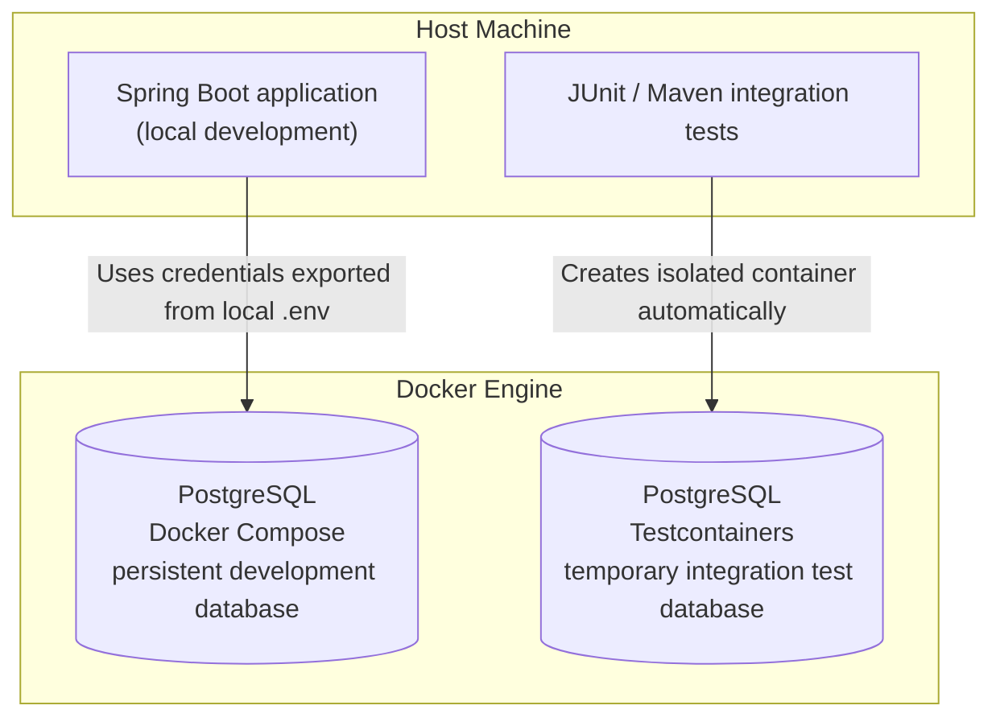

# Testing Strategy

**Status:** Approved quality requirements; foundation/domain/persistence tests executed; Increment 3 Reviewed – Accepted; application/concurrency gates Pending

## Scope and Prerequisites

The [PRD acceptance criteria](../01-requirements/product-requirements.md) define behavior; [ADR-0001](../03-decisions/ADR-0001-order-placement-concurrency.md) defines concurrency outcomes. The [Proposed ADR-0002](../03-decisions/ADR-0002-transaction-locking.md) defines technical verification scenarios. JUnit 6 is Accepted under [ADR-0005](../03-decisions/ADR-0005-technology-stack.md), explicitly replacing JUnit 5. Use Jupiter and Platform versions managed by Spring Boot 4.1.1 without JUnit 5-retention overrides; foundation and Increment 3 domain/persistence verification passed; application and concurrency gates remain Pending.

## Quality Gate Applicability

Applicable gates are mandatory for the approved increment. All remaining gates are future obligations and must be reported as **Pending**, not Passed. A gate is Passed only with actual successful verification evidence; a required gate that cannot run remains Pending and blocks the corresponding readiness claim. Human acceptance does not manufacture missing evidence.

| Increment type | Mandatory applicable gates | Future gates |
| --- | --- | --- |
| Documentation only | Documentation links, structure, ADR IDs/statuses, preserved rules, diff checks and human review | Build, domain/application, persistence/migrations, and concurrency: Pending |
| Technical skeleton | Documentation; Java 21/Boot 4.1.1 dependency alignment; PostgreSQL context startup; OSIV disabled; tests for any implemented transaction guard/template | Unimplemented business, mappings/migrations, and concurrency: Pending |
| Domain and application | Documentation/build; relevant domain rules, HTTP validation/error behavior, transaction ownership and DTO materialization for implemented use cases | Unimplemented features and unrelated persistence/concurrency scenarios: Pending |
| Persistence and migrations | Documentation/build; approved migration/schema validation, PostgreSQL round trips, constraints/capacity, atomic rollback and fetching tests for affected mappings | Unimplemented workflows and full concurrency protocol: Pending |
| Concurrency | All prerequisite implemented-layer gates plus deterministic PostgreSQL races, retries and uncertain-outcome handling | Any uncovered required scenario: Pending; no full concurrency-verification claim |

Before declaring the MVP complete, every required implementation gate must have passing evidence and every implementation increment must have explicit human acceptance. ADR-0002 acceptance remains a separate explicit decision. No migrations or test code are authorized by this strategy.

## Quality Gates

| Gate | Required evidence |
| --- | --- |
| Documentation | Working links, unique ADR identifiers, correct statuses, preserved approved rules, reviewed diff |
| Build | Java 21 compile, compatible Boot 4.1.1 dependency graph, Boot 4.1.1-managed JUnit 6 API/engine/Platform alignment |
| Domain | Pricing/consolidation/limits, EUR 99.99/100.00/100.05 discount cases, immutable snapshot behavior |
| HTTP | Actual request binding; unknown root/nested fields, price overrides, fractional/missing/null quantities, all approved boundary cases and error shape |
| Persistence | PostgreSQL round trips, reviewed schema/migrations, constraints, email uniqueness, monetary capacity, rollback, no lazy access after DTO return |
| Transaction infrastructure | Reject ambient coordinator entry, READ COMMITTED, fresh attempt contexts, shared helper transaction, commit-time exception observation |
| Concurrency | Deterministic PostgreSQL tests of the scenarios below, using actual JPA/provider paths |

Use unit tests for domain behavior and HTTP integration tests through real JSON binding. PostgreSQL/Testcontainers is required for persistence/concurrency evidence, not H2 or mocked repositories. Use reviewed migrations in disposable databases only after migration approval. A context smoke test does not establish locking correctness. No arbitrary coverage percentage replaces meaningful gates.

## Architecture Boundary Verification

These are mandatory obligations for implemented feature code, not evidence that boundaries already exist. For a documentation-only increment they remain Pending; a technical skeleton verifies only boundaries actually introduced. Check against [system architecture](../02-architecture/system-architecture.md).

- Controllers depend on application operations, not repositories or domain orchestration; HTTP-level tests cover delegation and translation.
- Domain code does not depend on API/application packages or persistence components and performs no database access. Direct JPA metadata coupling is the accepted exception, not permission to call infrastructure.
- Cross-feature access uses feature-owned narrow public contracts; no imports/access to foreign persistence packages or managed entity graphs.
- REST request/response types expose DTOs, never managed JPA entities/proxies. Verify complete serialization after transaction/context closure without new queries.
- No circular constructor dependencies, recursive use-case call chains, or forbidden layer cycles. Narrow feature contracts may reference features in both directions without creating those execution/wiring cycles; a blanket ban on all feature-level references in both directions would contradict the accepted design.

Inspect actual imports/dependency paths and wiring, with targeted tests where applicable. The concrete automated enforcement mechanism remains **Open**. Do not introduce ArchUnit, Spring Modulith, or other dependencies without separate approval. Manual inspection must be reported as review evidence, not as an automated test result; future/unavailable automated checks remain Pending.

## Deterministic Concurrency Matrix

- Placement versus product repricing and renaming, each in both winning orders; inspect original names/prices and all totals.
- Placement versus product/customer deactivation, both orders; success before deactivation or 409 with no order afterward.
- Physical customer deletion versus first order, both orders; force deletion to wait, then prove its subsequent query sees the committed reference and deactivates. Delete-first placement yields 404.
- Multi-product orders with reversed request order/different customers and coordinated updates; inspect actual acquisition order and capture no incompatible mixture.
- Confirmed holder rollback, partial-save failure, and restrictive foreign keys; no partial orders or orphaned items.
- Controlled deadlock/lock timeout; confirmed full rollback, bounded attempts, fresh reads, exhaustion behavior, no individual-statement retries.
- Lost commit confirmation after real commit and HTTP transport loss; no automatic replay, no assumed rollback, no response required when transport fails.
- Concurrent normalized-email creation/update, including inactive records; database uniqueness and approved business errors.

Use independent transactions/connections/contexts, barriers/latches, and bounded lock observations and deadlines. Avoid arbitrary sleeps and an enclosing test transaction shared by workers. Always clean up workers/locks. Fault injection must distinguish actual commit success with lost confirmation from confirmed rollback.

## Evidence and Release Readiness

Record test locations/commands, selected PostgreSQL image, outcomes, and limitations in the increment report. Increment 2 explicitly accepts Surefire for Docker-free tests and Failsafe for PostgreSQL `*IT` during `verify`. Include serialization after the persistence context closes and prove it emits complete DTO data without additional queries.

Foundation tests and the scoped Increment 3 domain/persistence tests have run; see the [Increment 3 execution record](../04-agentic-coding/prompts/04-domain-model.md#implementation-results--executed-pending-human-review). No concurrency evidence is claimed. Passing tests does not automatically accept ADR-0002; explicit ADR acceptance and implementation verification are independent gates.

## Increment 2 Test Responsibilities

The current test classes verify the technical foundation:

- `AgenticOrderServiceApplicationTest`: web application context, DispatcherServlet, and Validation wiring. DataSource, Hibernate JPA, and Flyway auto-configuration are excluded only in this smoke test; it provides no persistence evidence.
- `PostgreSqlImageConfigurationTest`: understandable failures for missing files/properties, empty or malformed image values, and malformed properties syntax, using temporary files.
- `PostgreSqlFoundationIT`: isolated container startup, configured image and actual server version, JDBC `SELECT 1`, EntityManagerFactory initialization with four approved entities, disabled OSIV, Hibernate validation, disabled SQL initialization, V1 migration/history and exactly the four domain tables plus Flyway metadata. The earlier zero-entity/metadata-only assertions are preserved in Increment 2 history.

Historical foundation results are recorded in the [Increment 2 execution record](../04-agentic-coding/prompts/03-postgresql-foundation.md). Increment 3 extends the current suite:

- MoneyTest, EmailAddressTest, CustomerTest, ProductTest and OrderTest: exact values, normalization/grammar, Unicode and field limits, controlled lifecycle, consolidation, discount rounding and large totals.
- CustomerPersistenceIT and ProductPersistenceIT: converter hydration after flush/clear, generated identity, controlled updates and inactive-inclusive email uniqueness.
- OrderPersistenceIT: production root save/cascade, original snapshots after catalog changes, lazy/explicit fetch counts, immutable closed-context values, restrictive FKs and confirmed full rollback.
- DomainSchemaIT: unconstrained NUMERIC, named negative constraints, actual V1/checksum/repeat migration and normalized unique email index.

The initial execution passed 25 fast/14 PostgreSQL tests. Human-reviewed test hardening increased this to 120 fast tests (10 foundation, 110 domain) and 21 PostgreSQL integration tests, all passing without skips. Increment 3 is Reviewed – Accepted. Application/HTTP, transaction coordination, concurrent uniqueness response handling and ADR-0002 gates remain Pending; see the [Increment 3 execution record](../04-agentic-coding/prompts/04-domain-model.md#implementation-results--executed-pending-human-review).

## Running Tests

Run commands from the repository root using the Maven Wrapper. Both test groups use JUnit 6; Surefire and Failsafe determine their execution within the Maven lifecycle.

### Fast Tests and Integration Tests

| Aspect | Fast tests | PostgreSQL integration tests |
| --- | --- | --- |
| Maven plugin | Surefire | Failsafe |
| Project naming convention | `*Test` | `*IT` |
| Execution phase | `test` | `integration-test`, with results checked in `verify` |
| Current scope | Smoke, image-configuration and pure domain checks | Real PostgreSQL foundation, migrations, mappings and constraints |
| PostgreSQL / Docker required | No | Yes |
| Command | `./mvnw test` | `./mvnw verify` also runs the fast tests |

Fast tests provide frequent development feedback without starting containers. They are not necessarily unit tests: the smoke test loads a Spring web application context. PostgreSQL integration tests additionally exercise database connectivity and framework integration, including container and database startup.

`verify` includes the earlier `test` phase, so it runs both groups. These commands do not select mutually exclusive suites; a passing `test` run does not establish PostgreSQL readiness.

Use the existing Java 21 installation through command-local JAVA_HOME without changing system configuration:

```sh
env JAVA_HOME=/Library/Java/JavaVirtualMachines/jdk-21.jdk/Contents/Home ./mvnw test
env JAVA_HOME=/Library/Java/JavaVirtualMachines/jdk-21.jdk/Contents/Home ./mvnw verify
```

### Docker Compose vs. Testcontainers

Both approaches use the image defined in [config/postgres.properties](../../config/postgres.properties), but their database instances, credentials, and lifecycles are separate.

| Aspect | Local development | PostgreSQL integration tests |
| --- | --- | --- |
| Application/test process | Spring Boot application on the host | JUnit/Maven tests on the host |
| Database management | Docker Compose, started explicitly | Testcontainers, started automatically |
| Credentials | Git-ignored local `.env`, exported to the application | Isolated values in `PostgreSqlTestConfiguration` |
| Host database port | Configurable, bound to `127.0.0.1` | Dynamically mapped |
| Database storage | Persistent named volume | Disposable test database; reuse disabled |
| Teardown | Explicit Compose shutdown; preserve the volume | Application-context teardown and Testcontainers cleanup |



Integration tests require a reachable Docker Engine and may download images on first use. They read the central properties file directly, without parsing Compose YAML, loading local `.env`, or requiring a running Compose database. They do not modify the persistent development database. Docker unavailability fails integration startup; unavailable verification must not be reported as Passed.

Spring starts the PostgreSQL container bean before dependent beans. Context teardown closes JPA and the connection pool before stopping the container; Testcontainers cleans up its test resources.

Local Compose commands require `--env-file .env --env-file config/postgres.properties`. See the [technology reference](../02-architecture/technology-stack.md#postgresql-configuration-source-and-local-credentials) for startup, teardown, environment export, and image-override checks. The automated tests do not use this local startup workflow.

### Development and Pre-commit Workflow

1. Run `./mvnw test` during development for fast feedback.
2. Run `./mvnw verify` after database/integration changes and before proposing an implementation commit.
3. Inspect results in `target/surefire-reports/` and `target/failsafe-reports/`, review the actual Git diff, and run whitespace checks. Report failures and applicable verification limitations.
4. Obtain human acceptance and explicit commit authorization through the [AI workflow](../04-agentic-coding/ai-development-workflow.md).

Documentation-only changes use documentation gates. Passing the current tests does not establish completion of future application, HTTP, transaction coordination or concurrency gates.
